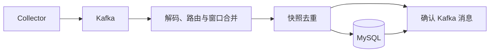

# 指标元数据消费模块

`metricmetadata` 消费 Collector 通过 Kafka 上报的指标元数据，解析并合并重复记录后写入 Metadata MySQL，为自定义指标管理、按服务查询指标和 Histogram 指标族展示提供数据。



独立进程和 BMW daemon 使用相同的消费链路：按业务 DataID 路由、合并并去重后，按指标组写入 MySQL。

## 配置

消费 DataID 和 Kafka 连接信息从 Consul 固定 key 读取，key 位于 `store.consul.pathPrefix` 下：

```text
${store.consul.pathPrefix}/metricmetadata/kafka
```

Value 使用以下 JSON 格式：

```json
{
  "data_id": 12345,
  "brokers": ["kafka.example.com:9092"],
  "topic": "metric-metadata",
  "username": "",
  "password": ""
}
```

`brokers` 中每项使用 `host:port` 格式。用户名和密码同时为空时不启用 SASL，同时填写时使用 SCRAM-SHA512。

daemon 启动时读取该 key，配置无效时会重试；独立命令启动时必须已有有效配置。消费者启动后修改配置，需重启 worker task。

窗口时长通过配置文件设置：

```yaml
taskConfig:
  metricmetadata:
    batch:
      wait: 30s
```

可配置项及默认值如下；`batch.wait` 从窗口内第一条 Kafka 消息开始计时：

| 配置项 | 默认值 | 说明 |
| --- | --- | --- |
| `batch.size` | `30000` | 达到记录数后提交当前窗口 |
| `batch.maxBytes` | `16777216` | 达到消息估算字节数后提交当前窗口 |
| `batch.wait` | `30s` | 消费窗口时长上限 |
| `queue.maxMessages` / `queue.maxBytes` | `1000` / `67108864` | 等待及处理中的消息数和估算字节上限 |
| `state.pageSize` | `1000` | 状态刷新每条 SQL 查询的最大行数 |
| `capacity.maxScopes` / `capacity.maxValues` | `0` / `0` | 每个业务分组的容量限制；`0` 表示不限制 |
| `database.timeout` / `drainTimeout` | `20s` / `25s` | 数据库操作和退出排空超时 |
| `retryInterval` | `5s` | 数据库或 Kafka 超时后重建运行实例前的等待时长 |
| `kafka.offsetReset` | `newest` | 消费组没有已提交位点时的起始位点；`oldest` 表示回放全量历史消息 |
| `refreshInterval` | `5m` | scope 过期清理周期 |
| `touchInterval` | `24h` | 活跃 scope 的 `last_seen` 刷新周期 |

> **注意**：`refreshInterval` 控制 scope 过期清理，默认 5 分钟；路由和完整指标状态的刷新周期固定为 15 分钟。指标过期时长复用 `taskConfig.metadata.global.timeSeriesMetricExpiredSeconds`，默认 30 天。

## 启动

启动前，需由 Metadata migration 创建 `metadata_timeseriesreportscope` 和 `metadata_timeseriesreportvalue`；本模块不自动建表。

### 独立进程

在 `pkg/bk-monitor-worker` 目录执行：

```bash
go run ./bmw.go start_metricmetadata --config ./bmw.yaml
```

命令和 daemon 从固定 Consul key 读取消费 DataID 与 Kafka 连接信息；`store.mysql` 用于指标元数据持久化。消费组名为 `metric-metadata-<DataID>`。

### BMW daemon

worker 需监听 `metricmetadata` 队列。daemon 注册固定任务 `daemon:metricmetadata:consume`，由任务在运行时读取 Consul 固定 key；与独立命令共用同一消费和持久化链路。

## 消息处理与可靠性

消息支持元数据记录 JSON 数组和 Collector `data[].dimension` 信封。消费 DataID 选择 Kafka topic，消息中的业务 DataID 匹配已启用且未删除的指标组；一个消费者可处理多个业务数据源。

窗口内相同 `(group_id, scope_hash, field_name)` 的记录会合并：都有 timestamp 时保留较新的事件，否则按消费顺序保留最后一条。timestamp 仅在当前窗口内生效，不保证跨窗口或跨 partition 的事件顺序。APM scope 使用 `-` 分隔服务名和 scope 名，字面量 `-`、`%` 分别编码为 `%2D`、`%25`。

scope 的指标清单和 value 引用数在同一事务中更新；增量消息未出现的指标不会被删除。重复记录通过内存快照去重，完整状态每 15 分钟刷新一次。其他写入者修改同一 scope 时，旧快照可能暂时跳过有效报告；刷新后持续上报可修正状态，但已跳过的一次性报告不会重放。

批次中需要持久化的记录全部写入成功后才标记 Kafka offset。数据库提交后、offset 提交前发生故障时，消息可能重放，写入按幂等方式处理。队列预算覆盖已接收的等待及待提交消息；预算不足时暂停接收并提前提交当前窗口。各 partition 已从 Kafka 取出但仍在等待预算的消息，以及解析后的记录，不计入该预算。单条消息超过队列字节预算时，当前消费 session 停止且消息不确认。

消费组尚无已提交位点时，默认从 topic 尾部（`kafka.offsetReset: newest`）开始消费，不回溯队列中已有的历史消息；低频上报的指标要等到采集器下次上报才会入库。如果首次接入就需要建出完整目录，可将 `kafka.offsetReset` 配置为 `oldest` 回放全部历史消息；该设置仅在消费组没有已提交位点时生效，已有提交位点的消费组不受影响。

### 运行指标

模块运行指标注册到项目已有 Prometheus Registry，名称以 `bmw_metricmetadata_` 开头。`refresh_duration_seconds` 按成功、失败或因并发失效而丢弃的结果记录刷新耗时；`cache_size` 提供 scope 数、指标引用数和估算字节数，估算字节数不是 Go 堆内存。Debug 日志中的 `state load timing` 记录加载耗时、分页数、计划的 value 查询批次数和 ID 数（跨页可能重复），可用于分析数据库读取成本。worker 模式通过已有 `/metrics` 暴露；独立命令在 `worker.listenHost:worker.listenPort` 上启动只提供 `/bmw/metrics` 的 HTTP 服务。


## 测试

运行模块测试：

```bash
GOTOOLCHAIN=go1.24.4 go test -race -tags jsonsonic -vet=off ./internal/metricmetadata/...
```

设置 `METRICMETADATA_TEST_DSN` 可运行隔离 MySQL 测试；再设置 `METRICMETADATA_TEST_KAFKA` 可运行 Kafka 集成测试。未设置对应变量时，相关集成用例会跳过。

## 设计

指标元信息模型参考[自定义指标开发方案](https://github.com/ZhuoZhuoCrayon/ai-workspace/blob/main/knowledge/bkmonitor/issues/2026-09-15-custom-metric-metadata/PLAN.md)。
