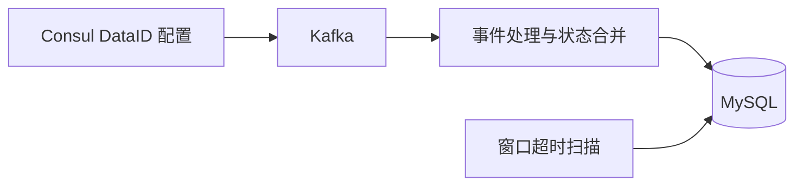

# Active Profiling 预计算

本模块消费 Kafka 中的 Active Profiling 事件，将执行和主机状态写入 MySQL。上游负责采集和发送事件；本模块负责读取 DataID 配置、消费 Kafka、合并状态和持久化。



## 配置

BMW 现有配置需提供 MySQL 和 Consul 连接。Active Profiling 使用以下配置；均可省略并采用默认值：

```yaml
taskConfig:
  activeProfiling:
    kafka:
      flushInterval: 8s
      eventQueueSize: 1000
      eventBatchSize: 500
    consul:
      pathPrefix: active_profiling/data_id
    window:
      maxDuration: 5m
      delay: 5m
```

`eventQueueSize` 是每个 DataID 消费者的内存队列容量，默认 `1000`；`eventBatchSize` 是批量写入条数阈值，默认 `500`。未配置这两项时使用默认值。

DataID 的 Consul key 为：

```text
<store.consul.pathPrefix>/<taskConfig.activeProfiling.consul.pathPrefix>/<data_id>
```

key 的 value 示例：

```json
{
  "bk_tenant_id": "system",
  "bk_biz_id": 2,
  "bk_data_id": 1618077,
  "kafka_info": {
    "host": "127.0.0.1:29092",
    "username": "",
    "password": "",
    "topic": "0bkmonitor_16180770"
  }
}
```

`bk_data_id` 必须与 key 末级 ID 相同；租户、业务 ID、Kafka 地址和 topic 必须有效。多个 Kafka broker 可用逗号分隔；用户名和密码必须同时配置或同时留空。

## 启动

### 独立进程

连接文件列出要消费的 DataID：

```yaml
connections:
  - dataId: 1618077
```

启动时会从对应 Consul key 读取 Kafka 配置：

```sh
go run ./bmw.go start_profiling \
  --config ./bmw.yaml \
  --file ./internal/profiling/connections.yaml.example
```

省略 `--file` 时，进程从配置的 Consul 前缀发现 DataID，并每 10 分钟对账一次；新增、删除或变更的 DataID 会相应启动、停止或重启消费者。

### BMW daemon

提交 `daemon:profiling:active` 常驻任务。指定 `data_id` 时消费单个 DataID；使用空 payload `{}` 时消费 Consul 前缀下的全部 DataID。

```sh
curl --location --request POST 'http://127.0.0.1:10211/bmw/task/' \
  --header 'Content-Type: application/json' \
  --data '{
    "kind": "daemon:profiling:active",
    "payload": {"data_id": 1618077},
    "options": {"queue": "default"}
  }'
```

## 事件与状态

- 处理 `active_profiling_started` 和 `active_profiling_finished` 事件；执行按 `bk_tenant_id + bk_biz_id + task_id + scheduled_at` 定位，主机再按 `bk_host_id` 区分。缺少 `task_id` 的旧事件按 `0` 处理。
- 执行和主机状态分别写入 `apm_activeprofilingexecution`、`apm_activeprofilinghostexecution`；执行摘要由主机状态汇总。
- `started` 打开主机采集窗口，`finished` 写入终态。窗口时长为 `started_at + min(collector_config.duration_sec, maxDuration) + delay`；未收到 started 的目标快照主机从 `scheduled_at` 起算。超时扫描默认每 10 秒运行，将仍在 `running` 的主机标为 `unknown`。
- 事件时间戳和窗口截止时间以 Unix 毫秒保存。事件消息支持单条 Event、Event 数组和带 `data` 的外层封装。

## 消费与可靠性

每个 DataID 使用独立且稳定的 Kafka consumer group：`active-profiling-materializer-<dataid>`。消息每达到 500 条或到达 `flushInterval` 时批量写入 MySQL；存储失败时当前批次会重试。

Kafka offset 在消息进入内存队列后即确认。因此，进程若在 MySQL 写入前崩溃或被强制终止，队列中的已确认消息可能丢失。

## 本地流程示例

Mock 命令无需连接 Kafka 或 MySQL，会使用内存 Store 处理示例事件并输出窗口超时前后的结果：

```sh
go run ./bmw.go run_profiling_mock
```

可以通过 `--file` 指定事件文件，并用 `--max-duration`、`--delay` 调整模拟窗口。
