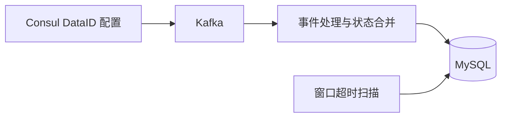

# Active Profiling 预计算

本模块消费 Kafka 中的 Active Profiling 事件，将执行和主机状态写入 MySQL。上游负责采集和发送事件；本模块负责读取 DataID 配置、消费 Kafka、合并状态和持久化。



## 配置

BMW 现有配置需提供 MySQL 和 Consul 连接。Active Profiling 使用以下配置；均可省略并采用默认值：

```yaml
taskConfig:
  activeProfiling:
    enabled: true
    kafka:
      flushInterval: 8s
      eventQueueSize: 1000
      eventBatchSize: 500
    consul:
      pathPrefix: active_profiling/data_id
    window:
      maxDuration: 5m
      delay: 5m
```

`enabled` 控制是否启动 Active Profiling 事件消费，默认 `true`；设为 `false` 时，worker 不会注册或运行消费任务，独立 `start_profiling` 命令也会拒绝启动。`eventQueueSize` 是每个 DataID 消费者的内存队列容量，默认 `1000`；`eventBatchSize` 是批量写入条数阈值，默认 `500`。未配置这些项时使用默认值。

DataID 的 Consul key 为：

```text
<store.consul.pathPrefix>/<taskConfig.activeProfiling.consul.pathPrefix>/<data_id>
```

key 的 value 示例：

```json
{
  "bk_tenant_id": "system",
  "bk_biz_id": 2,
  "bk_data_id": 1618077,
  "kafka_info": {
    "host": "127.0.0.1:29092",
    "username": "",
    "password": "",
    "topic": "0bkmonitor_16180770"
  }
}
```

`bk_data_id` 必须与 key 末级 ID 相同；租户、业务 ID、Kafka 地址和 topic 必须有效。多个 Kafka broker 可用逗号分隔；用户名和密码必须同时配置或同时留空。

## 启动

### 独立进程

连接文件列出要消费的 DataID：

```yaml
connections:
  - dataId: 1618077
```

启动时会从对应 Consul key 读取 Kafka 配置：

```sh
go run ./bmw.go start_profiling \
  --config ./bmw.yaml \
  --file ./internal/profiling/connections.yaml.example
```

省略 `--file` 时，进程从配置的 Consul 前缀发现 DataID，并每 10 分钟对账一次；新增、删除或变更的 DataID 会相应启动、停止或重启消费者。

### BMW daemon

`daemon:profiling:active` 是由 Profiling worker 管理的系统常驻任务，不通过 BMW daemon HTTP 接口注册。接口提交该任务类型会返回 400，避免手工任务与 worker 启动时的自动注册产生冲突。

Profiling worker 监听 `profiling` 队列时，会在启动阶段自动注册一个 payload 为 `{}` 的常驻任务。该任务从配置的 Consul 前缀发现并消费全部 DataID；任务注册使用 Redis Set，worker 重启或多个副本同时启动都不会产生重复任务。

如需运行单个 DataID，请使用独立的 `start_profiling --file` 模式。已有的历史 Profiling daemon 任务不会由升级过程自动清理，需要在升级前手动移除。

## 事件与状态

- 处理 `active_profiling_started` 和 `active_profiling_finished` 事件；执行按 `bk_tenant_id + bk_biz_id + task_id + scheduled_at` 定位，主机再按 `bk_host_id` 区分。缺少 `task_id` 的旧事件按 `0` 处理。
- 执行和主机状态分别写入 `apm_activeprofilingexecution`、`apm_activeprofilinghostexecution`；执行摘要由主机状态汇总。
- `started` 打开主机采集窗口，`finished` 写入终态。窗口时长为 `started_at + min(collector_config.duration_sec, maxDuration) + delay`；未收到 started 的目标快照主机从 `scheduled_at` 起算。超时扫描默认每 10 秒运行，将仍在 `running` 的主机标为 `unknown`。
- 事件时间戳和窗口截止时间以 Unix 毫秒保存。事件消息支持单条 Event、Event 数组和带 `data` 的外层封装。

## 消费与可靠性

每个 DataID 使用独立且稳定的 Kafka consumer group：`active-profiling-materializer-<dataid>`。消息每达到 500 条或到达 `flushInterval` 时批量写入 MySQL；存储失败时当前批次会重试。

Kafka offset 在消息进入内存队列后即确认。因此，进程若在 MySQL 写入前崩溃或被强制终止，队列中的已确认消息可能丢失。


### Active Profiling worker 队列

`bk-monitor-worker` 子 chart 通过 `deploymentConfig.worker.queues` 创建 Profiling worker Deployment 和对应的 BMW ConfigMap。worker 使用通用配置、环境变量 ConfigMap 和 Secret，监听 `profiling` 队列。在 umbrella chart 的 values 中将以下条目追加到现有 `queues` 列表，保留其他队列配置：

```yaml
bk-monitor-worker:
  deploymentConfig:
    worker:
      queues:
        - replicas: 1
          queueName: profiling
          resources:
            limits:
              cpu: 4000m
              memory: 1Gi
            requests:
              cpu: 100m
              memory: 128Mi
          config: {}
          nodeSelector: {}
          affinity: {}
          tolerations: []
```

`profiling` worker 启动时会向 Redis 投递一次 `daemon:profiling:active` 常驻任务，payload 为 `{}`，从 Consul 前缀发现所有 DataID。多个 worker 副本使用相同任务记录，Redis Set 会去重。BMW controller 将任务绑定到监听 `profiling` 队列的 worker。该任务类型禁止通过 BMW daemon API 注册。
