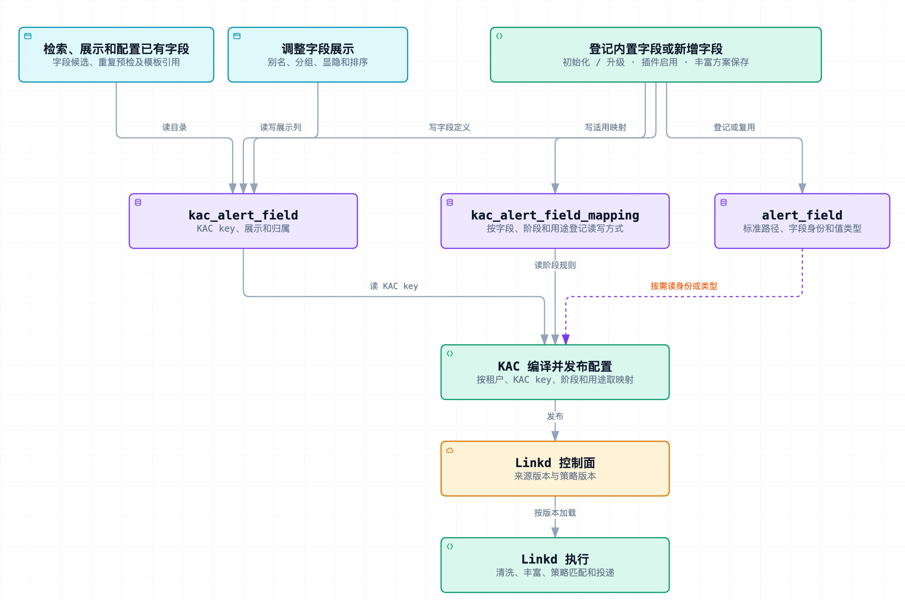

---
https://devops.cwoa.net/devops/console/vteam/aiops/twDemand?vmode=table&id=eb060343356d4c9b95fd9bce7e923d7d&
p130_16212 【告警】告警字段管理更新
---

# 5.4 设计要点

- 页面只使用 `kac_alert_field` 的字段 key。`alert_field` 登记标准路径，`kac_alert_field_mapping` 定义各阶段如何读写字段。
- 60 个内置字段及其映射随版本初始化。插件启用或丰富方案保存时，新字段归入 `extra`，在同一事务中登记三表。
- KAC 将映射编译成配置并发布到控制面，Linkd 按版本加载执行。[读写关系图](./p130_16212_field_access.png)

# 字段目录的 MySQL 表结构

`alert_field` 保存租户的 Linkd 标准字段和已登记的扩展路径。`kac_alert_field` 保存 KAC 字段定义、展示配置以及可选的标准字段引用。`kac_alert_field_mapping` 记录各阶段和用途的读写规则。三张表按 InnoDB、utf8mb4 设计，并沿用 Kingeye 的 `TimeInfo`、`MaintainerInfo` 和租户约定。[字段目录与分阶段映射初始化 SQL](./p130_16212_kac_alert_fields.sql)

## 标准字段表 `alert_field`

| 列 | MySQL 类型 | 允许 NULL | 数据库默认 | 含义 |
| --- | --- | --- | --- | --- |
| `id` | BIGINT | 否 | AUTO_INCREMENT | 主键 |
| `bk_tenant_id` | VARCHAR(128) | 否 | 无 | 租户标识，由调用方提供 |
| `field` | VARCHAR(2048) | 否 | 无 | 可发布的确定路径，例如 `$.labels.strategy_id`；Linkd 接收的路径表达式按字节计长 |
| `field_digest` | BINARY(32) | 否 | 无 | 登记时解析路径，对 Linkd `Target.String()` 规范表示的 UTF-8 字节计算 SHA-256，存二进制摘要 |
| `name` | VARCHAR(64) | 否 | 无 | 标准字段名称 |
| `category` | VARCHAR(16) | 否 | 无 | `alert`、`subject`、`extra`；插件、丰富新增字段登记时写 `extra` |
| `source_type` | VARCHAR(32) | 否 | 无 | `built_in`、`plugin`、`enrich`，由登记入口填写 |
| `value_type` | VARCHAR(16) | 否 | 无 | 标准值类型，取 `text/number/date/list/object` |
| `created_by` | VARCHAR(32) | 是 | `''` | 创建者，沿用 `MaintainerInfo.created_by` |
| `updated_by` | VARCHAR(32) | 是 | `''` | 更新者，沿用 `MaintainerInfo.updated_by` |
| `created_at` | DATETIME(6) | 否 | 无 | 创建时间，由 ORM 或初始化 SQL 写入 |
| `updated_at` | DATETIME(6) | 否 | 无 | 修改时间，由 ORM 或初始化 SQL 写入 |

索引为主键 `(id)`、租户路径唯一键 `(bk_tenant_id, field_digest)`、供复合外键引用的唯一键 `(bk_tenant_id, id)` 和 `TimeInfo` 的普通索引 `(created_at)`。例如 `$.extra_data.region` 与 `$["extra_data"]["region"]` 具有相同摘要，含点号的单个键 `$.extra_data["a.b"]` 与两段嵌套路径分别登记。

沿用草案的路径深度约定，例如 `$.subject_name`、`$.extra_data.region`、`$.extra_data.list[0]`、`$.extra_data.object["key"]`。对照表中的 `evaluations[].severity` 描述数组项结构；目录登记 `evaluations` 列表，策略按当前等级取值。

## KAC 字段表 `kac_alert_field`

| 列 | MySQL 类型 | 允许 NULL | 数据库默认 | 含义 |
| --- | --- | --- | --- | --- |
| `id` | INT | 否 | AUTO_INCREMENT | 主键。迁移现有 `AlarmEnrichField` 时保留 ID，页面按 ID 批量更新 |
| `bk_tenant_id` | VARCHAR(128) | 否 | 无 | 租户标识 |
| `key` | VARCHAR(64) | 否 | 无 | 租户内唯一，创建后不可修改 |
| `key_display` | VARCHAR(64) | 否 | 无 | 产品或登记入口提供的默认展示名 |
| `alias` | VARCHAR(64) | 否 | `''` | 用户别名；未设置时使用默认展示名 |
| `alias_zh_hans`、`alias_zh_hant`、`alias_en` | 各 VARCHAR(64) | 是 | `''` | 简体中文、繁体中文和英文别名，保留已有翻译列 |
| `alert_field_id` | BIGINT | 是 | NULL | 同租户标准字段 ID。各内置 key 的目标路径或空引用依据见下方 60 项对照 |
| `category` | VARCHAR(16) | 否 | 无 | 初次登记时确定的归属分类，有直接映射时与标准字段分类一致 |
| `display_category` | VARCHAR(16) | 否 | **无** | 创建时由写入方显式传入，首次初始化取 `category`；页面调整分组只改此列 |
| `source_type` | VARCHAR(32) | 否 | 无 | 字段来源，取 `built_in/plugin/enrich` |
| `source_info` | JSON | 否 | 无 | 登记时显式写入，按来源分别保存下文约定的对象 |
| `type` | VARCHAR(32) | 否 | `'text'` | KAC 展示类型，取 `text/number/user/time/link`；实际字段值仍依照对照表输出 |
| `is_display` | TINYINT(1) | 否 | 1 | 是否展示，初始化可为具体字段指定隐藏 |
| `order` | INT | 否 | 0 | 详情分组内排序，允许并列 |
| `option_order` | INT | 否 | 0 | 搜索候选排序，独立于详情排序 |
| `created_by` | VARCHAR(32) | 是 | `''` | 创建者，沿用 `MaintainerInfo.created_by` |
| `updated_by` | VARCHAR(32) | 是 | `''` | 更新者，沿用 `MaintainerInfo.updated_by` |
| `created_at` | DATETIME(6) | 否 | 无 | 创建时间，由 ORM 或初始化 SQL 写入 |
| `updated_at` | DATETIME(6) | 否 | 无 | 修改时间，由 ORM 或初始化 SQL 写入 |

- 主键为 `(id)`，新增唯一键 `(bk_tenant_id, id)` 供分阶段映射表建立同租户复合外键。唯一键 `(bk_tenant_id, key)` 保证租户内 key 唯一。唯一键 `(bk_tenant_id, alert_field_id)` 保证同一标准字段至多绑定一个 KAC key，允许多行空引用。
- 外键 `(bk_tenant_id, alert_field_id)` 引用 `alert_field(bk_tenant_id, id)`，更新、删除使用 `RESTRICT`。按 KAC key 可查标准字段，反向通过该复合索引查询。
- 列表索引为 `(bk_tenant_id, display_category, order, id)` 与 `(bk_tenant_id, option_order, id)`；另保留 `TimeInfo` 的 `(created_at)` 索引。分组和排序变动不影响直接映射。

各内置字段的 `alert_field_id` 目标数据逐项列在[字段对照表](#kac-builtin-field-map)。表内以标准路径指代不同环境分配的 ID。

### 旧接口兼容

字段来源以 `source_type` 为准。旧接口的 `is_build_in` 由模型 property 计算，数据库只存 `source_type`。

```python
@property
def is_build_in(self):
    return self.source_type == self.SOURCE_TYPE_BUILT_IN
```

序列化器保留只读的 `is_build_in`。使用 `values()`、`only()` 的查询应取 `source_type` 后计算响应值；原先按 `is_build_in` 筛选的查询改用 `source_type`。迁移已有字段时按产品内置清单核对来源，将历史插件、丰富来源码 `alarm_source_plugin/alarm_enrich` 转为 `plugin/enrich`，并承接已有 ID、别名、显隐、排序和用户展示分组。

### 已有 SQL 的覆盖范围

脚本按租户初始化三张表。60 个 KAC 内置字段中，34 个关联标准字段，26 个保留空引用。分阶段映射表登记 361 条读写记录，覆盖 57 个字段。`conductor`、`notify_status` 和 `alarm_details_link` 由 KAC 维护或生成。示例 `region` 在相应插件或丰富方案登记时写入。

SQL 面向新目录初始化。先选择数据库并在同一连接指定 `@bk_tenant_id`，可用 `@maintainer` 指定操作者。重复初始化按唯一键报错；现有用户配置的迁移需保留原记录。新租户优先沿用既有内置字段的排序、显隐和已有英文、繁体翻译，新增 key 按对照表顺序接续，`dimension` 默认隐藏。默认名取本表产品名称，`metric_id` 以文本展示，时间、链接、用户及数值展示项在 SQL 中逐项列出。`dimension` 的值始终是对象，现有 KAC 展示类型尚缺结构化渲染约定。

## 分阶段字段映射表 `kac_alert_field_mapping`（5.4 设计）

每行回答一个问题：**某个 KAC 字段在指定阶段、为指定用途，Linkd从哪里读，或写到哪里？** 例如 `name` 在清洗时是赋值目标，在丰富条件中是读取对象，在投递时是输出 key。一个字段在 `kac_alert_field` 中始终只有一行，在映射表里会有多行。

| 列 | MySQL 类型 | 允许 NULL | 数据库默认 | 含义 |
| --- | --- | --- | --- | --- |
| `id` | BIGINT | 否 | AUTO_INCREMENT | 主键 |
| `bk_tenant_id` | VARCHAR(128) | 否 | 无 | 与 KAC 字段的租户一致 |
| `kac_alert_field_id` | INT | 否 | 无 | 外键，指向该租户的 KAC 字段 |
| `stage` | VARCHAR(32) | 否 | 无 | 处理环节，决定可使用的数据对象，见下表 |
| `usage` | VARCHAR(32) | 否 | 无 | 阶段内的用途，取值见下方用途枚举表 |
| `direction` | VARCHAR(8) | 否 | 无 | `read` 或 `write`，相对于本阶段的 Linkd 数据对象。投递读取有效 Alert，故为 `read` |
| `method` | VARCHAR(16) | 否 | 无 | `path` 按路径读写，`builtin` 由 Linkd 按 `stage`、`usage` 和 KAC 字段 key 选择内置处理逻辑 |
| `path` | VARCHAR(2048) | 是 | NULL | `method=path` 时填写相对于该阶段对象的确定路径。`method=builtin` 时为 NULL |
| `created_by`、`updated_by` | 各 VARCHAR(32) | 是 | `''` | 沿用 Kingeye `MaintainerInfo` |
| `created_at`、`updated_at` | 各 DATETIME(6) | 否 | 无 | 创建、修改时按 `TimeInfo` 填写；`created_at` 保留其普通索引 |

唯一键为 `(bk_tenant_id, kac_alert_field_id, stage, usage)`。同一用途只有一条默认规则；同一阶段的两种用途即使都是读取，也可以分别登记。同一路径可供多个产品字段使用。按阶段发布用普通索引 `(bk_tenant_id, stage, kac_alert_field_id)`。父表 `kac_alert_field` 增加唯一键 `(bk_tenant_id, id)`，子表复合外键按这两列引用，更新和删除使用 `RESTRICT`。

**`usage` 用途枚举**

| `usage` | 适用 `stage` | 方向 | 含义 |
| --- | --- | --- | --- |
| `condition` | `source_clean`、`enrich`、`policy_event`、`policy_alert` | `read` | 读取参与来源过滤、告警源丰富条件或策略条件的字段值 |
| `assignment` | `source_clean`、`enrich` | `write` | 来源清洗规则写入 RawEvent，或告警源丰富规则写入当前 evaluation 的丰富补丁 |
| `builtin_output` | `enrich` | `write` | 记录内置丰富处理器写入结果的位置，例如 `display` 将对象名称写入 `$.subject_name` |
| `detail` | `event_detail` | `read` | 读取当前原始 Event 的详情或其生命周期处理记录 |
| `output` | `kac_projection` | `read` | 读取投递所需的值，写入对应的 KAC 告警字段 |

| `stage`（5.4 设计值） | 路径基准和消费者 |
| --- | --- |
| `source_clean` | 来源清洗的 RawEvent 输入或赋值目标。KAC 发布时转换为 Cleaner 的读写路径语法 |
| `enrich` | 当前 evaluation 的 Event 有效视图；条件读取当前值，assignment 将结果写入丰富补丁 |
| `policy_event` | 策略判断「这次来源事件是否命中」。输入为一个 Event 和其中正在评估的等级。抑制、屏蔽匹配会读取该等级已冻结的丰富结果，`alarm_time` 取本次 `Event.occurred_at` |
| `policy_alert` | 策略判断「这条已有告警现在是否仍命中」。例如合并窗口结算时，Linkd 重新读取成员 Alert 并复核条件。丰富字段沿用首次触发时冻结的快照，等级和动作取 Alert 当前事实，`alarm_time` 取 `Alert.begin_at` |
| `event_detail` | 当前原始 Event；若需要处理元数据，由内置规则按同一 Event ID 读 `EventProcessing` |
| `kac_projection` | 投递给 KAC 的有效 Alert。若取值须使用对应原始 Event、生命周期关系或处置状态，由内置规则取得相应上下文 |

`source_type` 仍回答“谁定义了字段”。内置丰富处理器负责产生其输出；告警源丰富方案负责具体条件、表达式和赋值顺序。两者都可以为同一字段提供值。该表只描述消费者所需的读写规则，不逐条复制告警源的 assignments。发布时可沿用来源版本和策略版本分别编译相应规则；本设计不规定 Linkd 的内存索引形状。

`policy_event` 和 `policy_alert` 都属于策略匹配，区分的是**本次调用用哪个对象求值**，没有先后执行的约定。例如一条告警 10:00 首次触发、10:15 再收到事件，针对新 Event 判断“告警时间晚于 10:10”时命中；以同一 Alert 复核该条件时，开始时间仍是 10:00，条件不命中。对应实现是 Linkd 的 `internal/policy/view.go` 中的 `EventView` 和 `AlertView`。5.4 表中的两个 stage 名是配置设计值。

### 何时使用 `method=builtin`

`method=path` 表示给定本阶段的对象和一个 JSON 路径就能读写目标值。例如投递读 `$.title` 得到“CPU 过高”，直接写入 KAC 的 `name`。即便标题由丰富处理器生成，投递仍只需读路径。若本阶段还要判断状态、处理多个候选值、转换协议值或读取关联记录，就用 `method=builtin`。例如，同一个 `action` 在 `policy_event` 的条件中按本次判定转换，在 `kac_projection` 的输出中按 Alert 状态转换。

| 阶段 / KAC 字段 | 给定输入，Linkd 实际应返回什么 | 实现依据 |
| --- | --- | --- |
| `kac_projection` / `object` | 若显式传入 `extra_data.object=""`，输出空串；若该键缺失且 `subject_name="主机 A"`，输出“主机 A”；名称也为空时取 `subject_id` | 已有取值顺序及文本转换，见 `internal/lifecycle/kachook/message.go` |
| `kac_projection` / `source_alarm_status` | Alert 同为 closed：来源主动关闭时输出 `close`，人工关闭时输出 `firing`；Alert 已恢复时输出 `resolved` | 已有 `internal/kaccompat/writer.go` 的 `sourceAlarmStatus`，需同时看状态和结束类型 |
| `kac_projection` / `associate_count` | 对合并父告警，读取合并关系。两条关系成员分别为 A、B 和 B、C 时，按成员 Alert ID 去重，输出 3 | 已有 `internal/kaccompat/writer.go` 的关系读取和计数 |
| `policy_event` / `action` | 当前等级判定为 `triggered` 时给 KAC 条件的值是 `firing`；`resolved` 对应 `resolved`，`closed` 对应 `close` | 已有 `internal/policy/view.go` 的 `newFactView`。当前等级由调用方传入 |
| `event_detail` / `processing_status` | 同一 Alert 下两条 Event 可以分别返回 `accepted` 和 `suppressed`。各自读取其存储记录的 `Processing.State` | 原始 Event JSON 不含此值。查询已取得处理记录，5.4 可复用该值，无须另查一次 |
| `kac_projection` / `item_id` | 假设原始 Event 的 `labels.strategy_id=17`，有效视图中同名标签后来变为 23，按 5.4 约定输出 17 | 5.4 新规则。投递根对象是有效 Alert，需要取得对应原始 Event 的事实 |

规则能否简化为路径取决于阶段提供的对象。例如将来详情入口若直接提供含 `processing.state` 的复合文档，同一字段就可以按路径读取。

### 映射记录示例

以下用 KAC key 代指本租户的 `kac_alert_field_id`。阶段和用途采用 5.4 设计值。表中 `—` 表示对应列为 NULL。

| KAC key | stage | usage | direction | method | path | 读写语义 |
| --- | --- | --- | --- | --- | --- | --- |
| `name` | `source_clean` | `assignment` | write | path | `$.title` | 接入清洗写 RawEvent 标题 |
| `name` | `enrich` | `condition` | read | path | `$.title` | 在丰富条件中读取当前标题 |
| `name` | `enrich` | `assignment` | write | path | `$.title` | 赋值来源由告警源丰富方案决定 |
| `name` | `policy_event` | `condition` | read | path | `$.title` | Event 策略从选中等级的有效视图取值 |
| `name` | `kac_projection` | `output` | read | path | `$.title` | 从有效 Alert 读取，输出为 KAC 的 `name` |
| `item_id` | `kac_projection` | `output` | read | builtin | — | 从投递对应的原始 Event 取 `labels.strategy_id`。标准字段引用给出字段身份；若其值已被丰富改写，仅取有效 Alert 会读错 |
| `item` | `kac_projection` | `output` | read | path | `$.labels.strategy_name` | 使用策略丰富结果，与产品字段 `strategy_name` 共享来源 |
| `object` | `enrich` | `builtin_output` | write | path | `$.subject_name` | 内置 `display` 写入对象名称 |
| `object` | `enrich` | `assignment` | write | path | `$.extra_data.object` | 告警源丰富规则写入显式对象值 |
| `object` | `kac_projection` | `output` | read | builtin | — | 依次按既有规则处理显式 `extra_data.object`、对象名称、对象 ID |
| `processing_status` | `event_detail` | `detail` | read | builtin | — | 按当前 Event ID 读取 `EventProcessing.state`，不生成告警投递记录 |
| `region`（来源新增示例） | `enrich` | `assignment` | write | path | `$.extra_data.region` | 由该来源方案写入 |
| `region`（同一字段） | `kac_projection` | `output` | read | path | `$.extra_data.region` | 从冻结后生效的扩展值读出；`region` 不在 60 个内置字段中 |

KAC 自行维护的 `conductor` 保留产品字段行，没有对应 Linkd 用途时无需在本表建行。投影侧保留已有文档中的处置值。

## source_info 字段来源信息

- 来源类型 built_in：`{}`
- 来源类型 plugin：`{"plugin_id": ""}`
- 来源类型 enrich：`{"task_id": "", "enrich_id": ""}`

plugin_id：告警源插件 id
task_id：告警源接入任务id，来源新的告警源任务表
enrich_id：丰富方案id，来源 alarm_collect_alarmenrich 

# 内置字段与登记规则

## 内置

1. 部署初始化时，init_kingeye_data 按三类写入产品内置字段，并按下表登记标准字段引用；分阶段用途另写入 `kac_alert_field_mapping`。
2. 按产品预定义，字段归入告警信息、对象信息、其他信息（原文称拓展信息）三个分类
3. 所有内置字段 source_type=built_in

<a id="kac-builtin-field-map"></a>

### Linkd 标准字段与 KAC 内置字段对照

核对基线为 2026-11-26 的 Linkd `feat/linkd-2.x-dev@435f6a3a` 和 Kingeye `develop/5.4.0@a031ad42cb`。Linkd 标准字段取自 `docs/design/define.md` 的 Event 章节，并以 `internal/domain/event.go` 与内嵌的 `EventEnrichment` JSON 字段补齐。KAC 一侧沿用本需求的 60 个内置 key 和产品分组。

**读表方式。** 分类是 KAC 的告警信息（`alert`）、对象信息（`subject`）、其他信息（`extra`）。表末只有 Event 的行按语义排放，供核对标准字段覆盖范围；它们没有对应的产品内置 key。Event 列列出来源事实或参与计算的字段，`—` 表示没有可确认的直接 Event 路径。新增的 `kac_alert_field.alert_field_id` 列给出 5.4 初始登记目标：按当前租户找到相应 `alert_field.field` 的 ID。60 个内置 key 中，34 个给出目标路径（其中 2 个待 5.4 丰富输出落地），26 个逐项注明空引用及取值依据。表末仅 Event 行没有 KAC 记录。

标准目录可登记来源事实或具体的丰富扩展路径。`$.labels.*` 表示对应标量内置丰富输出的字段身份。对于来源显式覆盖、读取多处后取值、标量与集合并存、格式转换等情况，阶段规则仍沿用“5.4 取值规则”列；发布方不能一律将该外键翻译成单一路径读取。例如 `bk_biz_id` 的策略读取还可能使用维度，`namespace` 的固定投影仍须保留既有的 labels/extra_data 取值顺序。“丰富后取值”行列出实际消费的结果键。当前内置 Processor 一般把标量写进有效视图的 `labels`，把数组或对象写进 `extra_data`；`display` 对标题、内容和对象名称有专门处理。固定投影解码时同名值优先取有效 `labels`，显式来源字段及集合有单独取值规则。因此例如 `bk_set_name` 可以有明确的产品含义，同时在不同输入里存为标量或列表。

| 分类 | KAC key 与名称 | Linkd Event 字段与类型 | `kac_alert_field.alert_field_id`（以 `alert_field.field` 表示） | 对应方式 | 当前实现 | 5.4 取值规则 |
| --- | --- | --- | --- | --- | --- | --- |
| 告警信息 | `alarm_id` 告警ID | — | `NULL` · Alert 身份 `alert_id` | Alert 身份 | 取 `Alert.alert_id`。一次 Event 可关联多个 Alert；来源提交的 `alert_id` 保存在 `source_alert_id`。 | 按当前实现 |
| 告警信息 | `item_id` 监控项ID | `labels.strategy_id` · 标量 | `$.labels.strategy_id` | 字段对应 | 原始 Event 的 `labels.strategy_id` 保存来源标识，现有固定消息未输出 `item_id`。 | 取原始 `Event.labels.strategy_id`，该值代表监控项 ID。 |
| 告警信息 | `item` 监控项 | — | `NULL` · 共享策略丰富的 `$.labels.strategy_name`，见用途记录 | 丰富后取值 | 策略读取和投影依次取显式 `extra_data.item`、指标 `display_name`、策略丰富结果 `strategy_name`。 | 策略读取和投影均取策略丰富结果 `strategy_name`。 |
| 告警信息 | `name` 告警名称 | `title` · string | `$.title` | 字段对应 | 来源标题；投递取有效 `Alert.title`，可包含展示丰富的结果。 | 按当前实现 |
| 告警信息 | `fingerprint` 告警指纹 | `fingerprint` · string | `$.fingerprint` | 字段对应 | 生命周期按指纹关联，KAC 新建和更新均写 `Alert.fingerprint`。 | 按当前实现 |
| 告警信息 | `alarm_time` 告警时间 | `occurred_at` · 时间 | `NULL` · Event 发生时间 / Alert 开始时间 | 按阶段取值 | Event 策略看本次事件发生时间；Alert 策略和投递用 `Alert.begin_at`，投递格式化为上海时间。 | 按当前实现 |
| 告警信息 | `latest_alarm_time` 最近告警时间 | `occurred_at` · 时间 | `$.occurred_at`（原始告警） | 按阶段取值 | 告警汇总文档将 `Alert.last_occurred_at` 写入 `latest_event_time`。 | 原始告警行的 `latest_alarm_time` 取该 Event 的 `occurred_at`。 |
| 告警信息 | `content` 告警内容 | `content` · string | `$.content` | 字段对应 | Event 保留来源正文；投递更新取 `Alert.content`，可能经内容生成或丰富。 | 按当前实现 |
| 告警信息 | `level` 告警等级 | `evaluations[].severity` · 数组项 · string | `NULL` · 按 evaluation 或 Alert 等级转换 | 按等级转换 | Event 可含多个等级；策略按当前 evaluation，投递用 `Alert.severity` 转 KAC 等级。 | 按当前实现 |
| 告警信息 | `metric_id` 指标ID | — | `NULL` · 按对应策略版本生成指标标识 | 策略配置 | 策略查询项通过 `metric_ref_id` 引用指标目录行。5.3 告警写入全名的位置尚未核实。 | 单指标取指标全名。多指标按事件对应策略版本的计算表达式，将每个查询变量替换为它引用的指标全名，保留运算符、操作数顺序和括号，将结果作为字符串写入。告警检索对该字符串按包含关系模糊匹配。 |
| 告警信息 | `strategy_id` 监控策略ID | — | `NULL` · 显式 `extra_data.strategy_id` 或丰富所得 `monitor_template_id` | 丰富后取值 | 固定投影取 `monitor_template_id`；显式 `extra_data.strategy_id` 可覆盖。来源标签中的 `strategy_id` 可用于绑定策略版本，两者含义不同。 | 按当前实现 |
| 告警信息 | `strategy_name` 监控策略名称 | — | `$.labels.strategy_name` | 丰富后取值 | 策略丰富产出 `strategy_name`，详情读取还按冻结的策略上下文组装展示。 | 按当前实现 |
| 告警信息 | `processing_status` 处理状态 | — | `NULL` · 按 Event ID 读 `EventProcessing.state` | Event 处理结果 | Lifecycle 将整条 Event 的裁决写入 `EventProcessing.state`，取值为 `unprocessed`、`accepted`、`suppressed`、`orphaned`、`rejected`。 | 原始告警按 Event ID 读取 `EventProcessing.state`，独立展示，不同步至汇总告警。 |
| 告警信息 | `status` 告警状态 | — | `NULL` · 生命周期与 KAC 处置状态 | 状态转换 | Linkd 生命周期、屏蔽和合并状态参与投影；活动告警还要保留 KAC 已有处置状态。 | 按当前实现 |
| 告警信息 | `source_alarm_status` 源告警状态 | `evaluations[].action` · 数组项 · string | `NULL` · 按 Alert 状态和结束类型转换 | 状态转换 | 投递结合 Alert 状态和结束类型计算；人工关闭与来源关闭的源状态不同。 | 按当前实现 |
| 告警信息 | `tag_info` 告警标签 | — | `NULL` · 合并 `Alert.policy_tags` 与 KAC 标签 | 策略与 KAC 合并 | 取 `Alert.policy_tags` 追加到 KAC 已有标签；Event 的 `labels` 是键值对象。 | 按当前实现 |
| 对象信息 | `object` 告警对象 | `subject_name`、`subject_id` · string | `NULL` · `extra_data.object`、`subject_name`、`subject_id` 按优先级读取 | 多处取值 | 标准输入 `subject.name` 清洗到 `subject_name`；投递优先取有效 `extra_data.object`，再取对象名称、对象 ID。 | 按当前实现 |
| 对象信息 | `bk_biz_id` CMDB业务ID | `dimensions.bk_biz_id` · 标量 | `$.labels.bk_biz_id` | 丰富后取值 | 读取 resource 等丰富结果中的 `bk_biz_id`。策略在有效标签和扩展均缺失时还读 `dimensions.bk_biz_id`。 | 按当前实现 |
| 对象信息 | `bk_biz_name` CMDB业务名称 | — | `$.labels.bk_biz_name` | 丰富后取值 | 读取 resource 等丰富结果中的 `bk_biz_name`。 | 按当前实现 |
| 对象信息 | `bk_set_id` CMDB集群ID | — | `NULL` · 拓扑可返回标量或列表，按有效 `labels.bk_set_id` / `extra_data.bk_set_id` 读取 | 丰富后取值 | 读取 resource 等丰富结果中的 `bk_set_id`。多条拓扑路径保留列表。 | 按当前实现 |
| 对象信息 | `bk_set_name` CMDB集群名称 | — | `NULL` · 拓扑可返回标量或列表，按有效 `labels.bk_set_name` / `extra_data.bk_set_name` 读取 | 丰富后取值 | 读取 resource 等丰富结果中的 `bk_set_name`。多条拓扑路径保留列表。 | 按当前实现 |
| 对象信息 | `bk_module_id` CMDB模块ID | — | `NULL` · 拓扑可返回标量或列表，按有效 `labels.bk_module_id` / `extra_data.bk_module_id` 读取 | 丰富后取值 | 读取 resource 等丰富结果中的 `bk_module_id`。多条拓扑路径保留列表。 | 按当前实现 |
| 对象信息 | `bk_module_name` CMDB模块名称 | — | `NULL` · 拓扑可返回标量或列表，按有效 `labels.bk_module_name` / `extra_data.bk_module_name` 读取 | 丰富后取值 | 读取 resource 等丰富结果中的 `bk_module_name`。多条拓扑路径保留列表。 | 按当前实现 |
| 对象信息 | `bk_cloud_id` CMDB云区域ID | — | `$.labels.bk_cloud_id` | 丰富后取值 | 读取 resource 等丰富结果中的 `bk_cloud_id`。 | 按当前实现 |
| 对象信息 | `bk_obj_id` CMDB模型ID | — | `$.labels.bk_obj_id` | 丰富后取值 | 读取 resource 等丰富结果中的 `bk_obj_id`。 | 按当前实现 |
| 对象信息 | `bk_inst_id` CMDB模型实例ID | — | `$.labels.bk_inst_id` | 丰富后取值 | 读取 resource 等丰富结果中的 `bk_inst_id`。 | 按当前实现 |
| 对象信息 | `dimension_info` 维度信息 | `dimensions` · 标量对象 | `NULL` · 显式 `extra_data.dimension_info` 或展示丰富的 `dimension_text` | 展示转换 | 投影取显式 `extra_data.dimension_info` 或展示丰富的 `dimension_text`，输出维度拼接字符串，例如 `主机名=bk17`。 | 按当前实现 |
| 对象信息 | `dimension` 维度 | `dimensions` · 标量对象 | `$.dimensions` | 字段对应 | Event 以 `dimensions` 保存维度键值对，固定投影未输出 `dimension`。 | 直接取 `Event.dimensions`，保留原始键名和字符串、数值、布尔值类型。 |
| 对象信息 | `model_inst_id` 对象模型实例ID | — | `$.labels.model_inst_id` | 丰富后取值 | 读取 resource 等丰富结果中的 `model_inst_id`。 | 按当前实现 |
| 对象信息 | `model_id` 对象模型ID | — | `$.labels.model_id` | 丰富后取值 | 读取 resource 等丰富结果中的 `model_id`。 | 按当前实现 |
| 对象信息 | `model_name` 对象模型名称 | — | `$.labels.model_name` | 丰富后取值 | 读取 resource 等丰富结果中的 `model_name`。 | 按当前实现 |
| 对象信息 | `bk_cloud_name` CMDB云区域名称 | — | `$.labels.bk_cloud_name` | 丰富后取值 | 读取 resource 等丰富结果中的 `bk_cloud_name`。 | 按当前实现 |
| 对象信息 | `bk_target_ip` 目标IP | `dimensions.bk_target_ip` · 标量 | `$.dimensions.bk_target_ip`（来源提供时） | 来源相关 | 标准接入样例从 `dimensions.bk_target_ip` 提供目标 IP，固定 AlarmMessage 未定义同名输出。 | 来源提供的目标 IP 经插件清洗取得。固定消息投影待定实现。 |
| 对象信息 | `log_query_string` 检索语句 | — | `$.labels.log_query_string` | 丰富后取值 | 读取 log 等丰富结果中的 `log_query_string`。 | 按当前实现 |
| 对象信息 | `log_theme_id` 日志主题id | — | `$.labels.log_theme_id` | 丰富后取值 | 读取 log 等丰富结果中的 `log_theme_id`。 | 按当前实现 |
| 对象信息 | `log_theme_name` 日志主题名称 | — | `$.labels.log_theme_name` | 丰富后取值 | 读取 log 等丰富结果中的 `log_theme_name`。 | 按当前实现 |
| 对象信息 | `log_relate_info` 日志关联信息 | — | `$.labels.log_relate_info` | 丰富后取值 | 读取 log 等丰富结果中的 `log_relate_info`。 | 按当前实现 |
| 对象信息 | `cloud_plat_id` 云平台id | — | `$.labels.cloud_plat_id` | 云资源丰富 | 云资源处理器将 `resource.CloudID` 写入 `ResourceValues.CloudPlatformID`，固定消息已声明 `cloud_plat_id`，构造时未赋值。 | 取云资源丰富结果 `ResourceValues.CloudPlatformID`，投影到 `cloud_plat_id`。 |
| 对象信息 | `cloud_plat_name` 云平台名称 | — | `$.labels.cloud_plat_name`（5.4 拟新增的标量丰富输出） | 云资源丰富 | 云资源查询将 `cloud_application_cloud.name` 读入 `CloudResource.CloudName`，处理器目前仅写入 `BKCloudName`。 | 取云资源丰富的云平台名称 `CloudResource.CloudName`，通过独立的 `cloud_plat_name` 字段输出至 KAC。 |
| 对象信息 | `apm_app_name` apm应用名称 | — | `$.labels.apm_app_name` | 丰富后取值 | 读取 apm 等丰富结果中的 `apm_app_name`。 | 按当前实现 |
| 对象信息 | `apm_app_id` apm应用ID | — | `$.labels.apm_app_id` | 丰富后取值 | 读取 apm 等丰富结果中的 `apm_app_id`。 | 按当前实现 |
| 对象信息 | `apm_app_alias` apm应用别名 | — | `$.labels.apm_app_alias` | 丰富后取值 | 读取 apm 等丰富结果中的 `apm_app_alias`。 | 按当前实现 |
| 对象信息 | `apm_service_name` apm服务名称 | — | `$.labels.apm_service_name` | 丰富后取值 | 读取 apm 等丰富结果中的 `apm_service_name`。 | 按当前实现 |
| 对象信息 | `app_service_alias` apm服务别名 | — | `$.labels.app_service_alias`（5.4 拟新增的标量丰富输出） | 按 APM 场景丰富 | KAPM 服务模型已有 `service_alias` 和 `service_name`。Linkd 的 `APMValues` 只带服务名称。 | 应用、服务告警无此项。服务实例、接口告警取所属服务别名，与 `apm_service_name` 组合展示；别名为空时只显示服务名称。 |
| 对象信息 | `cluster_name` 集群名称 | — | `$.labels.cluster_name` | 丰富后取值 | 读取 k8s 等丰富结果中的 `cluster_name`。 | 按当前实现 |
| 对象信息 | `namespace` 命名空间 | — | `$.labels.namespace` | 丰富后取值 | 读取 k8s 等丰富结果中的 `namespace`。固定输出小写 `namespace`。 | 按当前实现 |
| 对象信息 | `workload_name` 工作负载名称 | — | `$.labels.workload_name` | 丰富后取值 | 读取 k8s 等丰富结果中的 `workload_name`。 | 按当前实现 |
| 其他信息 | `notify_status` 通知状态 | — | `NULL` · KAC 通知流程维护 | KAC 处置 | 新建兼容文档时写空字符串，后续通知流程维护。 | 按当前实现 |
| 其他信息 | `source_id` 告警源ID | `event_source_id` · string | `$.labels.source_id` | 按来源转换 | 兼容投影优先用来源丰富结果 `source_id`，缺失时用 Linkd 来源 ID。 | 按当前实现 |
| 其他信息 | `source_name` 告警源名称 | `event_source_id` · string | `$.labels.source_name` | 按来源转换 | 优先用来源丰富结果 `source_name`，缺失时同样用 Linkd 来源 ID。 | 按当前实现 |
| 其他信息 | `action` 告警动作 | `evaluations[].action` · 数组项 · string | `NULL` · Event 判定或 Alert 状态转换 | 状态转换 | 来源判定可为 triggered/resolved/closed；兼容文档按 Alert 状态写 firing/resolved/close。 | 按当前实现 |
| 其他信息 | `meta_info` 告警元信息 | `source_event_id` · string | `NULL` · 显式 `extra_data.meta_info`、来源丰富或 `source_event_id` | 多处取值 | 先看显式 `extra_data.meta_info`，再看来源丰富结果；缺失时使用来源事件编号。 | 按当前实现 |
| 其他信息 | `close_reason` 告警关闭原因 | `evaluations[].action_reason` · 数组项 · string | `NULL` · 生命周期 `Alert.end_reason` | 生命周期 | 来源结束原因可来自该判定；主动关闭也可产生原因，投影统一取 `Alert.end_reason`。 | 按当前实现 |
| 其他信息 | `close_time` 告警关闭时间 | — | `NULL` · 生命周期 `Alert.end_at` | 生命周期 | 终态取 `Alert.end_at`。主动关闭可独立于任何来源 Event。 | 按当前实现 |
| 其他信息 | `storage_time` 告警入库时间 | — | `NULL` · 兼容文档首次入库时间 | 投影写入 | 兼容文档新建时记录写入时间，与 Event 的接收、创建时间分别计时。 | 按当前实现 |
| 其他信息 | `alarm_details_link` 告警详情链接 | — | `NULL` · KAC 根据告警 ID 生成链接 | KAC 生成 | 例如通知组装用告警 ID 生成 URL；详情组装跳过此字段。无需在 Event 存储页面 URL。 | 按当前实现 |
| 其他信息 | `associate_count` 告警计数 | — | `NULL` · 按合并成员关系计算 | 关系计算 | 投影读取合并关系，按去重的成员 Alert ID 计数。 | 按当前实现 |
| 其他信息 | `conductor` 当前处理人 | — | `NULL` · KAC 处置流程维护 | KAC 处置 | 投影新建时初始化为空数组，后续保留 KAC 写入的处理人。 | 按当前实现 |
| 其他信息 | `duration` 告警持续时间 | — | `NULL` · KAC 按告警时间与关闭或当前时间计算 | KAC 计算 | 详情从 `alarm_time` 到关闭时间或当前时间计算秒数。 | 按当前实现 |
| 其他信息 | `data_source` 数据来源 | — | `$.labels.data_source` | 丰富后取值 | 取策略丰富结果 `data_source`。 | 按当前实现 |
| 对象信息 | — | `subject_system` | —（无 KAC 行） | 仅 Event 清单 | string，来源声明的对象系统。 | 按当前实现 |
| 对象信息 | — | `subject_type` | —（无 KAC 行） | 仅 Event 清单 | string，来源声明的对象类型。映射到资源模型 ID 还需要识别对象系统。 | 按当前实现 |
| 其他信息 | — | `bk_tenant_id` | —（无 KAC 行） | 仅 Event 清单 | string，租户作用域；兼容消息也携带该值。 | 按当前实现 |
| 其他信息 | — | `event_source_version` | —（无 KAC 行） | 仅 Event 清单 | int64，接入该事件的来源发布版本。 | 按当前实现 |
| 其他信息 | — | `event_id` | —（无 KAC 行） | 仅 Event 清单 | string，Linkd 内部事件 ID。兼容消息另以首次触发事件 ID 填 event_id。 | 按当前实现 |
| 其他信息 | — | `related_alert_ids` | —（无 KAC 行） | 仅 Event 清单 | string 数组，由生命周期追加关联的告警 ID。 | 按当前实现 |
| 其他信息 | — | `source_alert_id` | —（无 KAC 行） | 仅 Event 清单 | string，来源系统的告警 ID，区别于 Linkd 创建的 Alert ID。 | 按当前实现 |
| 告警信息 | — | `values` | —（无 KAC 行） | 仅 Event 清单 | 数值对象，本次事件的观测值，由各等级共享。 | 按当前实现 |
| 其他信息 | — | `produced_at` | —（无 KAC 行） | 仅 Event 清单 | 时间，来源产生事件的时间。 | 按当前实现 |
| 其他信息 | — | `received_at` | —（无 KAC 行） | 仅 Event 清单 | 时间，适配器接收该消息的稳定时间。 | 按当前实现 |
| 其他信息 | — | `create_at` | —（无 KAC 行） | 仅 Event 清单 | 时间，Event 创建时间，当前工厂采用 received_at。 | 按当前实现 |
| 其他信息 | — | `source_raw_data` | —（无 KAC 行） | 仅 Event 清单 | JSON 对象，完整来源消息快照；投影按登记字段取值。 | 按当前实现 |
| 其他信息 | — | `labels` | —（无 KAC 行） | 仅 Event 清单 | 标量键值对象，容纳来源标签；具体键的含义取决于来源。 | 按当前实现 |
| 其他信息 | — | `extra_data` | —（无 KAC 行） | 仅 Event 清单 | JSON 对象，容纳来源扩展；例如登记 $.extra_data.region 后才有具体映射。 | 按当前实现 |
| 其他信息 | — | `merge_origin` | —（无 KAC 行） | 仅 Event 清单 | 对象，仅内置合并来源携带的合并操作、策略、窗口和成员摘要等信息。 | 按当前实现 |
| 其他信息 | — | `enrich_status` | —（无 KAC 行） | 仅 Event 清单 | 枚举，汇总本次 Event 各等级的丰富状态。 | 按当前实现 |
| 其他信息 | — | `enrich` | —（无 KAC 行） | 仅 Event 清单 | 对象，enrich.evaluations[] 按 severity 保存 status 和 data。 | 按当前实现 |
| 其他信息 | — | `enriched_at` | —（无 KAC 行） | 仅 Event 清单 | 时间，丰富结果提交时间。 | 按当前实现 |
| 其他信息 | — | `enrich_config_digest` | —（无 KAC 行） | 仅 Event 清单 | string，实际丰富配置摘要。 | 按当前实现 |
| 其他信息 | — | `enrich_source_version` | —（无 KAC 行） | 仅 Event 清单 | int64，实际执行丰富的来源版本。 | 按当前实现 |

#### 一对一的适用范围

- **标准字段身份与阶段取值。** 除可明确归属的丰富输出外，`title ↔ name`、`content ↔ content`、`fingerprint ↔ fingerprint`、`labels.strategy_id ↔ item_id`、`dimensions ↔ dimension` 有明确的字段身份。来源和丰富明确声明的 `$.extra_data.region ↔ region` 也可按同租户登记。查询时仍须选择处理阶段，例如来源正文保存在 Event，告警投递使用 Alert 的当前正文。
- **两份完整清单无法逐项互配。** 从 KAC 一侧看，`conductor` 由处置流程维护，`duration` 要结合告警时间计算。从 Linkd 一侧看，`enrich_config_digest` 没有产品展示 key。即使两边都有相关字段，`object` 也有多个实际来源，而一次 Event 的多个 `evaluations` 不能用固定下标代表选中的等级。
- **两表约束。** KAC 独属字段（如 `conductor`、`notify_status`）只在 `kac_alert_field` 登记，无需创建 `alert_field` 行，`kac_alert_field.alert_field_id` 可空。一对一约束用于字段身份；例如 `latest_alarm_time` 登记到 `$.occurred_at`，而 `alarm_time` 在不同阶段按对应时间取值。`dimension_info` 使用维度生成展示文本，`item` 和 `strategy_name` 都可消费策略丰富结果，这些计算或展示依赖不占用第二条直接映射。标准字段可独立登记，反向引用通过 `kac_alert_field.alert_field_id` 查询。
- **跨阶段读取。** `processing_status` 跟随原始 Event，`status` 跟随告警及其处置。同一 Alert 下多条 Event 各自保有处理状态和发生时间，详情按对应 Event 返回 `latest_alarm_time`，汇总文档另有 `latest_event_time`。[告警详情调整](../../../../../../../kingeye/docs/specs/kac/5_4_0/p130_16218【告警】告警详情调整.md)

#### APM 服务别名

依据《鲸眼5.4告警字段和告警生成规则设计.xlsx》的“告警标准字段定义”B44:B45 和“告警生成规则（5.4））”第 38 行。前者分别定义 `app_service_alias`（别名）、`apm_service_name`（名称），后者在 C38 定义组合展示“{服务别名}（{服务名称}）”。

| 告警场景 | 单元格 | 工作簿原值 | 5.4 取值 |
| --- | --- | --- | --- |
| 应用告警 | N38 | / | 此项不适用 |
| 服务告警 | O38 | / | 此项不适用。第 17 行另有告警对象的展示规则 |
| 服务实例告警 | P38 | 所属服务别名/名称 | 按实例所属服务取别名和名称 |
| 接口告警 | Q38 | 所属服务别名/名称 | 按接口所属服务取别名和名称 |

无数据告警沿用对应场景（Z38）。KAPM 服务模型已有 `service_alias` 和 `service_name`，Linkd 当前 APM 丰富结果只有服务名称。5.4 需把所属服务的别名带入丰富结果。服务实例、接口告警沿用 KAPM 的展示规则：服务名为 `checkout`、别名为“结算服务”时显示“结算服务（checkout）”；别名为空时只显示 `checkout`。此处只约定展示，`app_service_alias` 仍表示实际别名。

#### 指标标识与投影更新

- **单指标**沿用指标全名 `<metricset_code>.<metric_name>`。按事件对应的策略版本，通过查询项的 `metric_ref_id` 定位 OneModel 指标目录行。例如 CPU 使用率告警写入 `metric_id="system.cpu_summary.usage"`。[统一指标管理](../../../../../../../kingeye/docs/specs/base/unified-metric-management.md)
- **多指标计算**沿用同一策略版本的变量与查询项对应关系，按表达式中的出现顺序，用各指标全名替换变量，保留运算符和括号。以 `A+B` 为例，若 `A` 对应 `system.cpu_summary.usage`，`B` 对应 `system.cpu_summary.idle`，则写入的字符串为 `metric_id="system.cpu_summary.usage+system.cpu_summary.idle"`。
- **按指标检索告警**时，对已写入的 `metric_id` 做模糊搜索，字段值包含查询文本即命中。以上例为准，搜索 `system.cpu_summary.usage` 会同时命中单指标 `usage` 告警和 `usage+idle` 告警；搜索 `system.cpu_summary.idle` 也会命中该组合告警，但不会命中仅含 `usage` 的告警。
- **创建与更新均要覆盖。** 工作簿“告警标准字段定义”的“原始告警同步至告警”列将监控项、维度、云平台和 APM 服务别名等列为“创建及更新”。当前兼容文档的普通更新只写固定的生命周期字段，5.4 需同步检查更新路径。可以用同一 Alert 的两次 Event 验证维度改变后告警中的 `dimension` 更新，同时每条原始告警仍保留自己的 `processing_status`。

### 字段映射在告警流程中的使用

KAC 发布定义是这四个环节的共同配置入口。5.4 设计沿用现有 control-plane，由 KAC 按租户把登记结果编译进来源或策略配置。Linkd 运行时按实际处理的来源版本、策略版本读取配置。字段的 `alias`、`display_category` 和页面排序只参与 KAC 展示。

| 环节 | 当前谁在何时用映射 | 5.4 设计中的用法和边界 |
| --- | --- | --- |
| 告警源接入 | KAC 在发布来源清洗规则时用 `standard_field` 将 KAC 字段转成 **RawEvent** 路径，如 `name → title`、`object → subject.name`、`level → evaluations.0.severity`。原生 V2 插件可直接产出标准 RawEvent。Linkd Cleaner 和 EventFactory 将输入变成 Event。 | 插件启用时登记所声明的新增字段。编译清洗赋值和过滤条件时，先识别 KAC key 对应的标准字段，再用 **输入协议** 的路径；标准插件直接发正确的字段。区分输入 `subject.name` 和 Event 的 `subject_name`。多等级 Event 不应从接入规则中的固定下标推导后续策略语义。 |
| 告警丰富 | KAC 把来源引用、匹配条件和赋值目标编译成规则；现有 `source_value` 与 `field_path` 分别决定读、写位置。Linkd 对当前 evaluation 运行 Processor，冻结结果，供后续有效视图读取。 | 读侧由登记的 key 解析已声明的来源路径，写侧按丰富方案保存时登记的目标生成 assignment。例如读 Event 的 `title`，写 `$.extra_data.region`；后续用有效视图读取结果。展示分组不会搬动已存数据，能读取的字段也不自动成为可写目标。 |
| 告警策略匹配 | KAC 发布抑制、屏蔽、合并策略时收集条件、聚合字段、模板引用，生成 `field_mappings`。当前自定义字段的 `read_path` 依次查 `extra_data` 和 `labels`；Linkd 分别在指定等级的 `EventView` 或生命周期的 `AlertView` 取值，内置字段还有专门的计算。 | 对声明路径的字段，条件和字段引用按同一登记关系编译。例：`region` 已登记到 `extra_data.region`，即使 `labels.region` 也有值，仍以登记路径为准。`level`、`action`、`alarm_time` 等沿用对应视图的等级、状态和时间转换。KAC 处置字段的可用性按执行位置判断。 |
| KAC 告警投递 | 创建 KAC 兼容文档时，Linkd 将丰富后的 Alert 转为扁平字段，随后展开冻结的 `__kac_custom_fields` 目录；普通更新只写约定的生命周期字段并合并标签。投影写 ES；后续动作按部署配置交给 KAC，动作消息与告警文档承担不同职责。 | 方向是 **Linkd 有效值 → KAC key**，例如 `$.extra_data.region → region`。现有兼容写入只向 `mappedPayload` 传空的显式映射，并从目录取同名 extra 值；要支持不同名或其他声明路径，发布内容和消费处都需调整。保持创建、更新的字段所有权，避免后续投递覆盖 `conductor`、`notify_status`。 |

**贯穿样例。** 插件登记 `region ↔ $.extra_data.region` 后，一条标准输入同时带 `extra_data.region="华南"` 和 `labels.region="华东"`。5.4 的预期是清洗保留两个原值，引用 KAC `region` 的丰富条件和策略条件均读到“华南”，首次投递写 `region="华南"`。只把 `display_category` 从其他信息移到对象信息，以上结果应相同。该样例是新设计的验收条件。

**已验证的基线。** 本地运行 Linkd 现有测试，分别验证了标准接入字段转换、丰富后续操作读取先前写入、策略对同名字段按声明的路径顺序取值、冻结的 K8s 丰富结果投影到 KAC，以及新建和更新均写入指纹。设计中的三表登记、配置发布和上述 `region` 跨环节样例仍待实现后联调。

**代码核对入口**（下列路径分别相对 Kingeye 仓库根目录、Linkd 模块根目录）。

| 核对内容 | Kingeye | Linkd |
| --- | --- | --- |
| 标准输入与 Event | `src/kingeye/kac/alarm_collect/linkd/raw_event.py`、同目录 `source_rules.py` | `docs/reference/contracts/standard-event.md`、`docs/design/define.md`、`internal/domain/event.go`、`internal/domain/event_enrich.go`、`internal/cleaner/raw_event.go` |
| 丰富结果与规则 | `src/kingeye/kac/linkd/enrich.py` | `internal/enrich/models/output.go`、`internal/enrich/kingeye/projection.go`、`internal/domain/enrich_patch.go` |
| 策略字段读取 | `src/kingeye/kac/linkd/configuration.py` 中的 `policy_field_mappings` | `internal/policy/view.go`、`internal/policy/runtime/field_mapping_read_path_test.go` |
| 投递与 KAC 展示 | `src/kingeye/kac/alarm/utils.py`、`src/kingeye/kac/alarm/models.py` | `internal/lifecycle/kachook/message.go`、同目录 `compatibility.go`、`fields.go`、`internal/kaccompat/writer.go`、`docs/reference/contracts/kac-alert-projection-v1.md` |

## 插件、丰富新增字段的登记规则（5.4 设计）

插件启用时，KAC 按插件声明的输出字段登记。告警源丰富方案新建或编辑后，KAC 在保存时登记方案声明的新增字段。两种入口都将新增字段归入 `extra`，首次写入时显式设置 `display_category=extra`。字段实际位于哪个路径，由插件的标准输出或丰富方案的赋值目标决定。例如插件输出 `$.labels.region`，该字段仍归入 `extra`。页面只提交 KAC 字段 key、展示名和类型等业务信息，标准路径由后端从插件声明或赋值约定取得。由 KAC 分配路径的普通扩展字段，默认放在 `extra_data` 下，以完整 KAC key 作为子键，例如 `$.extra_data.region`。

### 三张表的写入顺序

以下以新声明的文本字段 `region`（地域）为例。KAC 在同一租户、同一数据库事务中完成本次字段定义和相应用途的登记，各行按表结构填写维护人和时间。同次请求中的业务配置与新增字段一并提交或回滚。控制面发布的事务边界见下文“发布与执行”。

| 顺序 | 表 | 插件或丰富新声明字段时写什么 |
| --- | --- | --- |
| 1 | `alert_field` | 按声明的标准路径在当前租户登记或复用路径记录。`field` 使用规范路径，`field_digest` 按规范路径计算。新增行写入 `name=地域`、`value_type=text`、`category=extra`，`source_type` 分别取 `plugin` 或 `enrich`。已有路径沿用其 ID 和来源。 |
| 2 | `kac_alert_field` | 写入 `key=region`、`key_display=地域`、展示类型 `type=text`，`alert_field_id` 指向第 1 步的同租户记录。新行的 `category`、`display_category` 都写 `extra`。插件字段写 `source_type=plugin`，在 `source_info` 中记 `plugin_id`；丰富字段写 `source_type=enrich`，记 `task_id` 和 `enrich_id`。 |
| 3 | `kac_alert_field_mapping` | 将第 2 步的 `kac_alert_field.id` 写入 `kac_alert_field_id`，按该字段支持的用途一次登记 `stage`、`usage`、`direction`、`method` 和 `path`。直接读写扩展路径使用 `method=path`。同一租户、字段、阶段和用途共用一行。后续业务配置从已登记用途中选取本次需要的映射。 |

### 按值产生和使用的阶段登记映射

下表以声明路径 `$.extra_data.region` 为例。字段定义时依据其来源、可读阶段和赋值用途登记适用行；左列说明这些映射日后由谁使用。若声明的是 `$.labels.region`，丰富、策略和投递就按该路径读写；来源清洗按 RawEvent 的输入协议编译路径。

| 何时需要 | stage | usage | direction | path |
| --- | --- | --- | --- | --- |
| 插件的来源清洗规则把原始值赋给地域 | `source_clean` | `assignment` | `write` | `$.extra_data.region` |
| 来源过滤条件读取 RawEvent 已携带的地域 | `source_clean` | `condition` | `read` | `$.extra_data.region` |
| 告警源丰富方案把计算结果写入地域 | `enrich` | `assignment` | `write` | `$.extra_data.region` |
| 后续丰富条件读取当前有效的地域 | `enrich` | `condition` | `read` | `$.extra_data.region` |
| 策略按本次 Event 判断地域 | `policy_event` | `condition` | `read` | `$.extra_data.region` |
| 策略按已有 Alert 复核地域 | `policy_alert` | `condition` | `read` | `$.extra_data.region` |
| 告警投递时从有效 Alert 取地域，输出为 KAC 的 `region` | `kac_projection` | `output` | `read` | `$.extra_data.region` |

插件直接产出带地域的标准 RawEvent 时，字段在接入时已经有值，无需生成清洗赋值。若地域由丰富方案首次算出，只有该赋值执行后的处理才能读取本次结果。例如一个方案新增地域，字段支持告警源丰富赋值、Event 策略匹配和告警投递，保存时就登记 `enrich / assignment`、`policy_event / condition` 和 `kac_projection / output`。以后第一次或第十次在策略条件中选择地域，都只保存对 `region` 的引用。

### 新声明字段与给已有字段赋值

- **声明新字段。** 沿用租户内 key 唯一和标准路径一对一约束。显式新增时遇到重复 key，返回重复的 key 清单。已绑定的标准路径也只能关联原 KAC 字段。
- **给已有字段赋值。** 假设插件已声明 `region` 位于 `$.labels.region`。丰富方案选择该字段为赋值目标时，复用它的 `alert_field_id`、KAC 字段 ID 和已登记路径，使用字段登记时已定义的 `enrich / assignment / write`。字段仍归原插件定义，`source_type=plugin`、`source_info.plugin_id` 及用户调整过的展示分组都保留。该方案的条件、表达式和赋值顺序随来源配置发布。
- **再次保存或发布。** 同一插件或方案已登记的字段和用途沿用原记录；一次编辑中只有新声明的 key 走新增流程。只引用已有字段的条件复用相应读取映射。

# 三张字段表的读写场景（5.4 设计）



上半图的箭头从操作指向它访问的表，线上标明读或写。下半图从表向下展示发布时读取的数据，虚线表示仅在需要标准字段身份或类型时读取。[查看可缩放关系图](./p130_16212_field_access.html)

## KAC 上层

页面以 KAC key 选字段、存条件、读告警值。下面的“读写”只统计三张字段表；告警数据、查询模板、丰富方案和策略本身各自有存储。

| 场景 | 三张字段表的读写 | 接口结果或业务动作 |
| --- | --- | --- |
| 告警检索、列表、详情、导出及使用告警字段的通知模板 | 字段目录只读 `kac_alert_field` | 取字段名、类型、别名、展示分组及排序。过滤、展示和渲染的实际值来自告警文档或相应详情接口。原始 Event 详情由后端按 KAC key 组装，页面使用同一套字段名。 |
| 配置字段候选、重复 key 预检、查看字段引用 | 按租户读 `kac_alert_field` | 候选和预检以 KAC key 为准。查询“哪些策略或方案用了此字段”要读对应业务配置；阶段映射只记录字段支持哪些用途。预检结果以实际登记事务中的唯一键为准。 |
| 修改别名、显隐、展示分组及排序 | 读写 `kac_alert_field` 的展示列 | 保留字段 key、归属分类、来源和已有映射。调整 `region` 的页面分组不会移动历史告警中的值。 |
| 保存检索模板、策略条件、聚合字段、清洗规则或丰富方案，只使用已有字段 | 上层按需读 `kac_alert_field`，写相应业务配置 | 保存 KAC key、条件、表达式或赋值顺序。若同一请求触发发布，由 KAC 发布逻辑读取映射。第一次引用某个字段也走这条路径。 |
| 初始化内置字段或随产品版本升级 | 初始化或版本迁移写三表 | 一次登记内置 KAC 定义、有直接对应关系的标准字段引用以及全部适用的阶段映射。KAC 独属字段按对照表保留空引用。 |
| 丰富方案保存时声明新字段 | 同一接口事务写方案及三表 | 新字段按 `source_type=enrich`、`category=extra` 登记，同时生成该字段支持的读写映射。一次保存混有新增字段和已有字段时，逐字段区分声明和引用。 |
| 告警源插件启用时声明新字段 | 同一接口事务写启用状态及三表 | 按插件输出声明登记 `source_type=plugin` 的字段，归入 `extra`。再次启用复用已登记记录。停用插件或解除方案关联时更新业务绑定及对应配置，字段目录继续供历史告警和其他引用使用。 |

## Linkd 与 KAC：发布与执行

| 场景 | 谁读取什么 | 何时使用 |
| --- | --- | --- |
| KAC 编译来源配置 | 从清洗、丰富方案取得 KAC key，按租户用 `kac_alert_field` 定位字段，再从 `kac_alert_field_mapping` 选本阶段、本用途的路径或内置处理方式 | 将来源清洗和丰富的条件、赋值编译进相应来源版本。投递所需的字段 key 和取值映射也要传到正式投影入口，具体随哪个版本冻结见下文“Linkd 改动影响面”。 |
| KAC 编译策略配置 | 收集条件、聚合和模板实际引用的 KAC key，读取对应的 `policy_event` 或 `policy_alert` 映射 | 随策略版本发布给 Linkd，使候选筛选与最终匹配使用同一读取规则。发布方按用途选择记录，映射表中一行可以服务多个策略。 |
| Linkd 加载配置及执行清洗、丰富、策略、投递 | 读取控制面下发的版本化配置；执行时使用本次 Event、有效 Alert 或阶段上下文 | Linkd 直接按路径读写，或按阶段、用途及 KAC key 执行内置逻辑。告警投递写入 KAC 告警文档或发送相应消息，三张 MySQL 字段表均不参与逐条告警处理。 |
| 配置重新发布、预览、历史回放 | 重发同一版本使用该版本的发布内容；预览或回放按对应入口选定的配置和快照读取 | 配置发布和只读预览都不会新增字段。定位历史取值时应核对当次来源或策略版本及冻结结果，不能用今天的字段目录解释过去的有效值。 |

`alert_field` 主要在字段登记、标准路径复用和按标准字段反查时读取。分阶段映射的 `path` 已相对于阶段对象写全，`builtin` 也已由阶段、用途和 KAC key 标识，因此发布方仅在需要标准字段身份或类型时关联 `alert_field`。例如编译 `object` 的来源清洗直接取 `source_clean / assignment`，即使它的标准字段引用为空，仍能得到 `$.subject.name`。

**事务与发布结果。** 插件启用、方案保存和三表登记的原子性由 KAC 的 MySQL 事务提供。现有 `src/kingeye/kac/linkd/configuration.py` 的 `sync_enrichment` 在调用方事务内同步发布，发布异常向上传递并回滚本地保存。5.4 接入映射时应保留该入口对调用方的成败语义；若改为提交后发布，须另行明确失败如何重发，以及接口如何区分“已保存”和“Linkd 已生效”。控制面远端写入不受本地事务回滚控制。


# Linkd 改动影响面（按重要程度）

以下按“是否影响正式写入或匹配结果、能否复用现有执行入口”排序。源码位置相对于 Linkd 模块根目录，依据前述核对基线。

| 优先顺序 | 改动面与依据 | 5.4 需要完成或核实的行为 |
| --- | --- | --- |
| 1．正式 KAC 投影与配置传递 | `internal/lifecycle/kachook/compatibility.go` 的 `CompatibilityPayload` 没有传入显式映射，`fields.go` 依赖冻结的 `__kac_custom_fields` 名称目录；`internal/kaccompat/writer.go` 分开构造新建和更新内容。旧 Kafka Hook 已接收 `FieldMappings`，与正式写入入口不同 | 确定投影规则随哪个已有版本发布、冻结和重放。让正式新建与普通更新按字段所有权消费规则。用同一 Alert 的两次 Event 检验 `item_id` 读原始标签、`dimension` 反映相应事件、`conductor` 保留 KAC 已有值。若当前 Alert 没有所需的本次事件值，沿现有事件关联补齐取值依据 |
| 2．策略字段读取和候选筛选 | `internal/policy/config.go` 的自定义映射限于 `labels/extra_data` 且不覆盖内置 key；`internal/policy/view.go` 对 `item` 等内置字段另有规则。候选筛选也通过 `internal/policy/runtime/snapshot.go` 读取字段 | 调整受影响的内置读取和配置编译，使候选筛选与最终匹配按相同规则读值；区分 Event 与 Alert 的取值阶段。用 `item`、同名且不同值的 `labels.region/extra_data.region` 验证候选及最终结果 |
| 3．内置丰富补值 | `internal/enrich/processors/cloud.go` 已取得云平台 ID 和名称；`internal/enrich/processors/apm.go` 及 `internal/enrich/models/output.go` 尚缺服务别名输出 | 将云平台 ID 接入投影，补齐独立的云平台名称、所属服务别名。分别验证应用、服务、服务实例、接口四种场景及无别名展示。配置里有路径并不会自动产生字段值 |
| 4．共享字段目录的读侧与合并链路 | `internal/controlplane/api/recovery_record.go`、`event_enrich_window.go` 及 `internal/merge/renderer.go` 分别读取或生成现有目录。原始事件查询已经取得 `stored.Processing.State` | 目录协议变化时同步核对恢复详情、丰富预览和合并产生的告警。原始告警的 `processing_status` 复用该 Event 的处理状态；验证多个 Event 对应同一 Alert 时各自返回自己的裁决 |
| 5．来源清洗与告警源自定义丰富 | `internal/cleaner/source_rules.go` 已执行配置化赋值和过滤，使用点分路径和数字下标；`internal/enrich/custom/config.go` 已编译条件和 assignments | 优先由 KAC 将登记路径编译为已有来源配置。对可表达的规则沿用执行器。对含点号的字面键、数组下标分别验证读写；若 Cleaner 无法无歧义表达，再调整路径读写实现 |

阶段映射属于 KAC 发布配置。普通字段变更沿用 control-plane；告警 ES 投影与后续动作投递仍按现有部署配置运行。上述影响面是源码分析和验收范围，分阶段映射的实际发布、加载与联调尚待实现。

# 对 5.3 现有实现的影响

- 将可配置的字段路径随 KAC 配置发布。需要多来源、状态或计算的内置规则保留在对应代码中，由阶段规则引用。
- 移除 kac 同步到 Linkd 的字段固定集合； 
- 移除告警策略匹配告警字段时猜测嵌套字段位置的逻辑； 
- 仍通过 kac 发布机制同步字段定义给 Linkd；
- 用到告警字段接口的页面，需向前兼容；
