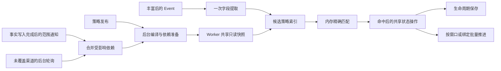

# 抑制、屏蔽、合并的内存匹配与增量运行方案

> 状态：开发方案，尚未实现。用户已确认性能目标、内存匹配方向，以及业务范围、动态分组、拓扑和 CMDB 关系正常情况下允许 60 秒变更生效延迟。
> 更新时间：2026-10-14。源码核对基线：Linkd `397cf45d`，Kingeye `de4050b7b8`。
> 本文规定后续改造方向，不把候选索引、共享依赖快照或统一变更通知描述为当前已实现能力。

业务语义继续以[三类策略开发方案](event-enrich-and-alarm-policies.md)为依据；本文集中定义规模增长下的执行方式、依赖刷新和验收要求。

## 1. 目标与边界

当实际相关策略数量不变时，增加无关策略、无关活动 Alert、已完成历史记录，不应明显增加单个 Event 的策略处理时间。

正常处理路径应满足：

- 普通条件、业务范围、目标成员和已准备好的关系匹配在内存完成，不逐事件查询 MySQL、OneModel 或 CMDB。
- Event 只经过可能相关的策略；不遍历、复制或记录全租户所有策略。
- 抑制计数、依赖主占位、合并成员登记仍使用现有跨 Worker 共享状态；实际命中后才执行必要操作。
- 依赖屏蔽不全量扫描租户活动 Alert，合并入窗不读取完整窗口。
- 完整合并、绑定复查和关联释放按实际待办批量推进，不扫描所有历史完成记录。

单事件成本目标为：字段提取 + 候选索引查询 + K 条候选的内存求值 + S 次必要共享状态操作 + 原有生命周期保存。K、S 取决于本次实际相关规则，不取决于无关策略总数 R 或全部活动 Alert 数 A。

不承诺任意规则下严格 O(1)：全部适用的宽泛规则、无法索引的正则/否定表达式、大文本以及同组状态竞争仍有实际成本。完整 M 成员合并和解绑至少需要处理 M 个对象，后台化不会消除这部分总工作量。不得通过超量后静默跳过策略来证明高吞吐。

## 2. 当前实现与需要改变的环节

| 环节 | 当前代码事实 | 改造方向 |
| --- | --- | --- |
| 配置缓存 | Catalog 按需刷新、5 秒缓存，逐事件冻结全量 release refs，FindFrozen 线性查找 | 后台准备、进程共享、版本 map、候选 refs |
| 策略匹配 | 每规则解析业务和完整目标后才执行普通条件；依赖屏蔽已有 PossibleMatch | 候选索引和便宜条件前置，目标集合内存查找 |
| 依赖屏蔽 | 每规则按 32 条分页扫描租户全部活动 Alert，再选择最新主 | 每策略维护合资格主有序索引 |
| 屏蔽复查 | 逐告警重读配置、Event 和主，更新下一检查时间 | 到期/变更驱动，批量读取，共享依赖 |
| 合并入窗 | 每次 Join 后 ReadMergeWindow，读取全部成员并排序 | 单成员操作返回元信息，维护小摘要 |
| 合并调度 | Alert × Window 扫描可重复裁决同窗 | Window 唯一调度，摘要和到期唤醒 |
| 合并持久化 | 成员逐条查询/保存，Members 被重复完整读取 | 现有批量 Alert 读、快照批量、分块进度 |
| 历史维护 | decision/relation 读出后在 Go 中过滤完成项 | 存储侧查询待办，历史独立查询 |

当前实现入口：[Catalog](../../internal/policy/catalog.go)、[Snapshotter](../../internal/policy/runtime/snapshot.go)、[条件求值](../../internal/policy/evaluate.go)、[依赖选主](../../internal/policy/runtime/dependency.go)、[合并执行](../../internal/merge/executor.go)。

## 3. 查询来源与变更通知核验

### 3.1 Linkd 实际从哪里读取

“通过 OneModel 查询”需要区分领域适配器和网络服务。Linkd 使用自己的 Go `internal/onemodel`，并非每次调用 Kingeye Python 的 `kingeye.base.onemodel` 或 Meta HTTP 接口。

| 数据 | 当前读取路径 | 边界 |
| --- | --- | --- |
| 模型定义、业务空间、动态组定义 | `resources.mysql` → Metadata 目录表 | 定义查询不是实例成员通知 |
| 通用实例、动态组条件展开、投影关系边 | Go OneModel → 配置的 ES / Doris 统一存储 | 动态组按定义条件查询，不以旧成员镜像代替 |
| CMDB 主线拓扑及节点成员 | Go OneModel 的专用 ES node / membership 投影 | 实例后端选 Doris 时也不改用 Doris 通用关系推算主线拓扑 |
| CMDB 服务实例、部分拓扑目标 | `LiveTargetReader` → CMDB API | 显式服务实例和服务实例拓扑直读 CMDB；主机拓扑投影空/失败时也存在实时回源 |
| CMDB 依赖关系条件 | 模型目录校验 + OneModel `Related` | 起点依赖选中的主实例，可能不是纯静态策略依赖 |

代码依据：[运行时装配](../../internal/policy/runtime/runtime.go)、[OneModel 后端装配](../../internal/onemodel/assembly/runtime.go)、[目标解析](../../internal/onemodel/target_resolver.go)、[目录读取](../../internal/onemodel/metadatastore/directory.go)。查询接口说明见 [OneModel 查询契约](../reference/contracts/onemodel-query.md)。

### 3.2 已有通知不等于统一 OneModel 变更流

Kingeye 当前已有变化感知，但尚不能直接据此取消 Linkd 的全部刷新：

| 渠道 | 已核验用途 | Linkd 能否直接作为完整失效依据 |
| --- | --- | --- |
| CMDB `resource_watch` | 消费 CMDB Watch，更新实例、事实关系、派生投影和受影响业务拓扑 | 这是上游同步入口；源端事件不代表 Linkd 读取的投影已可见 |
| `EntityScopeRefreshEvent` | CMDB 同步后直接调用 Plugind 范围刷新，包含实例身份、确认删除/存在与拓扑影响提示 | 当前是 Plugind 专用函数和 Workload 刷新，不是通用订阅接口 |
| `DynamicGroupScopeRefreshEvent` | 唤醒引用分组的 Plugind Workload | 可借鉴依赖反查，不能直接消费为 Linkd 的独立通知合同 |
| `CMDBEvent-v1alpha1` Kafka | 旧主机业务归属变化及删除，KMC 策略目标处理 | 不是任意实例/关系/拓扑事件，部分发送时点早于最终统一投影 |
| `meta_dynamic_group_change` Kafka | 旧动态组成员增删通知 | 仅成员差异非空时发送；载荷无明确租户信封，失败会记录后返回；不能覆盖定义及全部实例条件变化 |
| `meta_write_object_model` Kafka | 模型定义写操作通知，KAC 用于角色字段映射 | 模型定义不是实例、关系、拓扑变更；不能用来刷新全部目标事实 |
| Python `base.onemodel` / Linkd Go OneModel | 统一读取与目标解析 | 本次核查未发现供 Linkd 直接订阅的通用 watch/change API |

Kingeye 核验入口（路径相对 Kingeye 仓库，基线见文首）：

- `src/kingeye/meta/legacy/cmdb_sync/cmdb_watch/watch_data_handler.py::process_watch_events`：`sync_incremental` 完成后调用 Plugind 刷新，刷新成功后推进 CMDB cursor。
- `src/kingeye/base/domains/plugind/workload/contracts.py::EntityScopeRefreshEvent` 与 `DynamicGroupScopeRefreshEvent`。
- `src/kingeye/base/domains/plugind/workload/operations.py::request_execution_workload_scope_refreshes_for_event`：按 Workload 依赖反查订阅者。
- `src/kingeye/meta/legacy/dynamic_group/utils.py::push_change_to_kafka` 与 `meta/legacy/common/utils/kafka_utils.py::push_message`。
- `src/kingeye/meta/legacy/model/services/object_model_service.py::push_object_to_kafka`。
- `src/kingeye/kac/alarm/management/commands/alarmpipeline.py`：当前只消费模型定义通知。

现有 Plugind 通知也不能直接当作精细的失效范围：CMDB Watch 传入的 `object_model_codes=()` 会保守命中租户内条件模型依赖；UID 是本批种子而非整个派生投影连通分量，`include_topology` 仅针对 `inst_asst/host_relation/set/module/mainline_instance` 设置，没有覆盖 host/biz 的所有变化。其后发布的 `ExecutionWorkload-<PACKAGE_VERSION>` 是 Workload 唤醒，不是包含原始事实范围的 OneModel 广播。

动态组定义更新若成员结果不变，现有 `has_changed` 路径可能不发通知。新依赖缓存需要同时感知定义变化和实例事实变化，不能只消费旧成员增删列表。Linkd 现有 `dynamic_config.changed` 订阅仅用于动态配置，`shield_hint` 仅用于主告警终态，也不能替代 OneModel 失效通知。

这些是源码事实，不表示目标环境已经部署、启用对应进程，或 Kafka 消息完整性已通过运行验收。服务实例/模板、业务目录、非 CMDB 数据源、全量重建及旁路写入需分别审计，不能用 CMDB Watch 的存在推导全覆盖。

## 4. 总体执行方式

扩展现有 `Catalog`、`Compiled`、`policy/runtime`、`policy/redisstate` 与控制面任务。复用当前内部通信、Kafka、Redis、Repository 和进度结构，不为本次优化新增通用规则引擎、独立服务、任务账本、hash 对账或跨 Worker 的全量 Alert 镜像。

## 5. 候选索引与内存求值

### 5.1 编译时建立索引

先按租户、策略类型和实际业务作用域隔离，再使用来源、模型、业务、等级、实例身份等可索引条件建立候选 posting。初版优先正向等值/集合条件，沿用既有字段类型转换。

当前表达式只有 AND、OR 和括号，否定由叶条件表达。安全提取规则如下：

- `A AND B` 可选择一个足够有区分度的必要条件作为索引锚点。
- `A OR B` 必须覆盖两个分支；某个分支没有安全锚点时保留兜底候选。
- `source=X AND regex` 可索引 source；`source=X OR regex` 不能只索引 source。
- 多个合并条件组同样不能漏掉任一可能命中的组。
- 负向、任意正则、主字段引用和关系条件先保留精确求值，不强行转换成等值索引。
- 同名自定义字段按真实映射路径和类型区分。text 分词、phrase 和缺失值语义沿用现有 matcher。

索引只产生可能命中的超集。候选按原 `updated_at / ID` 优先级执行，保留抑制等级选择、clip 先于 aggregation、屏蔽首个命中及合并多策略入窗规则。未知字段和依赖不可用不得当作普通 false；优化不能将原不可求值的规则变成命中。

### 5.2 减少对象构造和持久化开销

- 发布时编译表达式、正则、模板、字段访问路径；建立 release 身份 map，去掉逐规则线性 FindFrozen。
- 每 Event 共用一次字段规范化和必要字段读取；避免每策略完整 JSON 往返和大对象复制。
- 批量 Event 共用不可变规则与依赖视图；跨 Event 的状态操作保持现有顺序和租户范围。
- 冻结安全候选 refs，包含全部触发等级及各阶段真实输入视图的候选；屏蔽绑定、合并 Pending 等待、既有关系和在途 decision 的精确策略引用独立保留，不由当前新匹配候选或最新发布列表裁掉。仍被这些运行状态引用的旧版本依赖继续提供读取/刷新，直到相关执行结束。
- 已保存的裁决仍按其精确版本继续；正常日志只记录候选和实际决定，全量未命中解释由预览按需计算。

## 6. 共享依赖与刷新压力

### 6.1 共享单位是依赖，不是策略

| 共享键的业务维度 | 内容 |
| --- | --- |
| 租户、空间 | 可用业务集合及全局业务语义 |
| 租户、模型 | 模型目录、字段类型及来源信息 |
| 租户、空间、规范化 selector | 动态组、拓扑或显式目标结果 |
| 租户、起点实例、关系、目标模型 | 关联实例集合 |

策略只引用这些共享结果。相同动态组被一千条策略使用，也只展开一次。集合以实体身份查找，避免每 Event 遍历全部成员。Worker 进程内共享，只装载任务需要的租户和作用域。

控制面集中合并依赖查询与刷新；Worker 获取准备后的数据，不各自向 CMDB 重复展开同一组。实例、字段和关系只保留策略需要的内容，避免复制完整 CMDB。关系起点随主告警变化的依赖按起点共享和准备，不能误当成固定策略值。

### 6.2 变更驱动为主，轮询按缺口补齐

推荐在 Kingeye 事实生产侧补充中立的范围失效通知，并由 Linkd 控制面订阅。复用现有 Kafka 基础设施；具体 topic、信封和鉴权接入在实现外部合同前固定，本文件不将其声明为现有接口。

通知在数据库提交且相应统一存储结果可被正式读路径读取后发布。不能让 Linkd 收到原始 CMDB Watch 就立即读取尚未更新的 OneModel 投影。CMDB 的派生边可能影响连通分量，不能假定只改变原始事件中的一条边。

通知表达“哪些依赖需要重读”，不要求携带完整实例或让 Linkd 重建 CMDB 投影。最低需要明确租户、变化类别和受影响范围；按来源能力提供模型、业务、实例、关系或动态组 ID。范围必须包含迁移前后业务、关系两端及删除身份；无法定位时提升到该租户的模型/业务范围，不猜测一个过窄范围。字段列表只作为确实完整时的进一步缩小依据。

正常消费过程：

1. 将变化范围映射到共享依赖；无订阅依赖直接结束。
2. 同一依赖反复变化只保留一次待刷新项，合并实例/业务范围，不按事件逐条触发查询。
3. 批量读取一次变化实例/边，在内存重算相关动态组及关系；复杂拓扑或任意条件暂不能安全增量时，只重读受影响的共享依赖。
4. 准备好完整新结果后切换快照；刷新期间到达的新变化保留为下一次工作，避免丢失。
5. 只唤醒受影响的主候选、绑定和窗口，不把一次源变化展开成每 Event 的回源。

依赖反查不能只登记当前集合成员。一个原本不在动态组内的实例更新后也可能进入，因此动态组至少订阅其模型/业务范围和相关属性；拓扑订阅成员迁移与节点变化，关系订阅起点、目标模型及关系类型。缺少旧范围时必须保守扩大刷新。

### 6.3 60 秒预算与兜底分层

60 秒是用户接受的正常变更生效预算，不是“每 60 秒对每条策略重新查询”。从依赖读取源可见开始计算，覆盖通知传递、合并排队、重读和 Worker 应用；源系统到统一存储的同步延迟另行观测。

- 策略发布立即触发准备；停用/删除立即撤出新匹配，已有绑定沿原解除规则处理。
- 已接入且验证覆盖的通知：以变更触发为主，启动、重连及低频后台校准补漏；低频校准不能被宣称为漏通知时仍严格 60 秒生效的保证。
- 尚无完整通知的目录/数据源：在 60 秒预算内轮询共享依赖，按租户/模型/业务合批、错峰、有界并发，不能按策略逐个全量展开。
- 若源端既无完整通知，也无低成本的变化查询，则不能同时承诺零轮询和严格 60 秒新鲜度。必须保留对应读取成本，或先补齐通知后再降低轮询频率。
- 刷新失败不发布空结果，保留上次完整结果并暴露实际数据年龄和失败；超过目标时效就是未达标，不能把成功命中缓存当作满足新鲜度。是否在长期不可用时继续执行旧依赖需在实现规格中单独确认，不设隐式无限期承诺。

持续变化不能无限延后刷新：合并以最早待刷新时间安排截止，不能每次收到新消息都重新等待完整周期。刷新拥塞只影响后台准备，不退化成每 Event 同步回源。

设 R 为策略数、D 为去重后的依赖数、W 为 Worker 数，旧式按策略/Worker 轮询会重复支付接近 R×W 份展开成本。共享后，无通知时按 D 的实际读取成本付费；有通知时主要按本轮变化影响的依赖和实例付费。若每条策略都依赖不同的大集合，D 仍接近 R，后台成本不会凭空消失，应优先共享模型事实读取、对变化实例本地批量计算。

## 7. 三类策略的运行状态

### 7.1 抑制

候选索引、条件和分组计算均在内存。实际命中的 clip/aggregation 保留 Redis 原子计数、去重、主占位/确认和终态清理。不同键可合批或 pipeline；同 fingerprint、同聚合组不任意重排。

第一阶段保留聚合主必要的当前态确认，但按批次去重读取；固定 CMDB 依赖允许 60 秒，并不意味着主告警终态也允许缓存 60 秒。热点 pending 等待单独观测，不能靠放大并发掩盖同组竞争。

### 7.2 时间与依赖屏蔽

每个 `(tenant, policyVersion)` 维护合资格主有序索引，排序保持 `BeginAt DESC, AlertID ASC`。索引存必要身份和字段摘要，不在每个 Worker 复制全部 Alert。Alert 主资格或相关字段变化时更新，终态通过 Alert→策略反向引用删除；保留现有 pending/registered 主协议的独立含义。

子事件先取候选依赖规则，再批量读取各规则选中的主，必要时批量实时确认，随后在内存执行子时间窗口、字段引用和关系条件。仍然先选最新合资格主，再判断子事件；最新主不匹配时不能退选更旧主。

新策略、目标变化和启动恢复的候选回填在后台批量完成。准备未完成不能以部分主集合替代完整选择，也不能让 Event 回退全租户扫描。已有绑定仍固定其策略与主，不随普通策略编辑重新选主。

复查使用真实时段变化点、主终态和依赖刷新驱动。复用现有主→子查询，按受影响绑定合批读取 Alert/Event/主/配置；无业务变化只更新调度项，不反复写整份 Alert。低频恢复扫描保留，连接及来源发布配置在进程内复用。

### 7.3 合并

入窗只处理单成员和摘要；Join 返回窗口元信息，移除随后整窗 HGETALL。首次成员确认更新唯一成员数及条件组覆盖，重复确认不重复计数。摘要只表示“值得裁决”，不能替代当前有效成员判定。

复用现有 `ListMergeDue` 等到期结构，按租户+WindowID 唯一调度：周期到期唤醒，非周期可能满足条件时提前唤醒；相关成员及依赖变化再次唤醒。未发生相关变化的未齐窗口不按成员重复裁决。原 Alert 等待扫描降为去重后的恢复补偿。

Judge 使用 `GetAlertsCurrent` 批量读；Journal 成员快照批量读写，渲染后复用结果；沿 `CaptureOffset/MemberOffset` 按块推进，不能每次先重走全部成员。父子关系和终态按已有关系 ID 唤醒，批量推进关联、释放和恢复；维护查询在存储侧排除完成项。

批量与分块必须保留既有冻结边界：policy、MemberIDs、WaitMemberIDs 和裁决时间一旦冻结不重算；成员快照仍为首次保存后不可替换。首轮 Judge 已取得的快照不能因进度块大小被丢弃，再于下一块改读更新后的 Alert。可先批量保存本轮已取得的快照集合，再分块确认进度；重试优先复用已保存项，只有块内持久化结果确认后才推进 offset。进入 prepared 后直接复用已准备的完整父 Event，不因来源或配置变化重新渲染。这里优化批量 I/O 和重复读取，不重新定义已有重试结果。

完整成员处理仍为 O(M)，应独立报告窗口完成延迟与积压，不能仅凭 Event 入窗快宣称合并吞吐达标。

## 8. 实施顺序与跨仓范围

| 阶段 | Linkd 工作 | Kingeye 依赖 / 检查点 |
| --- | --- | --- |
| 1 | 共享 Catalog、身份 map、候选索引、字段复用、候选 refs | 核验既有 KAC 规则顺序与表达式结果不变 |
| 2 | 共享依赖准备、后台刷新、Worker 快照应用；缺口按共享依赖轮询 | 60 秒时效，按实际来源确认依赖覆盖；不要求阶段 1 先有通用通知 |
| 3 | 消费中立范围通知、依赖反查、合并刷新及变化实例批量求值 | 补齐事实写入后通知、租户和范围合同；覆盖 Watch、全量重建、定义修改、非 CMDB 写入；验证后才减少对应轮询 |
| 4 | 依赖主索引、屏蔽到期/变更调度、合并按窗调度与入窗摘要 | 新策略回填、旧绑定版本及主变化语义验收 |
| 5 | 快照与关联分块批量、连接复用、待办存储过滤 | 验证中断续跑和大量历史下的扫描成本 |

本次文档不授权修改 Kingeye 运行代码。后续实现按上述实际依赖拆分，不把 Linkd 接收到某个遗留 topic 当作完成通用通知接入。

## 9. 验收要求

### 9.1 语义与通知

- 候选索引与原全量 matcher 对照：AND/OR、否定、缺失/不可用、自定义映射、多等级、多个合并组不漏命中；只对确定无关策略省略执行。
- 新主、主结束、最新主不匹配子、旧绑定版本、主字段引用及关系方向保持结果。
- 通知重复、乱序、合并、重连期间变化、刷新中再变化、实例删除/跨业务迁移、动态组非成员变成员、拓扑子树迁移与派生关系影响均有用例。
- 通知发出后正式读取可见；源同步失败、部分写入失败不能产生代表成功的范围通知。通知失败和旧快照年龄有可观测结果。
- 模型、空间、动态组定义与成员、实例、通用关系、专用主线拓扑、CMDB 直连例外分别列覆盖清单；未覆盖的源仍保留后台兜底。

### 9.2 可量化的规模曲线

| 场景 | 预期 |
| --- | --- |
| 无关策略 100→1000→10000，相关 K 固定 | 单 Event 候选数和远程依赖查询次数不增长，P95/P99 基本稳定 |
| 活动 Alert 1000→10万→100万 | 依赖选主不增加全租户分页查询 |
| 同依赖被 1→1000 条策略引用 | 一次变化只展开一次共享依赖，不产生千次相同查询 |
| Worker 数增长 | CMDB/OneModel 依赖回源量不按 Worker 数重复放大 |
| 同范围短时间大量通知 | 刷新数按合并后的依赖变化增长，首条变化不被无限推迟 |
| 单窗成员 2→32→100→256 | 单成员入窗返回大小与成员数脱钩；后台读取按块而非逐项 |
| 已完成历史 H 增长 | 正常待办查询不遍历 H |
| K 或兜底宽泛规则实际增长 | 如实体现必要 CPU/状态工作，不依赖静默跳过 |

同时记录候选/总规则比、内存分配、实际 SQL/ES/Redis 请求数、共享依赖数、通知到应用延迟、最老待刷新年龄、重读行数、缓存实际年龄、窗口完成 P99 和积压。60 秒内生效和单 Event 延迟必须分别达标。

本轮仅文档与源码核验，没有执行新的性能压测、通知联调或生产环境验证。后续普通单测使用自包含替身；真实服务压测独立准备测试资源，不能把内存 fixture 通过当成吞吐证据。
