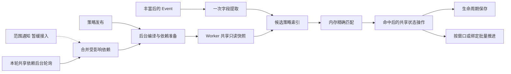

# 抑制、屏蔽、合并的内存匹配与增量运行方案

> 状态：三类策略优化、批量创建/建联/解除及 ES/MySQL 单组 5,000/10,000 容量回归已完成；尚未部署生产。业务范围、动态分组、拓扑和 CMDB 关系按共享依赖后台刷新，成功快照最长使用 60 秒。
> 更新时间：2026-10-16。实施基线：Linkd `9b00fcbdf`，Kingeye `65b786f0a1`；前期调查基线为 Linkd `397cf45d`、Kingeye `de4050b7b8`。
> 已实现候选索引、共享依赖快照、依赖主索引、合并批量捕获/引用/建联/解除、锁开销及连接复用修复；验证记录见第 10、11 节。OneModel 变更通知暂缓，不能将下文的通知设计视为已接入能力。
> 合并现行执行模型为[单进程内存批次与直接回报](#1210-单进程内存批次与直接回报)。此前跨进程持久批次方案已退役，历史记录仅作测量对照。

业务语义继续以[三类策略开发方案](event-enrich-and-alarm-policies.md)为依据；本文集中定义规模增长下的执行方式、依赖刷新和验收要求。

## 1. 目标与边界

当实际相关策略数量不变时，增加无关策略、无关活动 Alert、已完成历史记录，不应明显增加单个 Event 的策略处理时间。

正常处理路径应满足：

- 普通条件、业务范围、目标成员和已准备好的关系匹配在内存完成，不逐事件查询 MySQL、OneModel 或 CMDB。
- Event 只经过可能相关的策略；不遍历、复制或记录全租户所有策略。
- 抑制计数、依赖主占位、合并成员登记仍使用现有跨 Worker 共享状态；实际命中后才执行必要操作。
- 依赖屏蔽不全量扫描租户活动 Alert，合并入窗不读取完整窗口。
- 完整合并、绑定复查和关联释放按实际待办批量推进，不扫描所有历史完成记录。

单事件成本目标为：F 个不同字段映射的提取 + posting 查询 + K 条候选排序与内存求值 + S 次必要共享状态操作 + 原有生命周期保存。相同字段映射只读取一次；K、S 取决于本次实际相关规则，不取决于无关策略总数 R 或全部活动 Alert 数 A。当前候选排序为 O(K log K)，索引查询仍遍历不同字段映射；若新增策略同时引入大量不同字段路径，F 也会增长，不能将固定一个字段的基准推广到该场景。

不承诺任意规则下严格 O(1)：全部适用的宽泛规则、无法索引的正则/否定表达式、大文本以及同组状态竞争仍有实际成本。完整 M 成员合并和解绑至少需要处理 M 个对象，后台化不会消除这部分总工作量。不得通过超量后静默跳过策略来证明高吞吐。

## 2. 当前实现与剩余边界

| 环节 | 本轮已实现的代码范围 | 尚存边界 |
| --- | --- | --- |
| 配置缓存 | 进程共享 Catalog、发布目录一次 HTTP 读取、身份 map、候选 refs；Worker 默认 5 秒，控制面 60 秒缓存并在发布/删除后失效 | 原有配置字节预算仍保留；首次目录装载及真实相关规则仍有成本 |
| 策略匹配 | 编译正向等值/集合 posting，保守覆盖 AND/OR；联合各等级候选，目标成员用集合查找 | 正则、否定、引用和关系等无安全锚点分支保留兜底；全部宽泛规则时成本仍随候选增长 |
| 共享依赖 | Scope / Target / Relation 按完整请求 JSON 去重，控制面与 Worker 两层共享、后台刷新，传递实际源 LoadedAt | 未单独缓存模型目录，也未跨不同 selector 共享完整模型事实；不同请求仍可能重复目录/实例查询 |
| 依赖屏蔽 | Redis 合资格主有序索引；Event 取最新主并实时核对，不再逐规则全租户扫活动 Alert | 启动、新规则和实际依赖变化仍需后台回填；准备期间等待，回填总工作量随实际 Alert/规则增长 |
| 屏蔽复查 | 连接/Hook/不可变来源 Release 复用，服务端筛选到期工作，主终态提示与定时补偿保留；共享配置与依赖 | MySQL 到期条件使用服务端 JSON 表达式，本轮未新增专用到期索引，物理扫描成本仍需观测 |
| 合并入窗 | Join 返回单成员所需元信息，移除随后整窗读取；确认时维护去重计数与条件组摘要 | Redis 原子共享状态仍必要；摘要不能代替完整有效成员裁决 |
| 合并调度 | 待处理 Alert 分页中按窗口去重，利用到期与成员变化摘要避免重复裁决同一未变窗口 | 等待窗口发现仍依赖待处理 Alert 分页，尚非全新的窗口通知/队列 |
| 合并持久化 | 当前 Alert 批读、首次快照批读/批建、分块推进；prepared 复用完整父 Event；结束关系按批复用父/关系事实并保存连续前缀 | 子告警更新保留单成员 lease/CAS，完整 M 成员处理仍为 O(M)；建联与失败释放仍有阶段调度成本 |
| 历史维护 | 合并 decision / relation 使用存储侧待办字段、分页查询与旧记录回填，避免在 Go 中逐条筛掉全部完成历史 | 其他场景查询与 MySQL JSON 到期物理扫描不因此自动消失 |

实现入口：[Catalog](../../internal/policy/catalog.go)、[候选索引](../../internal/policy/candidate.go)、[Snapshotter](../../internal/policy/runtime/snapshot.go)、[条件求值](../../internal/policy/evaluate.go)、[共享依赖](../../internal/policy/runtime/dependencies.go)、[Worker 依赖读取](../../internal/policy/runtime/worker_dependencies.go)、[依赖主索引](../../internal/policy/runtime/dependency_index.go)、[合并执行](../../internal/merge/executor.go)。

依赖主索引仍保留不匹配标记、Alert revision 和外部快照时间，保证后台旧回填不能恢复失效资格。
revision 推进时整体替换当前成员 Hash，保留独立的源时间记录；纯字段不匹配不读取源时间，
新 revision 不重复读取刚清理的成员，只有从清理状态恢复时才撤销全局 owner 的 TTL。
这些调整减少 Redis 命令，不改变主资格或恢复协议；无匹配规则也不能直接跳过旧成员撤销。

以上为工作区实现范围，验证范围以第 10 节为准，不代表生产部署或大规模长期吞吐验收完成。

## 3. 查询来源与变更通知核验

### 3.1 Linkd 实际从哪里读取

“通过 OneModel 查询”需要区分领域适配器和网络服务。Linkd 使用自己的 Go `internal/onemodel`，并非每次调用 Kingeye Python 的 `kingeye.base.onemodel` 或 Meta HTTP 接口。

| 数据 | 当前读取路径 | 边界 |
| --- | --- | --- |
| 模型定义、业务空间、动态组定义 | `resources.mysql` → Metadata 目录表 | 定义查询不是实例成员通知 |
| 通用实例、动态组条件展开、投影关系边 | Go OneModel → 配置的 ES / Doris 统一存储 | 动态组按定义条件查询，不以旧成员镜像代替 |
| CMDB 主线拓扑及节点成员 | Go OneModel 的专用 ES node / membership 投影 | 实例后端选 Doris 时也不改用 Doris 通用关系推算主线拓扑 |
| CMDB 服务实例、部分拓扑目标 | `LiveTargetReader` → CMDB API | 显式服务实例和服务实例拓扑直读 CMDB；主机拓扑投影空/失败时也存在实时回源 |
| CMDB 依赖关系条件 | 模型目录校验 + OneModel `Related` | 起点依赖选中的主实例，可能不是纯静态策略依赖 |

代码依据：[运行时装配](../../internal/policy/runtime/runtime.go)、[OneModel 后端装配](../../internal/onemodel/assembly/runtime.go)、[目标解析](../../internal/onemodel/target_resolver.go)、[目录读取](../../internal/onemodel/metadatastore/directory.go)。查询接口说明见 [OneModel 查询契约](../reference/contracts/onemodel-query.md)。

### 3.2 已有通知不等于统一 OneModel 变更流

Kingeye 当前已有变化感知，但尚不能直接据此取消 Linkd 的全部刷新：

| 渠道 | 已核验用途 | Linkd 能否直接作为完整失效依据 |
| --- | --- | --- |
| CMDB `resource_watch` | 消费 CMDB Watch，更新实例、事实关系、派生投影和受影响业务拓扑 | 这是上游同步入口；源端事件不代表 Linkd 读取的投影已可见 |
| `EntityScopeRefreshEvent` | CMDB 同步后直接调用 Plugind 范围刷新，包含实例身份、确认删除/存在与拓扑影响提示 | 当前是 Plugind 专用函数和 Workload 刷新，不是通用订阅接口 |
| `DynamicGroupScopeRefreshEvent` | 唤醒引用分组的 Plugind Workload | 可借鉴依赖反查，不能直接消费为 Linkd 的独立通知合同 |
| `CMDBEvent-v1alpha1` Kafka | 旧主机业务归属变化及删除，KMC 策略目标处理 | 不是任意实例/关系/拓扑事件，部分发送时点早于最终统一投影 |
| `meta_dynamic_group_change` Kafka | 旧动态组成员增删通知 | 仅成员差异非空时发送；载荷无明确租户信封，失败会记录后返回；不能覆盖定义及全部实例条件变化 |
| `meta_write_object_model` Kafka | 模型定义写操作通知，KAC 用于角色字段映射 | 模型定义不是实例、关系、拓扑变更；不能用来刷新全部目标事实 |
| Python `base.onemodel` / Linkd Go OneModel | 统一读取与目标解析 | 本次核查未发现供 Linkd 直接订阅的通用 watch/change API |

Kingeye 核验入口（路径相对 Kingeye 仓库，基线见文首）：

- `src/kingeye/meta/legacy/cmdb_sync/cmdb_watch/watch_data_handler.py::process_watch_events`：`sync_incremental` 完成后调用 Plugind 刷新，刷新成功后推进 CMDB cursor。
- `src/kingeye/base/domains/plugind/workload/contracts.py::EntityScopeRefreshEvent` 与 `DynamicGroupScopeRefreshEvent`。
- `src/kingeye/base/domains/plugind/workload/operations.py::request_execution_workload_scope_refreshes_for_event`：按 Workload 依赖反查订阅者。
- `src/kingeye/meta/legacy/dynamic_group/utils.py::push_change_to_kafka` 与 `meta/legacy/common/utils/kafka_utils.py::push_message`。
- `src/kingeye/meta/legacy/model/services/object_model_service.py::push_object_to_kafka`。
- `src/kingeye/kac/alarm/management/commands/alarmpipeline.py`：当前只消费模型定义通知。

现有 Plugind 通知也不能直接当作精细的失效范围：CMDB Watch 传入的 `object_model_codes=()` 会保守命中租户内条件模型依赖；UID 是本批种子而非整个派生投影连通分量，`include_topology` 仅针对 `inst_asst/host_relation/set/module/mainline_instance` 设置，没有覆盖 host/biz 的所有变化。其后发布的 `ExecutionWorkload-<PACKAGE_VERSION>` 是 Workload 唤醒，不是包含原始事实范围的 OneModel 广播。

动态组定义更新若成员结果不变，现有 `has_changed` 路径可能不发通知。新依赖缓存需要同时感知定义变化和实例事实变化，不能只消费旧成员增删列表。Linkd 现有 `dynamic_config.changed` 订阅仅用于动态配置，`shield_hint` 仅用于主告警终态，也不能替代 OneModel 失效通知。

这些是源码事实，不表示目标环境已经部署、启用对应进程，或 Kafka 消息完整性已通过运行验收。服务实例/模板、业务目录、非 CMDB 数据源、全量重建及旁路写入需分别审计，不能用 CMDB Watch 的存在推导全覆盖。

## 4. 总体执行方式

扩展现有 `Catalog`、`Compiled`、`policy/runtime`、`policy/redisstate` 与控制面任务。复用当前内部通信、Kafka、Redis、Repository 和进度结构，不为本次优化新增通用规则引擎、独立服务、任务账本、hash 对账或跨 Worker 的全量 Alert 镜像。

## 5. 候选索引与内存求值

### 5.1 已实现的安全候选覆盖

Catalog 每次装载完整发布目录时构建不可变 posting 和精确版本 map；未变更的发布版本复用编译结果。Worker 使用一次 `/internal/policy-catalog` 请求读取租户目录，控制面复用共享目录，不再把上万条配置拆成数百次 Worker HTTP 分页。原有配置字节预算继续生效，移除了 256 条策略和 1024 条扫描记录造成的整批跳过限制。

当前表达式只有 AND、OR 和括号，否定由叶条件表达。候选索引已实现：

- 正向 `term/terms` 沿用 matcher 的类型规范化；同名自定义字段按真实映射路径和类型区分。text `term` 的精确值可以索引，text `terms` 的分词匹配保留兜底，不将 phrase 当作 glob。
- `A AND B` 选择有安全锚点的必要分支；`A OR B` 覆盖两侧，任一侧没有安全锚点则整条表达式保守兜底，不展开 DNF。
- `source=X AND regex` 可以用 source 缩小候选；`source=X OR regex` 不能只挂到 source posting。
- 多个合并条件组取覆盖并集；依赖屏蔽同时覆盖主条件和子条件，避免漏掉主资格登记或子匹配。
- 负向、任意正则、主字段引用和关系叶子不能安全提取时保留精确求值。缺失字段与读取不可用区分：不可用时保守保留相应候选，交原 matcher 决定 skipped，不能由预筛伪装成 false 或命中。

索引只产生可能命中的超集。查询只汇集、去重并排序相关候选，保持原 `updated_at DESC / ID` 优先级，不为恢复顺序重新遍历全部规则。全部宽泛规则或输入实际命中很多规则时，候选仍会增长，不能承诺任意表达式严格 O(1)。查询也需要读取索引涉及的不同字段/映射；大量互不相同的自定义字段会增加字段提取成本，当前 AND 锚点选择并非基于生产统计的成本优化器。

### 5.2 当前对象与版本边界

Event 对所有等级的有效丰富视图联合提取候选；同一字段映射复用视图和读取，不以某一个等级排除另一个等级可能命中的规则。抑制仍按严重程度尝试等级，组合 scheme 仍先 clip 后 aggregation，屏蔽首个命中和合并多组规则不变。

候选 refs 与 PolicyContext 仅在当前处理调用内使用；取消的是逐 Event **中间计划和策略上下文检查点**持久化，不能恢复旧检查点链。**最终处理结果仍保留终态 `Processing.PolicyDecision`**，包含实际参与求值的候选步骤；确定无关规则不补逐条未命中步骤，全量匹配解释由预览按需计算。

既有屏蔽绑定从完整目录确认当前配置是否停用，不能因新 Event 候选中没有该策略就解除绑定。旧绑定、合并 Pending 和在途 decision 的精确版本引用仍独立读取；Catalog 保留当前和上一代编译对象，更旧的持久引用走精确 ReleaseReader，不以最新配置替换旧版本。

跨 Event 共享不可变配置与依赖结果；本轮没有将抑制 Redis 状态操作改成批流水线，也没有为优化恢复逐 Event 中间计划持久化。

### 5.3 已有候选 CPU 基准

2026-10-14，本机 Apple M4 Pro，固定一个来源等值命中一条规则：

| 策略数 | 候选索引选择 | 原 matcher 全扫 |
| ---: | ---: | ---: |
| 100 | 171.0 ns/op | 13.128 us/op |
| 1,000 | 186.8 ns/op | 144.777 us/op |
| 10,000 | 167.6 ns/op | 1.556592 ms/op |

索引三档均为 256 B/op、2 allocs/op。入口为 `BenchmarkCandidateSelection` 与 `BenchmarkCandidateFullScan`；随机规则/输入对照、优先级、类型/路径、多等级、未知字段和并发用例另行覆盖。

这是**纯候选选择 CPU 基准**，不含 EventView 构造、丰富、Redis、ES/MySQL 保存、控制面回填或端到端网络延迟；不能用这些纳秒结果宣称 Event P95/P99 或生产吞吐已经达标。

## 6. 共享依赖与刷新压力

### 6.1 已实现的共享单位

当前去重键是 `DependencyRequest` 的**完整 JSON**，包括租户，不包含策略 ID：

| 请求种类 | 请求维度 | 缓存内容 |
| --- | --- | --- |
| Scope | 租户、空间 | 完整业务集合；单 Event 通过业务 ID 集合判断范围 |
| Target | 租户、空间、完整 TargetDescriptor | 完整目标结果与实例身份集合 |
| Relation | 租户、起点实例、关系、目标模型 | 关联实例身份集合 |

同一请求由不同策略或来源任务调用时合并首次读取；目标 descriptor 对象地址不同但 JSON 相同也可复用。目标 membership 使用预建集合，`evaluationTargets` 包装保留这一公共面，不回退每 Event 全成员遍历。

控制面统一访问 Metadata / OneModel / CMDB，Worker 获取只读副本并在进程内共享，不让每个来源任务各自展开相同目标。HTTP 返回在缓存装载时一次复核租户/空间与实例身份，逐 Event 不重复扫描整份集合。依赖响应读取预算覆盖既有 32 MiB 源结果，策略大小的请求仍由现有 3 MiB HTTP 请求体边界接收。

**没有实现单独的租户+模型目录缓存，也没有把不同 selector 请求分解成一份完整模型事实共享。** 两个目标描述、动态组条件或关系起点不同，就可能形成不同请求，模型目录及实例分页也可能重复。共享完整请求消除了相同依赖的重复展开，不能据此声称已经消除全部 `R × 目标规模` 后台成本。

### 6.2 本轮刷新与时间语义

`Dependencies` 的当前执行方式：

1. 首次调用等待同键的一次源读取；多个等待者合并，不把准备失败当作成功空集合。
2. 成功读取记录实际源 `LoadedAt`；约 30 秒后提前后台刷新，最多四个源读取并发。后台循环按秒检查到期项，失败后保留旧完整结果并安排重试。
3. 成功快照只在源年龄小于 60 秒时用于匹配。控制面返回的 LoadedAt 在 Worker 原样保留，Worker 缓存命中或接收时不重置有效期；两层缓存不能叠加成两个 60 秒。
4. 刷新发布新只读 entry，已取出的结果在本次求值内保持不变；仅时间戳变化不构成成员变化，实际依赖内容变化按租户合并，供主资格后台重算。
5. 五分钟未使用的依赖淘汰；缓存关闭会取消并等待在途源读取。同键首次读取与关闭并发已纳入 race 回归。

源故障期间，尚未超过 60 秒的完整结果可继续使用；到期后返回不可求值，不延长成功时间。既有屏蔽绑定仍按原依赖失败保留规则处理，新候选按现有 skipped 规则诊断，不能误解除既有绑定，也不能把此降级记成正常未命中。

60 秒约束的是 Linkd 已读取成功源快照的最大可用年龄，不包含上游到统一投影的同步延迟。提前刷新和并发预算降低正常变更等待，但源故障、排队或超时仍可能让当前依赖不可用，不能把“拒绝过期结果”写成“任意故障下仍在 60 秒内成功加载”。

Scope、Target、Relation 的完整结果仍由各自真实读取链路生成；主 Alert 活动性和生命周期 CAS 不纳入这个一分钟事实缓存。

### 6.3 通知暂缓与后续成本

本轮不修改 Kingeye 生产链，不新增变更 topic，也不消费旧 topic 假装获得通用 OneModel 通知。当前目录、动态组、拓扑、关系和实时 CMDB 例外均依靠共享依赖后台刷新。

后续如接入通知，仍需在事实投影正式可读后发布范围提示，将其映射到共享依赖并合并失效。动态组非成员更新后可能进入、拓扑迁移、关系两端和删除身份都必须覆盖；范围不完整时不能只按当前集合成员反查。启动、重连和漏通知仍需补读。具体 topic、信封、鉴权和覆盖合同不在本轮声明为已实现。

设 R 为策略数、D 为完整请求去重后的依赖数、W 为 Worker 数，当前控制面共享降低相同请求的 `R × W` 重复回源；后台仍需支付 D 的实际展开成本。若每条策略使用不同的大目标集合，D 仍接近 R。跨不同 selector 共享模型事实、按变化实例批量重算及通知减轻轮询，属于后续范围。

## 7. 三类策略的运行状态

### 7.1 抑制

候选选择、普通条件、目标 membership 和分组计算在内存完成；真实命中的 clip / aggregation 继续使用 Redis 原子计数、去重、候选占位、主确认和终态清理。**本轮未批量流水线化这些 Redis 操作**，实际命中规则数量和同组竞争仍影响耗时。

aggregation 保留主 Alert 实时活动性确认；Lifecycle 的仓储合批可汇集并发 Event 的点读，不能据此说单条事件的 claim → 主确认 → confirm 已变为一次操作。pending 有界等待及 `aggregation_busy` 降级仍存在，应单独记录尾延迟和跳过比例。固定 CMDB 事实允许 60 秒缓存，不代表主告警终态也允许延迟 60 秒。

### 7.2 时间与依赖屏蔽

已实现合资格主的 Redis 有序索引及 Alert→策略反向引用，保持 `BeginAt DESC, AlertID ASC` 选主。Event 从相关规则索引取最新主并实时核对，再执行子时间窗口、字段引用和关系条件；最新主不匹配子时不能退选较旧主，也不回退租户全部活动 Alert 扫描。

Alert 状态变化更新其相关规则的主资格，终态移除；新规则、依赖变化和启动恢复由后台回填。准备未完成采用待准备/重试边界，不以部分主集合裁决。已有绑定固定其版本和主，不随普通编辑迁移。

连接、Hook、不可变来源 Release 与固定依赖复用；后台工作查询将到期筛选放到存储侧，保留主终态提示和定时补偿。**MySQL 仍通过 JSON 表达式判断到期，本轮未增加专用到期索引，服务端物理扫描成本仍在。** 对实际绑定的状态修改继续使用必要的单 Alert lease / CAS，不把内存匹配等同于取消持久状态操作。

新规则/启动准备保留 15 秒过渡窗口，覆盖旧目录读取的 10 秒截止和 Worker 的 5 秒目录期限；发布目录前检查既有读取截止。ES 在最终回填前明确 refresh 活动索引，后台按页批量实时读取告警，完整成功后才开放 Ready。新发布不能混入已开始回填的冻结策略集合。准备期间保留 Mailbox 头，不以部分主集合裁决。

依赖快照区分 `LoadedAt`（最近成功读取，决定 60 秒新鲜度）与 `ChangedAt`（首次读取或内容实际改变，决定资格版本）。同内容刷新不推进 `ChangedAt`，避免不同 Worker 因普通刷新时间不同而相互阻塞。有目标的主策略从同一个固定 TargetResult 同时取 Scope 和成员，无目标/子范围仍使用 scope 快照，不能混用两种来源的版本时间。

主资格的源时间 floor 独立保存；较旧内容快照即使携带更高 AlertRevision，也不能先清除较新资格，事件会等待依赖刷新再补齐。floor 与当前成员分开，逐事件不扫描全部历史时间记录。等级映射复用既有 Severity Digest 划分运行索引，变更/回退先停用旧空间，完整准备后开放；业务求值与候选选择使用同一冻结映射，已保存 Alert 的资格更新跟随当前映射。终态清理该 Alert 的全部运行空间。

首次租户登记（含控制面重启）和实际 scope/target 内容变化，还会安排一次 60 秒后的最终 force 回填与 Active refresh，覆盖旧 Worker 缓存有效期间新建的主。目标变化保持已有 Ready，传播仍按 60 秒预算处理；最终扫描自身耗时和失败重试必须另计。重复目录读取和无变化的分钟检查不安排全量补扫。连续变化不推迟最早补扫，结束后若还有更晚变化，再安排其收敛轮；孤立变化至多初轮和最终两次扫描。

活跃 Alert 的历史策略版本和等级映射空间会积累小引用及源时间 floor，直到终态清理；没有复制完整 Alert，但这部分内存不是固定常数。

### 7.3 合并

已移除 Join 后每成员读取完整窗口的调用，入窗只返回当前成员所需元信息；首次成员确认更新唯一计数及条件组摘要，重复确认不重复计数。摘要用于避免不必要裁决，真正 Judge 仍读取并验证完整有效成员。

高并发容量复跑同时复现处理时间与 Redis 登记顺序颠倒：Event 较早冻结求值时间、较晚到达窗口，不应被当作过期候选。对仍开放且未冻结的同组窗口，将早于 start 的成员登记时间规范到 start；窗口 start/deadline 保持不变，不延长周期。冻结窗口的旧请求仍拒绝重新入窗，已登记 Event 重投仍先命中原幂等结果；精确 deadline 继续属于下一窗口。

等待发现仍分页读取待处理 Alert，经 `mergeWaitingScan` 按窗口去重并结合到期/变化摘要选择工作；**尚未改成全新的窗口通知或独立窗口队列**。合并 decision / relation 则使用存储侧待办字段与分页查询，并对旧记录渐进回填，避免扫描全部完成历史再在 Go 中过滤。

Judge 通过 `GetAlertsCurrent` 批读当前成员，Journal 批读/批建首次成员快照，执行器按 `CaptureOffset / MemberOffset` 分块推进，prepared 阶段复用完整父 Event。单文档领域测试替身仍支持原窄接口，正式 ES/MySQL 后端提供批量实现。

冻结边界保持：policy、MemberIDs、WaitMemberIDs 和裁决时间冻结后不重算；已保存的首次成员快照不替换。首轮已取得的快照先按批保存，重试优先复用持久项，确认完整块后才推进 offset；不因下一块重新读取而替换前一轮输入。prepared 后不因来源或配置变化重新渲染父事件。

父子关联、释放和终态处理仍有逐成员 lease / CAS，这部分是业务状态推进，批量读取没有消除它。完整 M 成员处理仍为 O(M)，完成延迟与积压应独立于单事件匹配延迟衡量。

2026-10-15 容量复核发现：256 成员清理的约 8 分钟主要来自每 30 秒仅推进 16 个单成员步骤，不是必须支付的存储延迟。已改造为每批固定最多 16 个成员，复用已确认的终态父和固定关系信息，最多四路并发调用单 Alert lease/CAS 解除；只将全部确认成功的连续前缀保存为 EndOffset。失败或取消后的已完成成员按原身份幂等重放，不能跨过失败成员。自动调度仅对成功且仍有进展的关系轮转续批，每批重新取得窗口租约并遵守十秒截止，同页总预算 45 秒；活动无进展、锁忙及失败保留原 30 秒补偿周期。部分失败、并发、取消、无重复处置及双后端 256 成员回归已通过。

## 8. 实施顺序与跨仓范围

| 阶段 | Linkd 工作 | Kingeye 依赖 / 检查点 |
| --- | --- | --- |
| 1 | 共享 Catalog、身份 map、候选索引、字段复用、候选 refs | 核验既有 KAC 规则顺序与表达式结果不变 |
| 2 | 共享依赖准备、后台刷新、Worker 快照应用；缺口按共享依赖轮询 | 60 秒时效，按实际来源确认依赖覆盖；不要求阶段 1 先有通用通知 |
| 3 | 消费中立范围通知、依赖反查、合并刷新及变化实例批量求值 | 补齐事实写入后通知、租户和范围合同；覆盖 Watch、全量重建、定义修改、非 CMDB 写入；验证后才减少对应轮询 |
| 4 | 依赖主索引、屏蔽到期/变更调度、合并按窗调度与入窗摘要 | 新策略回填、旧绑定版本及主变化语义验收 |
| 5 | 快照与关联分块批量、连接复用、待办存储过滤 | 验证中断续跑和大量历史下的扫描成本 |

本次实现范围仅为 Linkd，未修改 Kingeye 运行代码。阶段 3 通知接入暂缓；阶段 1、2、4、5 的实现范围与剩余边界见第 2、7 节，不把 Linkd 接收到某个遗留 topic 当作完成通用通知接入。

## 9. 验收要求

### 9.1 语义与通知

- 候选索引与原全量 matcher 对照：AND/OR、否定、缺失/不可用、自定义映射、多等级、多个合并组不漏命中；只对确定无关策略省略执行。
- 新主、主结束、最新主不匹配子、旧绑定版本、主字段引用及关系方向保持结果。
- 后续通知接入须补齐重复、乱序、合并、重连期间变化、刷新中再变化、实例删除/跨业务迁移、动态组非成员变成员、拓扑子树迁移与派生关系影响用例。
- 后续通知接入须验证发出后正式读取可见；源同步失败、部分写入失败不能产生代表成功的范围通知。通知失败和旧快照年龄需要有可观测结果。
- 模型、空间、动态组定义与成员、实例、通用关系、专用主线拓扑、CMDB 直连例外分别列覆盖清单；未覆盖的源仍保留后台兜底。

### 9.2 可量化的规模曲线

| 场景 | 预期 |
| --- | --- |
| 无关策略 100→1000→10000，相关 K 固定 | 单 Event 候选数和远程依赖查询次数不增长，P95/P99 基本稳定 |
| 活动 Alert 1000→10万→100万 | 依赖选主不增加全租户分页查询 |
| 同依赖被 1→1000 条策略引用 | 一次变化只展开一次共享依赖，不产生千次相同查询 |
| Worker 数增长 | CMDB/OneModel 依赖回源量不按 Worker 数重复放大 |
| 同范围短时间大量通知 | 刷新数按合并后的依赖变化增长，首条变化不被无限推迟 |
| 单窗成员 2→32→100→256 | 单成员入窗返回大小与成员数脱钩；后台读取按块而非逐项 |
| 已完成历史 H 增长 | 正常待办查询不遍历 H |
| K 或兜底宽泛规则实际增长 | 如实体现必要 CPU/状态工作，不依赖静默跳过 |

同时记录候选/总规则比、内存分配、实际 SQL/ES/Redis 请求数、共享依赖数、通知到应用延迟、最老待刷新年龄、重读行数、缓存实际年龄、窗口完成 P99 和积压。60 秒内生效和单 Event 延迟必须分别达标。

本轮已通过的范围：候选随机对照与 100 / 1,000 / 10,000 条 CPU 基准；定向及真实 Redis race；ES/MySQL policy storage 迁移与批量合同；三类策略的真实双后端场景与容量回归。具体结果见第 10 节，不构成大规模全链路吞吐验收。

完整 `make check` 与目标/CMDB/依赖屏蔽矩阵已通过，新规则就绪、ES 可见性和版本/等级映射边界已覆盖。本轮未接入或联调 OneModel 通知，未做生产环境验证。§9 中通知相关条目属于后续通知接入验收，不计入本轮已完成项。

普通单测使用自包含替身；真实服务测试使用独立资源。最终收口须列清通过、失败和未执行项，不能把内存 fixture 或纯候选 CPU 结果写成端到端高吞吐已验收。

## 10. 本轮验证记录（2026-10-14～15）

### 10.1 检查门禁与关键回归

第一阶段 `make check` 已通过：Go 格式、全部普通单测、vet、race、golangci-lint（0 issues），Console lint/typecheck/构建与测试，Helm 及发布脚本检查。Console 为 446 项通过、8 项按既有外部环境条件跳过；Helm 35 项通过。普通 `make check` 不启用真实外部服务 E2E，下面单独记录。

此外启用了隔离 Redis 的 policy、runtime、merge、lifecycle 与 controlplane/process race 回归。ES/MySQL 的批量快照、待办历史迁移和屏蔽工作查询合同已分别执行；ES 另测关闭自动 refresh 后的主 Alert 可见性。

新增回归重点包括：

- 候选与全量 matcher 随机对照，10,000 条规则单字段读取，停用规则不读字段；OR 兜底、多等级、自定义字段路径、Enrich 中等级配置变化保持同一次求值映射。
- 相同依赖合并回源、租户隔离、源时间跨控制面/Worker 保留、失败时 60 秒到期、相同内容刷新、并发关闭；目标 Scope 与成员使用同一不可变快照。
- 最新主排序、最新主不匹配时不退选、旧绑定版本、主终态移除、CAS 后更新失败修复；旧 Worker 数据不能覆盖新资格，新策略回填不能删除已有策略资格。
- 启动、新发布、等级映射回退的 Ready 屏障；发布中冻结版本集合、ES 搜索可见性、连续变化不推迟最终补扫。
- 入窗不读完整成员集、重复确认不增加摘要计数、当前 Alert 批读、首次快照只建不覆盖、部分写入重试及分块续跑；已完成历史不参与正常待办扫描。

### 10.2 候选 CPU 基准

在 Apple M4 Pro / Go 1.26.7 上运行 `go test ./internal/policy -run '^$' -bench 'BenchmarkCandidate(Selection|FullScan)' -benchmem`。规则共享一个字段映射、命中一条，结果如下：

| 策略数 | 索引候选选择 | 对照全量 matcher | 索引分配 |
| --- | --- | --- | --- |
| 100 | 171.0 ns/op | 13.128 μs/op | 256 B / 2 allocs |
| 1,000 | 186.8 ns/op | 144.777 μs/op | 256 B / 2 allocs |
| 10,000 | 167.6 ns/op | 1.556592 ms/op | 256 B / 2 allocs |

这只证明固定字段和候选数时的内存候选选择曲线，不包含网络、共享状态、生命周期保存，不是端到端 Event 延迟或吞吐。

### 10.3 真实存储与进程用例

测试启动正式 all-in-one，经真实 Kafka 输入并核对 KAC action 输出；底层为 ES 7.17.7、MySQL 8.4.10、Redis 7.2、Kafka 3.9.1。每次使用独立数据库、索引、topic 和 Redis 前缀。OneModel 通用目标使用真实隔离投影数据；CMDB API 用协议 fixture，未连接生产 CMDB 或 Kingeye 服务。

| 用例 | 本轮结果 / 覆盖 |
| --- | --- |
| `CMDBTargets` | ES/MySQL × 多租户开/关均通过；CMDB 故障超过成功快照期限、恢复与目标隔离 |
| `MergeCombinations` | ES/MySQL 均通过；多策略、重复成员、冻结版本、恢复和父子处置关系 |
| `MergeCapacity` | ES/MySQL 均通过；256 成员捕获、建父、准入、全部恢复和关系清理，各核对 2 条 KAC action |
| `DependencyCapacity` | ES/MySQL 均通过；1,024 双向关系、超限保留既有绑定、恢复后 65 个跨来源子绑定及主结束提示解除 |
| `EnabledPolicies` | ES/MySQL 均通过；防抖、跨来源聚合、时间屏蔽、合并与释放，各核对 14 条 KAC action |
| `PolicyAdmission` | ES/MySQL 均通过，批量解除追加后再次通过；三类策略联合执行顺序、定时解除不准入、下一事件准入与父子关闭，各核对 6 条 KAC action |
| `DependencyShield` | ES/MySQL 均通过；custom/CMDB 选主、固定主、最新主不回退、故障保留/跳过及恢复，各核对 11 条 KAC action |
| `TargetShield` | ES/MySQL 均通过；动态组与拓扑完整分页、故障保持、成员退出和下一事件准入，各核对 8 条 KAC action |
| `TargetCombination` | ES/MySQL 均通过；六种 selector 顺序、重叠成员、全局/固定业务、混合分支故障和移除，各核对 7 条 KAC action |

初轮 256 成员用例的关系清理约 7 分 58 秒 / 7 分 59 秒，暴露每 16 个成员固定等待 30 秒的调度成本。追加批量解除、父/关系事实复用与有进展续批后，两后端再次完整通过，结果如下：

| 256 成员场景 | Elasticsearch | MySQL |
| --- | --- | --- |
| 前 255 个成员等待就绪 | 3.741 秒 | 0.844 秒 |
| 第 256 个到齐到捕获、建父与准入 | 49.895 秒 | 41.176 秒 |
| 批量恢复子告警到确认父恢复 | 9.959 秒 | 21.841 秒 |
| 确认父恢复后，到确认关系 ended | 0.002 秒 | 0.204 秒 |
| 批量恢复到父及关系都完成的合计观测时间 | 约 9.96 秒 | 约 22.05 秒 |

最后两项是轮询观测：ES 在观察到父恢复时关系已 ended，后续 2 ms 是查询时间，**不能解释成 256 个解除操作只执行了 2 ms**。关系检查的首次发现仍可能等待 30 秒，完整合并建联仍存在单成员 CAS 和阶段调度成本；批处理没有让整个 M 成员流程变成固定时间。容量用例将父恢复后的关系完成等待上限从 10 分钟收紧到 90 秒，防止逐批固定等待退化。

65 子绑定建立约 ES 2.465 秒、MySQL 0.207 秒；不发新 Event、由主结束提示完成解除约 ES 3.813 秒、MySQL 0.232 秒。计时不含夹具写入，ES 夹具串行 CAS 的 `refresh=wait_for` 会额外等待索引刷新，不能混入实际提示解除耗时。

早期运行有两类未通过结果，已保留诊断：一类是主机合盖休眠造成超时及 lease 丢失，受影响用例独立重跑通过；另一类是旧用例假定注入故障立即生效或控制面恢复即代表所有 Worker 恢复。后者已按已确认的缓存期限等待真实传播，保留原业务结果断言，不清共享缓存、不扩大生产 TTL，相关双后端用例均通过。批量解除追加回归还复现了正常并发请求被窗口早于 start 判断拒绝的真实问题；已按第 7.3 节修复，补齐真实 Redis 的倒序/冻结/精确截止及 255 并发请求回归，双后端容量再次通过。受影响的合并组合与联合准入也已双后端复跑通过。

未执行百万活动 Alert、多 Worker 大规模长期吞吐和生产环境验收；没有接入 OneModel 通知。不同 selector 的重复源展开、MySQL 屏蔽到期物理扫描、宽泛规则和完整成员状态推进仍按前述边界计算容量。

## 11. 创建与建联追加优化（2026-10-15）

本节保留阶段性改造记录；引用写入和完成汇总的现行方案已由 12.10 取代。

当前 256 成员创建父告警并完成准入仍需约 40～50 秒：反查引用 257 个、成员建联 256 个按单步骤推进，每轮 16 步后再等待一秒。该等待是实现成本，不能作为单事件匹配延迟，也不能视为业务必要下限。

本次改造按以下顺序实施并验证：

1. 引用写入改为 create-only 批写与批读，网络块最多 32 项，整批确认后只保存一次 IndexOffset；验证部分写入、读取失败和进度保存失败后的幂等接续。
2. 成员按固定 WaitMemberIDs 前缀并发建联；实际子 Alert 继续使用原锁/CAS，父状态仍实时核对。仅确认成功连续前缀，一次保存关系成员状态、一次保存 MemberOffset；验证并发关闭父、终态子、未选中成员释放及失败重试。
3. 自动裁决有进展即续批，复用既有窗口租约、单项十秒和单页 45 秒预算；等待父 Event、无进展、失败仍退避。全部选中成员成功且父仍满足条件后才 Ready，显式诊断保留原步骤语义。
4. `control_plane.merge.member_batch_size` 与 `concurrency` 将提供可配置的批次和进程并发预算，默认调整为 128/8；它们并非 KAC 业务限制，也不是所有部署的最优值。以单组 5,000 / 10,000 成员开展真实双后端容量验证，并报告全部成员完成时间与动作数。

### 11.1 三个不同的数量边界

- **16：每批工作量。** 目的是让出执行机会并保存恢复位置，不应限制一个组的总量，也不应意味着每批固定等待。
- **4：并发执行名额。** 目的是约束数据库/Redis/Hook 的同时负载；原策略存储连接池为 8，控制面 Alert 共享连接为 16。数值最初保守选取，没有压测证明 4 是最佳点。
- **256：已移除的单组合并成员硬上限。** 这是 Linkd 首版合并实现 `8246f936f` 自行加入的工程预算，分布于 Redis 入窗、裁决、关系、父 Event 等模型，**不是 KAC 的成员数量限制**。核对 Kingeye 退役提交 `45622d10a1d` 的父版本：`alarm_merge/merge.py:update_redis_cache` 逐条 ZADD，`celery_tasks.py:alarm_merge_calc` 通过不带 LIMIT 的 ZRANGEBYSCORE 获取全部匹配 ID、去重后传入合并任务；未发现 256 成员判断。无该硬限制不代表旧 KAC 在数千成员下性能有保证。

本轮明确移除单组 256 数量限制，验收单组 5,000 和 10,000 成员；Redis 元数据上限调整为 8 MiB，完整窗口读取/成员字节预算为 32 MiB，保留现有文档与渲染字节预算。超过资源预算明确返回失败，不截断成员或改成 10,000 硬限制。正常入窗用元信息累计成员字节，不扫描整组。关系成员验证改为排序双指针，成员查找使用二分；批量路径复用固定关系，子告警和活动父仍实时读取。

### 11.2 锁与调度

单窗口租约保护裁决/关系游标，单 Alert 的 tenant/source/fingerprint 租约保护其生命周期状态及输出。成员建联只锁该成员，不嵌套父锁；父 Ready/Recover 单独获取父锁。所有窗口共享进程成员并发预算，不能把吞吐算为窗口数乘以成员并发。CAS 仍保留，锁不构成父子跨记录事务。

Hook 缓存关闭旧客户端移到全局互斥锁外；稳定来源版本命中只查 map，不再扫描全部来源。45 秒页预算耗尽且已成功推进时立即继续既有扫描，避免另等 30 秒；真实失败、无进展和取消仍退避/退出，单项 10 秒预算保持。大组容量验收需核实批次不会反复超时。

成员工作在外层截止前一秒停止启动/等待新操作，使用剩余时间保存原有关系和裁决进度；主动让出只能保存已确认的成功连续前缀。外层取消、真实依赖故障和释放租约不确定仍返回错误。页尾剩余不足一秒、已推进且无真实错误时，沿现有持久扫描立即续跑；不会重新等待 30 秒。八个窗口共享八个慢成员执行名额的测试覆盖多轮持续推进。

锁操作自身仍逐成员获取/释放，复用 Worker 的 tenant/source/fingerprint lease。没有把 128 个成员全部提前锁住；引用/快照网络请求、关系确认和游标保存批量化，成员实际 CAS/日志/Hook 仍逐个执行。单事件入窗不读取整组，整个合并组的总工作量仍随成员数增加；当前 Relation/Decision 使用整文档保存，每 B 个成员推进一次，序列化成本仍有 O(M²/B) 分量，批量优化没有把完整组处理变成固定耗时。

### 11.3 大组实测暴露的边界

- 模板 Render 的旧 256 数量判断已移除，并补齐 5,000 / 10,000 实际模板变量与预算回归；只改 Redis/领域模型不足以打通完整链路。
- 合并运行态列表/详情及 Console 代理允许 32 MiB 响应；成员分页与其他诊断保持各自预算，不能用截断数组显示成功。
- ES `WriteBatchTransport.performDirect` 原来在收到响应头后立即取消请求 context，响应体尚未消费即可失效并关闭 TCP。Lifecycle 多来源 Worker 共享合批名额，队列满载备用路径会频繁命中。现将取消和在途计数释放延至 Body 读完或关闭；真实 HTTP 回归覆盖 20 次满载备用请求复用一条 TCP、关闭时取消响应读取。未修改系统 TCP 或 ES 配置。
- 真实容量夹具按现有查询接口每页 32 条核对全部 Alert，Event 使用 1,000 条 search_after 分页，避免测试的 10,000 结果窗口或 HTTP 响应预算截掉父/子记录。夹具漏业务范围与错误分页大小的初轮失败不计为吞吐验收。

### 11.4 分段观测与剩余成本

增加 `TestAllInOneMergeScaleE2E`：单组分别 5,000 / 10,000，先发送 N-1 个第一条件成员，确认完整提交后再补最后条件。真实 Kafka 输入、完整 Alert 分页、Event search_after、全量恢复及 KAC 输出均验证。`LINKD_E2E_MERGE_PROFILE=1` 仅为测试开启现有 loopback metrics/pprof；`LINKD_E2E_MERGE_EVIDENCE_DIR` 保存每轮独立原始指标/CPU文件。`LINKD_E2E_MERGE_COMPARE=1` 追加 5,000 成员的 64/8、128/16 配置。普通单测不启动这些外部服务。

一个通过的 ES 5,000 / 128/8 分段样本如下。按约一秒轮询观察阶段，短阶段可能被合并或漏采，并非内部逐调用 trace；指标抓取也可能跨越边界。

| 阶段 | 观测墙钟 |
| --- | --- |
| 补齐最后条件 → 裁决出现 | 3.022 s |
| 捕获成员快照 | 4.072 s |
| 完整快照读取与模板准备 | 1.040 s |
| 等待真实父告警 | 1.914 s |
| 建立查询引用 | 2.079 s |
| 成员建联 | 9.146 s |
| 最终就绪与查询可见 | 1.070 s |
| 合并合计 | 22.343 s |

该轮入窗另为 7.055 s，恢复加清理 39.881 s（观察到父/关系进入结束前 33.736 s，后续解除 6.144 s）。恢复前段同时包含真实 Event 处理、每 30 秒关系发现、批量终态确认和父恢复，不能都归为数据库或锁；这次没有单独测出每项的独占耗时。

完整创建区间的逻辑指标增量：

| 操作 | 次数 | 并发累计耗时 | 单次平均 |
| --- | ---: | ---: | ---: |
| Alert CAS | 10,002 | 14.921 s | 1.492 ms |
| Alert 实时读（成功） | 10,087 | 3.413 s | 0.338 ms |
| Alert 批读 | 157 | 1.164 s | 7.416 ms |
| AlertLog append_batch | 5,003 | 2.131 s | 0.426 ms |
| 子状态 Hook | 5,001 | 3.332 s | 0.666 ms |
| 持久等待扫描 merge_work | 2,858 | 7.914 s | 2.769 ms |

这些是逻辑方法墙钟，包含序列化、存储和等待，可能并发、嵌套，**不能相加或除以整组墙钟当占比**。初始 `withAlertProcessor` 原始 Alert 读取、Journal 存储、控制面 lease 与槽位等待未单独打点；现有 lease 指标只覆盖 Worker，不能据此报告合并控制面锁的百分比。该轮创建区间累计 CPU 25.423 s、累计分配 12.330 GB，GC 停顿累计约 46 ms；累计分配不是峰值内存。

2026-10-15 基线：成员建联分别执行当前子/父读取、两次 Alert CAS（保存关系变更意图、完成输出后清除意图）、状态 Hook 和日志。MySQL 的 CAS 使用事务、SELECT FOR UPDATE、UPDATE、COMMIT；`AppendAlertLogs` 当时仍逐项 INSERT，方法名并不代表单条多行 SQL。后续底层改造见第 12 节。5000/10000 整组的总量仍随成员数增长，批处理不会消除每个真实成员的生命周期副作用。

另一项已量化的剩余开销是等待扫描：`mergeWaitingScan` 在读取后按窗口去重，避免重复裁决，但 `ListMergeWork` 每页仍读取最多16个完整 Alert。同一5000成员窗口约313页一轮，创建期间2858次查询约相当于九轮规模。可以后续将现有到期提示作为正常入口、持久扫描保留启动/丢失提示兜底，同时保留未完成 MergeChange 的及时修复；本轮没有改变该恢复契约。只加大页数能减少往返，仍不能消除重复读取成员的规模成本。

### 11.5 MySQL 连接复用修复

实测先发现 MySQL 5,000 成员创建39.510 s，其中建联31.292 s；CAS平均9.624 ms、日志批次平均15.634 ms，远高于上面的 ES 样本，且调用数相同、没有CAS冲突增加。10000入窗又出现建连超时。排查证实 Lifecycle 的 MySQL `maxOpen=0` 原表示按需建立连接，但只保留2个空闲连接，其他固定池也只保留最大数的一半，导致并发波谷大量销毁连接。几分钟累计建连超过30000次。

修复只调整空闲复用：有正最大连接数时 idle=open；原 maxOpen=0 保持原活跃连接语义，idle保留已实际建立的连接；连接30分钟寿命、Worker及合并执行并发不变。没有关闭事务、调整fsync或放宽数据库耐久性。隔离真实 SQL 6波对照：4并发从14个server connection ID/12次空闲淘汰降为4/0；原无限open的8并发从38/36降为8/0。详细容量重测结果见§11.6，不能把修复前慢样本当作最终性能。

测试期间本机磁盘耗尽曾使临时MySQL和本机Kafka退出。已清理可重建Go编译缓存、恢复服务并只清理失败测试自己的namespace；该环境中断样本不计入通过或性能结论。服务连接地址是当轮环境事实，不进入通用部署配置。

### 11.6 最终容量与门禁

最终单组容量用例全部通过。以下为本机真实服务单轮观测，测试期间后台任务和机器负载会变化，不是生产SLA或严格隔离的吞吐基准。合并计时从第N条补齐条件开始，到完整建联、父准入及查询确认；恢复从批量发送真实恢复Event开始，到父和关系均结束。

| 后端 / 单组成员 | 前N-1入窗 | 合并完成 | 恢复及全部清理 |
| --- | ---: | ---: | ---: |
| ES / 5,000 | 9.060 s | 25.424 s | 34.716 s |
| ES / 10,000 | 15.103 s | 51.049 s | 49.692 s |
| MySQL / 5,000（连接池修复后） | 19.069 s | 28.302 s | 52.808 s |
| MySQL / 10,000（连接池修复后） | 23.120 s | 47.727 s | 68.742 s |

四个用例均核对完整N成员、N+1引用、父模板计数、所有触发/恢复Event、恢复后的真实子状态，以及恰好两条父KAC动作、无子动作。ES额外分段样本22.343 s见§11.4。MySQL修复后5000的CAS平均3.887 ms、日志批次平均6.894 ms（修复前9.624/15.634 ms），次数仍为10002/5003。修复后的10000入窗和完整推进没有再发生建连超时。

MySQL 10000的创建分段为：等待裁决4.017 s、捕获5.066 s、完整读取/模板2.061 s、父及引用准备观测6.178 s、成员建联30.382 s、最终就绪24 ms。轮询未单独采到 waiting_parent，不能把整个6.178 s视为纯引用I/O。恢复前段58.499 s、观察到ending后的解除10.243 s；同样不能将前段全部归为30秒扫描或全部归为数据库。

另做ES5000参数对照：64/8合并53.345 s、恢复57.314 s；128/16合并25.516 s、恢复31.757 s，均完整通过。不同轮次入窗也有7～33秒变化，说明负载不完全相同，不能用这些单点宣称某参数固定快几倍。默认128/8的选择是减少共享文档进度保存、保留受控存储并发；16并发没有证明在各后端、多窗口负载下持续优于8。可以按实际存储预算配置，未新增组成员数量上限。

追加正确性回归：真实ES/MySQL `MergeCombinations`（每后端11条KAC动作）、`PolicyAdmission`（每后端6条）均通过；覆盖循环窗口、多策略重叠、部分解除、父关闭、抑制/聚合与合并联合语义。单测覆盖引用/成员部分成功、游标CAS失败、父子并发变化、未选中释放、取消、八窗口共用八名额持续推进、操作与释放锁双超时、源Hook并发关闭及稳定命中。

最终 `make check` 通过：全部普通Go测试、vet、race、golangci-lint 0 issues；Console 449通过/8按既有条件跳过、lint/typecheck/build；Helm 35通过及发布脚本检查。真实Redis5000/10000入窗冻结结束、ES/MySQL批量存储合同、MySQL连接复用真实SQL对照另行通过；普通门禁没有冒充这些外部服务测试。

本轮没有接入OneModel变更通知，没有扩大单事件的候选数量或更改原策略命中/处置规则。仍需按§11.4所列完整成员副作用、读取后去重的等待扫描、整关系文档编码等成本评估更大规模；未做多Worker长期生产负载验收。

## 12. CAS 与底层批处理改造（2026-10-16）

本节记录本轮实现与验收。目标是减少重复读取、独立事务及完整文档传输；保留单对象版本条件、稳定输出身份和同 fingerprint 顺序，不增加新的 hash、锁层次或跨对象事务协议。

### 12.1 第一版写入与批次边界（后续修正见 §12.4–12.5）

1. MySQL 实现已有 Lifecycle Event/Alert 快照接口，复用读取或成功写入返回的不可变快照。Alert 与 Event 结果通过一次带 tenant/id/version 的 UPDATE 提交，不再执行每条 BEGIN、SELECT FOR UPDATE、COMMIT；影响零行仍为版本冲突。普通接口先读取后复用同一路径。数据库唯一活动告警约束保留。
2. 控制面 ES 使用显式成员批处理，不接入主流程 WriteBatchTransport。`member_batch_size` 决定一个实际提交块的成员数，`concurrency` 限制准备/输出工作的并发，二者不能混为同一个上限。合并流程在本批范围内取得成员租约，在锁内批读当前成员与父，准备变更后一次 Bulk CAS，随后按成员执行输出、批量追加日志、Bulk 局部完成确认。没有收集计时器或跨请求后台队列。每项保持自己的版本与结果；部分失败只保留该项意图，父仍在全部必需成员完成后放行。活动父在每个实际提交块实时读取，父在提交中终结的已有竞态仍由父就绪检查与结束清理处理，不能使用长期缓存的父活动状态。
3. MySQL 控制面在 1ms 内合并已准备的 Alert 写入及日志调用。单 Alert 直接条件 UPDATE；多 Alert 在短事务中一次读取并锁定轻量版本，剔除冲突项后使用 UPDATE JOIN 批量更新，提交后逐项返回。事务不包含 Hook、Redis 或日志；每个批次仍受成员并发和 4MiB 预算约束。AlertLog 使用多行 INSERT，重复身份或 SQL 错误才逐项确认，不使用 INSERT IGNORE。主流程 MySQL 使用直接快照写入，不新增后台写队列。
4. MergeChange / PolicyChange 完成后只条件清除对应字段并维护待办字段，保留完整版本 CAS。确认不递增业务 revision，也不重新传输未修改的 Alert 载荷；返回的新存储 token 更新 Recent Alert。确认失败仍保留可重试意图，不将输出与数据库假定为一个事务。

成员业务顺序仍为“保存状态及意图 → 输出/日志 → 完成确认”。物理请求可合并不同成员的同类阶段，无需把所有成员锁在同一事务内；合并关系仍只推进成功连续前缀，父就绪仍在必需成员完成后执行。Redis lease 不是数据库条件写的替代品。

默认 ES 一块 128 成员、准备/输出最多并发 8 个；持有租约等待批次提交的成员不占执行名额，避免互等。每个窗口最多持有当前一块成员的租约，既有窗口执行器最多并行 8 个窗口，因此默认最多 1,024 个批内成员租约；全部仍受窗口十秒预算与既有 lease TTL 约束。更大的配置按仓储批读预算分块并为父预留一项，不扩大单次 HTTP 请求字节预算。不会一次锁住整个 5,000/10,000 成员组。

MySQL Repository 启用驱动参数插值，沿用已采用此方式的 OneModel 装配模式；参数仍通过驱动转义，JSON 参数改为文本，避免 `_binary` JSON 错误，同时省去每条 SQL 的临时 prepare/execute/close。Event 局部更新使用 JSON_SET，保留嵌套 null；不能使用会删除 null 成员的 JSON_MERGE_PATCH。数据库读回改变 JSON 空白/键序时，仅在已完成丰富结果的幂等重试中规范化比较，普通事件不增加这项工作。

同一 ES 成员批次的 EventSource Record 按来源 ID 去重读取，供成员准备共享；Release 与 Hook 继续复用已有资源缓存。下一批重新读取来源发布/删除状态，不引入跨批可变配置缓存或额外生效延迟。

### 12.2 验证检查点

- 存储合同：旧版本拒绝覆盖、业务版本正确、租户隔离、活动唯一约束、快照不被修改、完成确认不影响其他字段、真实 SQL 请求不再包含独立事务与前置读取。
- 批量失败：同批成功/冲突混合、重复日志与不一致日志、请求取消、响应丢失后重试；已完成确认的成员不重复产生新动作，也不能确认失败项已完成；未确认输出可能按原稳定身份重投，不把跨数据库/Kafka 的恢复描述成 exactly-once。
- 生命周期：意图持久化后失败恢复、输出后确认失败、主流程与合并/屏蔽/关闭竞争、锁失效后旧版本迟到；保留现有并发与 race 回归。
- 容量：保存改造前二进制，对两后端分别运行单组 5,000 / 10,000，核对全部子告警/事件/引用及父 KAC 动作。记录入窗、裁决、捕获、模板/父准备、引用、建联、恢复清理；同时记录逻辑调用及可取得的物理请求指标。轮询分段不是内部 trace，并发累计耗时不能当墙钟占比。
- 完整门禁：make check；测试仅使用各用例独立 namespace/数据库/topic，清理自己创建的资源。

容量测试可通过 `LINKD_E2E_MERGE_BINARY` 指定本次保存的基线二进制，省略则构建当前工作区。
`LINKD_E2E_MERGE_EVIDENCE_DIR` 中保存每阶段原始 Prometheus 与 CPU 样本。MySQL 额外读取测试独立数据库的 SQL digest；
旧版使用临时预编译语句时该表不能完整统计其执行，不将缺失计数当作零请求。

### 12.3 第一次容量验收与剩余成本（2026-10-16）

同一台开发机及同一组隔离测试服务，ES 7.17.7、MySQL 8.4.10，单组成员批次 128、成员工作并发 8。
基线是本轮修改前保存的工作区二进制，不等同于某个干净 Git 提交；最终版本包含 ES 显式批处理和批内 EventSource Record 去重。
下表为一轮配对容量样本，不是生产 SLA；恢复清理包含成员恢复事件处理、父恢复和周期关系检查的等待。

| 后端 / 成员数 | 入窗：改造前 → 后 | 创建完成：改造前 → 后 | 恢复清理：改造前 → 后 |
| --- | --- | --- | --- |
| ES / 5,000 | 7.070 → 7.052 s | 23.322 → 23.355 s | 39.168 → 40.248 s |
| ES / 10,000 | 12.108 → 14.094 s | 54.523 → 56.231 s | 45.603 → 47.700 s |
| MySQL / 5,000 | 10.076 → 7.070 s | 16.209 → 16.221 s | 41.814 → 14.234 s |
| MySQL / 10,000 | 21.289 → 14.152 s | 41.868 → 37.593 s | 42.999 → 55.431 s |

ES 总完成时间未改善；MySQL 10,000 创建时间下降约 10.2%，但不能由这一轮样本推导稳定收益。
MySQL 恢复清理的波动主要发生在实际解除之前，不能把 5,000 的约 27.6 s 降幅都归因于数据库批处理。
四组均验证完整成员、父子引用、触发/恢复 Event、最终子状态及恰好两条父 KAC 动作，没有子告警动作。

最终版本创建阶段的轮询观测如下；约一秒采样，未单独观测到的短阶段记在相邻区间，不作为内部精确 tracing：

| 阶段 | ES 5,000 | ES 10,000 | MySQL 5,000 | MySQL 10,000 |
| --- | ---: | ---: | ---: | ---: |
| 等待裁决 | 3.029 s | 7.062 s | 3.014 s | 3.016 s |
| 捕获首次成员快照 | 4.100 s | 11.261 s | 3.055 s | 6.070 s |
| 模板 / 父准备与等待 | 3.943 s | 1.664 s | 未单独观测 | 2.084 s |
| 建立查询引用 | 2.073 s | 9.508 s | 2.044 s | 5.158 s |
| 成员建联 | 10.171 s | 26.696 s | 8.070 s | 21.225 s |
| 最终完成观测 | 0.037 s | 0.039 s | 0.037 s | 0.040 s |
| 恢复至开始解除 | 34.069 s | 26.967 s | 11.166 s | 45.198 s |
| 实际解除成员 | 6.179 s | 20.733 s | 3.067 s | 10.233 s |

**批量请求已生效，但请求数下降不能直接换算为端到端提速。** ES 创建期间的存储层指标：

| 操作 | 5,000：次数 / 累计 / 单次均值 | 10,000：次数 / 累计 / 单次均值 |
| --- | --- | --- |
| 成员业务 Bulk CAS | 40 / 0.664 s / 16.60 ms | 79 / 1.381 s / 17.48 ms |
| 成员完成确认 Bulk | 40 / 0.509 s / 12.72 ms | 79 / 1.026 s / 12.98 ms |
| 当前 Alert 批读 | 237 / 3.202 s / 13.51 ms | 471 / 6.334 s / 13.45 ms |
| 等待合并扫描 | 2,802 / 8.018 s / 2.86 ms | 9,647 / 26.911 s / 2.79 ms |
| AlertLog 批次 | 43 / 0.528 s / 12.28 ms | 82 / 1.001 s / 12.21 ms |

这些是应用存储方法耗时，含编码、网络、解码；不是 ES 服务端 `took`。固定批次大小后，5,000 → 10,000 的单批存查均值基本稳定，主要是调用次数增加。
基线 ES 的 10,002 / 20,002 次单条 CAS 累计 10.526 / 20.743 s，但原来有成员并发，累计值不能当作可省掉的墙钟。
例如仅为说明并发口径，将它们理想均分到 8 路约为 1.316 / 2.593 s；本轮两阶段显式 Bulk 累计为 1.173 / 2.407 s，本就不足以解释整组几十秒。

仍未消除的成本：

1. **等待扫描读取后才去重。** `controlplane/process/merge.go` 的等待扫描仍每页 16 条读取完整 Alert，`mergeWaitingScan.selectWork` 才按窗口去重。等待/创建越久，被重复扫描越多；本样本成员翻倍时查询次数增长约 3.44 倍。去重减少裁决次数，没有减少前面的 ES 查询和解码。
2. **决策和关系仍是随 N 增长的整组文档。** `Executor.StepDecisionBatch` 每批重读 Decision 并调用 `ensureRelation`；后者还会重新构造整组关系、尝试 create-only、再读取实际关系。`putRelation` 与 Journal 的进度保存仍编码、条件写入和重读完整组文档。固定 B=128 时，约 N/B 次推进各处理 O(N) 的组元数据，这部分有 O(N²/B) 的数据处理量；Alert Bulk 本身的线性项不能解释全部增长。本轮局部完成确认只缩小 Alert 写入，未拆分 Journal 存储模型。
3. **批内编排仍有逐成员工作。** fingerprint 租约、领域变更、输出 Hook、缓存维护及 goroutine 调度仍按成员执行。10,000 建联 CPU 样本同时出现 JSON 解析、Journal/关系读取、等待扫描和 runtime 调度；采样累计栈彼此重叠，不据此报告墙钟占比或断言磁盘 fsync 是主因。
4. **恢复调度仍有等待。** 关系周期检查为 30 秒，且必须先完成恢复事件和父状态推进；因此恢复清理总时长不能等同于逐成员解除的执行时长。

后续优化应优先减少完整组元数据的重复构造/读取与无效等待扫描，再考虑扩大成员写入并行度。不能仅放大 Bulk、移除 CAS 或增加全局并发来掩盖这些放大项。

本轮完整 `make check` 通过，包含 Go 单测/vet/race/lint、Console、Helm 与发布检查；真实 ES 仓储合同、真实 MySQL 并发批写/部分冲突、局部更新保留嵌套 null、取消/关闭、提交响应丢失及幂等重试通过。合并组合与策略准入真实 E2E 两后端通过，ES 128 批另补跑合并组合。中途将 ES 批次误受成员并发 8 限制的版本已纠正，测试覆盖“1 个工作名额仍能提交多成员批次”，不能用该中间版本的耗时代替上述最终结果。

### 12.4 全调用链批次修正（继续实施）

§12.3 是第一次验收样本，不作为性能目标已完成的结论。进一步通过测试专用 HTTP 记录器观察真实 10,000 成员创建流程：业务写入与完成确认各 79 次 Bulk，服务端 `took` 累计仅 0.756 / 0.674 s；但决策/关系 GET+PUT 达 1,628 次，请求/响应合计约 2.02 GB，含 159 次重复 create-only 的 409。成员快照仍拆成 625 次 16 条批，查询引用拆成 313 次 32 条批。诊断转发增加额外开销，其总墙钟不与直接连接基线作性能比较。

继续修正以下执行边界，不改变策略、成员集合和成功前缀语义：

1. 每次推进只读取一次已有关系；仅缺失时创建，不重复构造/尝试创建整组。已读关系传给成员推进，成功持久化进度后使用返回的版本及本次快照，不再次读取自己的写入。
2. 决策仅条件更新 progress；关系仅条件更新状态、偏移和本批改变的成员状态。ES 使用带原 seq_no/primary_term 的局部更新，MySQL 使用单条带 namespace/id/version 的 JSON_SET UPDATE。保留整记录 CAS，不引入跨批缓存或无条件覆盖；ES 内部仍会重索引文档，不宣称局部更新消除了服务端所有 O(N) 工作。
3. 快照/引用的真实读写块统一为 128，保留已有文档与请求字节边界；重复引用仍核对原身份。等待扫描页改为 128，执行仍受原并发和页预算约束，不改变到期/补查条件。
4. MySQL 合并成员也使用显式块提交，复用已经验证的短事务批写实现，避免每块 128 成员最后只能由 1ms 收集到不足 8 条。其他控制操作保留原接口。
5. 首次裁决已完整批量保存所有成员快照后，直接一次确认完整捕获前缀，不再逐块读回并推进已经写完的快照。只有中断恢复且快照不完整时，继续使用有界补齐路径。

验证检查点：存储更新只改变指定字段、版本竞争/旧持有者被拒绝、失败后可重读恢复、批次未被隐式拆小、关系创建仅一次，以及两后端完整组合/并发失败矩阵和 5,000 / 10,000 端到端复测。

### 12.5～12.9 历史容量记录

此前持久批次池与多进程方案已退役，其设计和测量数据移至[历史容量记录](../research/benchmarks/2026-10-16-merge-persistent-pool-history.md)，仅用于对照，不作为当前部署或实现说明。

### 12.10 单进程内存批次与直接回报

状态：已实现，已通过本地完整门禁及两后端真实验收；未部署。

用户确认无需多进程调度，也无需为短时批次保存中间进度：允许崩溃后从固定关系重建批次并幂等重放。本节取代 12.5～12.9 的跨进程成员池设计；之前数据仅保留为历史对照。

1. 主控制面按固定成员集合在内存拆批，默认每批 128 个、最多 8 个在途。调度器有空闲名额才启动 goroutine，完成直接回报并释放名额，不预先启动空 Worker 扫描领取。
2. 批次、逐项成功结果、重试时间只保存在本进程内存；不创建 merge_batches ES 索引/MySQL 表，不通过 Redis 分发或保存批次。失败只重试本进程已知的未完成成员；进程崩溃后允许重建并重复执行整个尚未确认的阶段。
3. 业务恢复依据仍为持久 Decision、Relation、成员 Alert 和稳定输出身份。重放已有建联/解联不得重复动作或日志。成员原有 fingerprint 锁与 Alert CAS、组阶段 CAS、父最终准入保持；独立批次锁及批次进度 CAS 一并移除。
4. 引用/建联/解联各阶段收齐内存完成结果后直接推进组级执行器，不再读回结果或等待周期扫描。正常阶段之间立即派发下一阶段；进程重启及阶段提交失败由原决策/关系恢复任务接续。
5. 反向引用是固定关系派生的四字段映射，ES Bulk index / MySQL 多行幂等写入逐项成功即确认，无写后读回；成员快照保留首次捕获值。
6. 移除 merge-worker 命令、跨进程领取/回报、批次持久存储与扫描、跨进程测试及现行部署说明，不保留兼容空壳。Redis 的告警锁和窗口等其他业务职责保持。

验证覆盖空闲名额立即续批、并发上限与退出、部分失败仅重试未完成项、内存丢失后重建、成功后未汇总即崩溃、父提前结束、重复处理无重复动作，以及 ES/MySQL 5,000/10,000 成员真实验收。

性能主口径使用父 admission 资格时间和实际成员执行区间。最终搜索可见仅作查询验收，不算处置阻塞；新成员批次已不依赖搜索发现。以下记录为本轮内存批次方案的验收，不使用之前中间版本结果。

本轮单进程容量用例四组通过，环境与 12.9 历史样本保持相同服务版本和资源规格，B=128、M=8。主口径从最后一条补齐条件的 Event 开始，到父取得处置资格；不等待搜索可见作为性能终点。

| 后端 / 成员数 | 父资格：原单进程 → 内存批次 | 实际成员区间：原 → 内存批次 | 本轮每批均值 | 有效 / 峰值并发 |
| --- | ---: | ---: | ---: | ---: |
| ES / 5,000 | 9.424 → 6.319 s | 1.146 → 1.014 s | 188.22 ms | 7.42 / 8 |
| ES / 10,000 | 13.552 → 12.269 s | 1.987 → 2.027 s | 196.22 ms | 7.65 / 8 |
| MySQL / 5,000 | 6.849 → 4.497 s | 0.811 → 0.751 s | 140.35 ms | 7.47 / 8 |
| MySQL / 10,000 | 10.759 → 7.462 s | 1.772 → 1.930 s | 187.04 ms | 7.66 / 8 |

实际成员处理区间总体相近，部分 10,000 成员样本有反向波动；本轮主要消除了批次发现、逐批持久进度及收尾等待，不能据此宣称数据库吞吐成倍提升。固定成员快照、父 Event 处理和组级阶段保存仍有成本。

两后端另各运行一次 5,000 成员强制中断测试：在第一个成员批完成后终止进程，等待原控制面 60 秒租约自然过期，再从持久关系重建并完成合并、恢复及清理。完整事件/成员/关系及父 firing、resolved 动作各一次的校验通过。该样本包含停机等待，不用于性能比较。

最终验证：

- `make check` 通过，包括普通测试、race、vet、静态分析及 Console/发布脚本检查。ES/MySQL 真实局部进度 CAS 与反向引用幂等批写专项通过。
- 两后端组合用例通过：周期合并、重复事件、多策略共享成员、部分解联、抑制/聚合与合并组合、父子恢复。各后端核对 11 条真实 KAC 动作消息，未出现计时或解联引起的额外子告警动作。
- 并发复核复现了旧批次 `linked` 回报晚于成员 `terminal` 确认的情况：原有终态保护拒绝回退，导致组汇总无法推进。关系原本已经按字段写入，修复是在汇总时保留已确认终态，使该成员不进入更新字段；没有新增查询、锁或校验层。`TestMemberPoolKeepsTerminalConfirmationAfterBatchResult` 修复前失败、修复后通过，全部 `TestMemberPool*` 的 race 测试及完整门禁通过。
- 上述容量、强制中断及组合用例使用本轮固定构建；最终终态汇总修复由专项竞态测试和完整门禁覆盖，未重新运行容量计时。表中时间是各场景单次本地样本，不作为生产 SLA。

复现入口见 [E2E 指南](../../tests/e2e/allinone/README.md#5000--10000-成员与进程重建)。原始记录为 `/tmp/linkd-merge-memory-c8-20261016.log`、`/tmp/linkd-merge-memory-restart-20261016.log`、`/tmp/linkd-merge-memory-combinations-20261016.log`、`/tmp/linkd-merge-memory-final-check.log`，逐批起止与阶段指标位于 `/tmp/linkd-merge-memory-c8-20261016/`。旧单进程对照取 12.9 的 final2 样本，之前主动通知中间版本不作为本轮验收结果。

### 12.11 Review 边界修复（2026-10-17）

修复范围与验证检查点：

1. 源恢复、关闭和系统关闭先读取业务状态，不重新取得旧活动告警的依赖主资格；CAS 后仍观察新状态，业务已写入的重放仍补偿索引。覆盖目标依赖故障、终态写入后索引失败重试。
2. 人工屏蔽装配完整的共享策略目录和目标读取能力，保持依赖索引撤销。验证已放行告警可以人工绑定及重复提交。
3. 已有屏蔽绑定的发布状态从完整目录确认；缓存淘汰触发重新加载，加载失败保留绑定。覆盖淘汰、读取失败及真实停用。
4. 定时复查的候选筛选与正式求值使用同一等级映射。覆盖旧绑定到期后，非默认等级映射下的新策略接续。
5. 到期成员或窗口到期提示缺失时保留逐成员补偿，按窗口合并本页工作；窗口内容丢失而提示仍在也能恢复。正常窗口一批只裁决一次，丢失等待与迟到成员逐项补偿，一个成员失败仍继续其他成员。覆盖同页、跨页、首成员失败和取消。
6. 等待页的到期提示查询按 Redis 接口预算分块，失败不消费扫描位置。覆盖 16、17、128 个不同窗口及分块失败重试。
7. 关系已 ended 时只补齐裁决完成，不重建解联批次或改写结束时间。覆盖关系已提交但裁决提交失败，以及恢复过程中再次读取失败。

状态：7 项均已核实并修复。其中第 5 项当时覆盖立即失败，持续超时的补充修复见 12.12。修复前的故障用例已复现；人工屏蔽使用临时 Go 编译 overlay 恢复缺少 Catalog 的装配，构造器测试也复现了 `dependency candidate index is not ready`，工作区代码未回滚。

验证结果：相关 7 个包的 `go test -race -count=1`、完整 `make check` 及修改文档的本地链接检查通过。回归使用自包含内存仓储和故障替身；人工屏蔽走真实构造器和 BindShield，仅拦截 Redis I/O。正常窗口批内只裁决一次，丢失窗口的首成员失败后其他成员仍能释放，重试不重复释放成功成员；已结束关系补齐 Decision 时不产生新批次或修改 Relation 版本。

本轮没有启动真实外部服务端到端验证，也未重启此前已停止的容量压测。复现与验证日志为 `/tmp/linkd-review-repro-20261017.log`、`/tmp/linkd-review-manual-repro-20261017.log`、`/tmp/linkd-review-race-20261017.log` 和 `/tmp/linkd-review-check-20261017.log`。

### 12.12 成员补偿超时公平性（2026-10-17）

复核确认：12.11 的成员失败测试覆盖了立即返回错误，尚未覆盖首成员持续 I/O 耗尽整个 10 秒作业预算。固定顺序会让后续成员跨轮饥饿。

修复方案：成员实时读取/旧意图补齐、丢失等待/迟到成员补偿分别使用 3 秒子上下文，超时仍报告失败；窗口整体裁决与阶段推进继续使用原作业上下文。同窗口本页成员的起始位置随完整扫描轮次轮换，确保多个超时成员耗尽一轮预算后，后续轮次不会永远重复同一前缀。只增加本进程扫描轮次，不持久化短时调度状态，不增加锁或修改 CAS。

状态：已修复，专项竞态测试与完整 `make check` 通过。使用 Go 虚拟时钟保留生产 10 秒预算：修复前，首成员读取或补偿持续等待都会耗尽整轮；禁用起点轮换的编译 overlay 也稳定复现连续三轮只访问 `a`。

修复后验证了首成员读取/补偿在 3 秒子超时后，健康成员同轮完成且重试不重复写入；整轮超时后的多租户起点轮换、轮次循环、父取消均通过。正常窗口耗时 4 秒的裁决仍能完成且只执行一次，未被成员预算截断。验证日志为 `/tmp/linkd-merge-timeout-regression-20261017.log`、`/tmp/linkd-merge-timeout-final-check-20261017.log`，修复前证据为 `/tmp/linkd-merge-timeout-repro-20261017.log`、`/tmp/linkd-merge-fixed-prefix-repro-20261017.log`。本轮未运行真实中间件端到端或容量压测。

### 12.13 扫描页未开始窗口的续跑（2026-10-17）

复核确认：同窗口内的成员轮换不能解决不同窗口之间的饥饿。等待页最多 128 项，默认 8 路并发；前 40 个窗口持续耗尽 10 秒作业预算时，45 秒页预算结束前后排窗口尚未开始，而存储扫描游标已经推进。

扫描循环现在最多保留本页尚未开始业务步骤的窗口，沿用原失败退避后，以新页预算继续执行，排空后才调用 loader 读取下一页。在队列、共享执行名额或窗口租约处耗尽页预算均保留待执行项。已开始、锁忙或明确失败的窗口仍交原持久扫描重试，后续成员批次的续跑不能阻塞新页；取消进程后不继续执行，重启由持久记录重新发现。无需新增持久化任务、锁或 CAS。

验证用例采用 Go 虚拟时钟保留生产 45 秒页预算、10 秒作业预算及 30 秒失败退避：128 个窗口中的后 88 个健康窗口在读取下一页前全部执行一次；另覆盖等待共享名额时超时、父取消、失败原因保留及不重复执行已尝试窗口。修复前前两项测试失败，日志为 `/tmp/linkd-merge-page-before.log`。修复后专项竞态测试、完整 `make check` 和本文本地链接检查通过，日志为 `/tmp/linkd-merge-page-regression.log`、`/tmp/linkd-merge-page-check.log`。未运行真实中间件端到端或容量压测。
