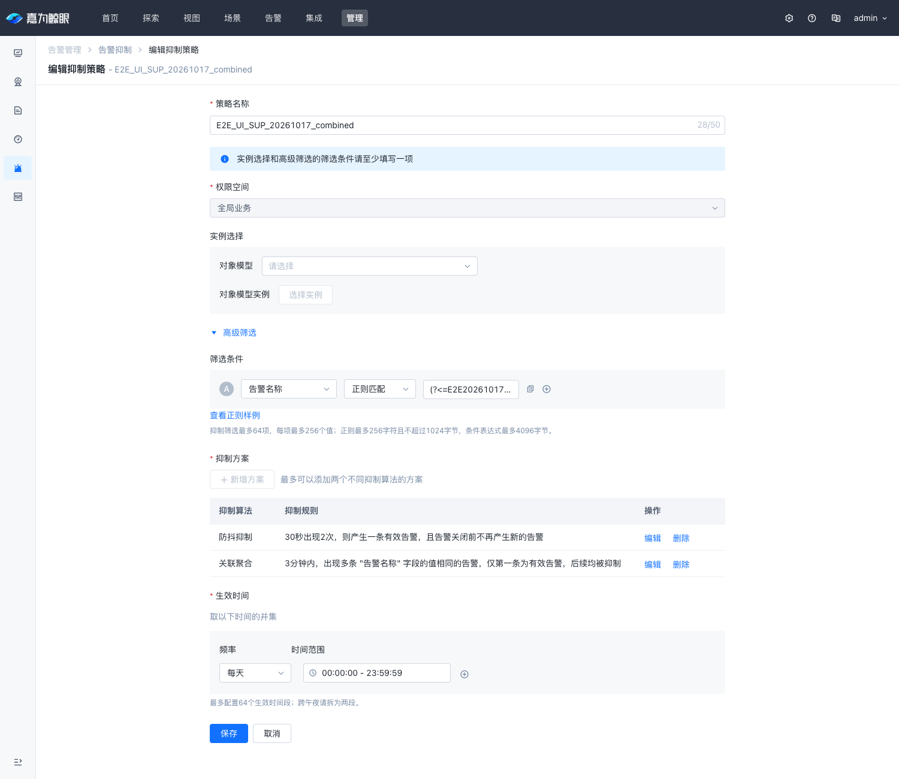
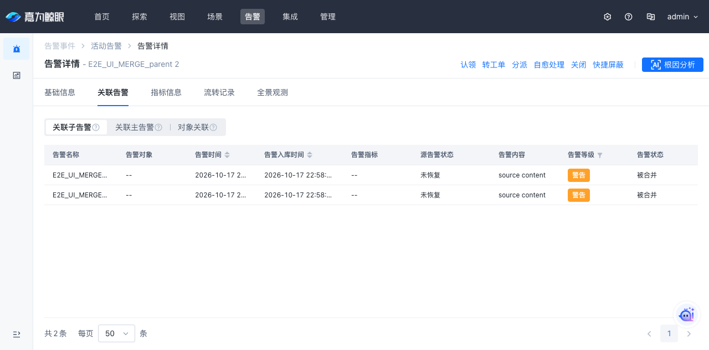
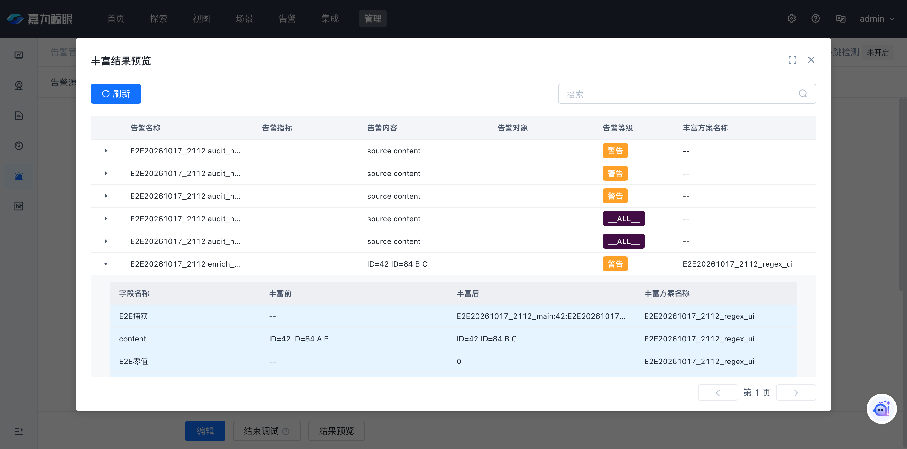

# 2026-10-17 test 环境 KAC → Linkd 全流程验证报告

> 环境：test（KAC、Linkd 及配套消息、缓存、存储组件）；时区：Asia/Shanghai。报告及附件已脱敏，不包含具体 IP、主机名或内部服务地址。
> 测试标识：`E2E20261017_2112`。实际操作自 20:54 开始；当前 Linkd 验证版本 `0.1.0-test.20261017.e2e.4`。页面补充验证、修后复测及清理均已完成。
> 本报告区分真实环境验证、进程内回归、环境数据缺口和测试脚本修正；不把静态门禁当作线上验收。

## 1. 结论

告警接入、生命周期、常规丰富、CMDB 主实例丰富、抑制、时间/依赖屏蔽、即时/周期合并、KAC 投影和配置同步的主要链路已在 test 实际执行。数据经过真实 HTTP/Celery、Kafka、Cleaner、Lifecycle、存储和 KAC 查询；配置使用部署中的 KAC Serializer/模型信号发布，未用数据库手工写入 Linkd 结果代替处理。

已确认、修复并部署以下 **八项问题**，修后定向回归和页面复验通过：

1. **策略索引 Hook 固定使用 2 个 Redis 连接，突发并发排队并消耗 1 秒请求预算。** 默认连接池改为 16，可通过 `pool_size` 调整；保留既有超时和失败语义。
2. **持续触发只更新 Linkd 正文，KAC 投影正文停留在首次告警。** 补齐 `content` 更新，包含显式空串，处置人、通知状态等 KAC 所有字段保持原有边界。
3. **时间屏蔽批量预览拒绝真实 Alert ID。** 原实现用租户/来源身份片段的字符规则校验完整 Alert ID，点号分隔的实际 ID 被拒绝为 HTTP 400；改为与完整 ID 查询入口一致的长度限制，租户归属仍由事实读取检查。
4. **OneModel 兼容关系查询把真实关系过滤成空。** canonical 边已存在，但旧字段出口未还原两端模型/实例字段，二次筛选无法命中。按租户目录转换模型并从端点还原字段，真实三个关联实例和跨租户空结果均验证通过。
5. **非 BKCC 空间在 Worker 依赖接口被拒绝。** 目录与匹配器支持负业务 ID，但 HTTP 入口仍只接受 BKCC。复用已有完整空间解析，合法非 BKCC 的 scope/targets 不再返回 400；真实负业务空间的首次抑制、第二次准入及 BKCC 隔离复测通过。
6. **合并页“不选实例”无法保存。** 页面合法传入 `target_descriptor=null`，Serializer 提前拒绝。允许此请求值进入既有 `{}` 归一化；选模型而不提供目标仍拒绝。修前两种租户模式复现，修后 224 项相关回归通过，Web 修复版已部署，原始页面不选实例的新建和保存已复测通过。
7. **抑制方案冷刷新显示 `undefined`。** 字段目录晚于详情到达时未重算字段名；补齐监听，字段删除时保留原 key。组件回归修前失败、修后通过；新页面冷刷新后字段目录到达即自动显示正确名称。
8. **屏蔽、合并编辑丢失合法条件编号。** API 条件使用对象键作为身份，不要求冗余 `code`；编辑器从对象键恢复编号，防止预览或重存变成 `undefined` 条件；32组编辑保存、依赖主/子条件、字段引用及时间屏蔽真实预览全部复验通过。

已保留并纳入隔壁会话的 Redis 命令数优化 `c8de40b1c`，未回退它。初轮 **130 个有效断言通过**，补充 **39 个有效断言通过**（[补充证据](samples/2026-10-17-kac-linkd-test/supplement-results.json)），包括运行、配置、边界与清理断言；第 6 节的环境受限项不计入线上通过。

**本次观测窗口内 Hook 失败尖峰消失，存储/丰富阶段仍有延迟。** 最终 e2e.4 的 23:06:39–23:09:39 窗口，13 个 Hook 成功率采样点均为 **100%**（浮点舍入），失败速率为 0，`final_hook` 平均约 **62 ms**；短窗口不能替代长期 SLA。关闭性能采样后的 21:56:30–21:59:30 窗口，Hook 成功率采样点平均为 **99.88%**，范围 **99.13%–100%**；Lifecycle `final_hook` 阶段平均由问题窗口约 **620 ms 降到 66 ms**。较早的修后窗口仍有少量 Hook 超时；最后窗口未观察到，存储/丰富耗时和环境数据问题仍独立保留。

## 2. 版本与执行方式

| 项目 | 记录 |
|---|---|
| 起始 Linkd 源码 | `569600bd5`，部署镜像 `0.1.0-test.20261017.569600bd` |
| 起始 Kingeye 源码 | `10afcb0388461530b8f89b89719300a1aa62e901`；部署 KAC 镜像版本 `5.3.0.1924` |
| Hook 修复镜像 | `0.1.0-test.20261017.hook-pool.1`，Helm revision 79 |
| 正文修复镜像 | `0.1.0-test.20261017.e2e.2`，Helm revision 80 |
| 并行优化版本 | `0.1.0-test.20261017.redis-qps.1`，三个角色实际 imageID 为 `sha256:62ea32d2cbb3eaf6a6922bd1ef53fc1a08d32549f1b51e1466e26a0ccb914776` |
| 预览修复部署 | `0.1.0-test.20261017.e2e.3`；Helm revision 85，22:05:56 发布；三个角色均 Ready |
| 当前 Linkd 部署 | `0.1.0-test.20261017.e2e.4`；Helm revision 86，22:49:34 发布；三个角色均 Ready |
| 当前 Linkd 摘要 | `sha256:dcce0fc1c9055861a9d6abeef03033628bc6bae5cd54aca744498160aa6dd337`，包含 Redis 优化、EventSource 耗时维度、预览与非 BKCC 修复 |
| KAC Web 最终补丁 | `5.3.0.1924-e2e.4`，基于部署原版本补 OneModel、合并空目标及三类策略前端；Web 1/1 Ready，其他后端角色未统一升级 |
| KAC Web 最终摘要 | `sha256:261962a82766bc7d5887d206a72e5b35f45b833f65a5c78c397b490a99cf0731`；前端入口 `app.d14b64be62e505c4be47.js` |
| e2e.3 镜像摘要 | `sha256:400681bd967b7f6bf94dab3c7d5680340577909d1c6b2506ae3fb2c6babbd3c7`，linux/amd64；基于 `c8de40b1c` 加本轮预览修复 |
| 工作区变化 | 两项初始修复已被并行会话提交为 `92b5143b1`、`ed0142e33`，随后为 `c8de40b1c`；用户后续授权沿原开发分支统一提交；当前 Linkd 使用 `feat/linkd-dev`，Kingeye 使用 `develop/5.3.0` |
| 执行入口 | KAC `alarm/collect/event/common/<source_id>/`、真实 Celery 拉取/恢复任务、KAC Serializer/模型保存、Linkd 管理 API、Kingeye Admin CLI |
| 最终可查询结果 | Linkd Event/Alert、丰富历史详情、策略发布版本、Worker 版本、KAC ES 告警文档 |

来源配置成功发布不等于 Worker 已切换：正式断言结合 Event 的 `event_source_version`，并在需要时确认 Cleaner/Lifecycle 实际版本。丰富保存失败检查本地事务和远端发布版本均未变化。

KAC 配置操作和部分调试服务在部署 Pod 内调用正式 Python 服务；补充使用真实已登录浏览器验证页面，IAM 全部角色矩阵仍未覆盖。推送和终态消息使用真实业务 HTTP，独立恢复使用真实异步 Celery，未替换成 mock。

## 3. 功能与边界验证

完整断言、输入片段、Alert/Event ID、版本和结果保存在 [results.json](samples/2026-10-17-kac-linkd-test/results.json)。批量 64/65 条按一个数量/状态断言计数，不按消息数扩大用例数。

| 功能 | 关键输入/操作 | 实际结果 |
|---|---|---|
| 来源创建 | 两个 V2 推送源、V2 拉取源、V1 REST 兼容源 | 独立来源/租户 topic；配置异步发布，Worker 接管 |
| 接入鉴权/校验 | 错误 X-Secret、空 evaluations、重复等级、数值字段传布尔值 | 业务响应拒绝；KAC 既有接口可能 HTTP 200 携带失败 code，未误算成功 |
| 心跳 | 纯心跳、顶层心跳与业务混合、evaluation 心跳与业务混合 | 心跳更新来源活跃信息，不生成业务告警、不增加告警计数；业务部分继续处理 |
| V2 拉取 | `pull_monitor_alarms.apply_async` | 实际建立 active Alert |
| 独立恢复 | `resolve_monitor_alarms.apply_async`，触发过滤设为永不匹配 | 同一 Alert 恢复；终态不被触发过滤拦截 |
| V1 兼容 | 旧 `alarm_name/alarm_content/source_time/level/action` 输入 | Worker 稳定后 firing/resolved 完整转换并恢复；时间使用旧协议格式 |
| 生命周期 | 创建、同等级持续触发、低等级恢复、高等级升级、终态后重触发 | 正文更新；低等级恢复不结束高等级；终态后生成新 Alert |
| 全等级关闭 | `severity=__ALL__`、action=closed | 当前活动周期结束，KAC 投影同步 |
| 孤立终态 | 未建立活动告警时先恢复/关闭 | Event 保留为 orphaned，不伪造活动 Alert |
| 多等级 | 同条 RawEvent 包含 warning/fatal | 同一个 Event 的两个 evaluation 历史可查询，当前 Alert 选择 critical；不是两个独立 Event ID |
| 重复来源事件号 | 相同 `event_id/alert_id` 再次 HTTP 推送 | 两个 Kafka 记录生成不同 Event ID，更新同一活动 Alert；未冒充相同 offset 重放验证 |
| 64 条输入 | 一次推送 64 个不同来源告警，随后一次恢复 64 条 | 64 个 Alert 全部建立并全部恢复 |
| 正则丰富 | lookbehind、命名捕获、all、多变量模板、分隔符 | `ID=12 ID=34` 输出两次捕获，并保持模板变量含义 |
| 正则边界 | `$12`、空捕获、Unicode、无匹配、非法表达式 | 第 12 组/空字符串/中文捕获正确；无匹配保留原值；非法表达式保存失败并回滚 |
| 超时隔离 | `(a+)+$` 对长不匹配输入，后接独立赋值步骤 | 当前正则记 `regex_timeout`，整体 partial；后续独立步骤仍成功，不丢整条告警 |
| 替换语义 | A→B、B→C 对 `A B` | 结果 `B C`，新生成文本不再次参与替换 |
| 标量与保护字段 | 0、false、尝试写 event_id | 展示为 `0`、`false`；保护字段配置被拒绝，原版本不变 |
| 丰富历史 | 列表后展开具体 Event/等级详情 | 详情保留捕获、正文、零值、布尔值四个有序 diff；列表 `diff=[]` 为轻量摘要语义 |
| CMDB 主实例 | 按地址查找测试主机 A；已有主机 B 身份与地址指向的主机冲突 | 成功补齐身份/拓扑/主机名；已有明确实例身份优先，不被另一个 IP 重新绑定 |
| CMDB 查空/缺边 | 不存在 IP；主实例成功但关系投影为空 | 不提交半身份；缺关系不回滚成功主身份和零值字段，关系步骤明确 skipped/partial |
| 防抖抑制 | 12 秒内第 1/2 条、单条过期后再触发 | 第 1 条 suppressed，第 2 条准入；过期重新计数 |
| 抑制边界 | 其他业务、已有活动告警升级 | 业务范围隔离；活动告警升级不被初次防抖拦截 |
| 聚合抑制 | 两来源相同 object、同一聚合窗口 | 一条准入、一条抑制，验证跨来源共享状态 |
| 时间屏蔽 | 测试主机 A 命中，主机 B 不命中 | 主机 A 建立屏蔽且无 admission；主机 B 正常准入 |
| 停用屏蔽 | 停用本轮时间屏蔽，再次触发 | 既有关系解除但不会自动触发处置；下一业务 Event 才准入 |
| 依赖屏蔽 | 主告警先建立，子告警到达，主告警恢复 | 子绑定主告警；主恢复后子解除，下一触发才准入 |
| 屏蔽入参 | 跨午夜、无效时区、处置态字段条件 | 正式 Serializer 拒绝；周期时间内无关历史字段不参与当前周期判定 |
| 批量屏蔽预览 | 完整点号 Alert ID、32 项、33 项请求 | 最终版本接受真实 ID；已终态告警返回 terminal_bypass；32 项返回 32 项，33 项拒绝。32 项边界使用同一历史 ID 重复输入，非 32 个不同实例的权限矩阵 |
| 依赖字段引用 | 子条件 object=`${object}`，主告警提供值；再省略主告警 | 真实历史触发 Event 匹配成功；缺少主事实返回 condition_unavailable，不误报普通未命中 |
| 即时/周期合并 | 两组即时合并、周期窗口两成员 | 生成真实父告警、子关联和 KAC `merged_into/associate_alarm_id` |
| 合并不满足 | 只有即时合并的一组到达 | 窗口到期释放并准入 |
| 父关闭解联 | 人工关闭合并父告警 | 子保持 active、解除关系、不自动 admission，KAC 关联清空 |
| 65 条合并 | 65 个子告警进入周期合并 | 65 条全部建联，父标题统计 65；另做独立父关闭回归，65 条全部 released、仍 active、admitted=0 |
| 合并配置保护 | 尝试覆写 source_id | 拒绝保护字段，避免改变来源身份 |
| 配置同步 | 三类策略新建/修改/删除；来源启停、重复同步 | 发布版本收敛；无变化重复同步不增加版本；重启用保持来源身份；删除发布 tombstone |
| 来源删除 | 已恢复的专属 V1 来源删除 | 远端 tombstone 发布、任务停止后本地记录删除；保留 Kafka 历史 |
| 调试 | 纯心跳、混合心跳、11 个触发样本、12 条恢复样本 | 纯心跳拒绝并撤销旧通过状态；11 个触发样本超限；12 条恢复分批完成 |
| 调试重算 | 原生样本重算、旧 sample_ref、伪造界面 alarm_list | 使用保存的原生输入；旧引用拒绝；过滤结果不受伪造界面列表影响 |
| 租户读隔离 | 对另一个租户查询本轮来源/告警 | 不返回 system 的测试数据；未据此声称完整多租户部署模式已验收 |

## 4. 性能问题的证据与修复

### 4.1 Hook 连接池

旧实现 `internal/lifecycle/process/hooks.go` 固定 `PoolSize: 2`。同节点 63、256 次小型只读 Redis EVAL 探针结果：

| 连接池 | 总时长 | P50 | P95 | 失败 |
|---:|---:|---:|---:|---:|
| 2 | 1349 ms | 388 ms | 803 ms | 2 |
| 16 | 594 ms | 18.4 ms | 83.1 ms | 0 |
| 32 | 715 ms | — | 104 ms | 0 |

探针只验证连接排队影响，不是业务 Hook 压测。旧进程累计采样为 failed=6744、succeeded=12013，约 36% 失败；这是该进程已运行区间的累计值，不是最终窗口的同口径对照。

回归 `TestStrategyHookBurstDoesNotSerializeBehindTwoConnections` 用受控 RESP 服务阻塞 EVAL，观察 8 个并发是否进入服务端：旧版只能进入 2 个并失败，修复后通过。新增 `pool_size` 的默认值、正值、负值和 Console 配置解析均有回归。

### 4.2 阶段耗时

以下是 Admin 指标接口按给定窗口计算的平均执行耗时，单位 ms；阶段口径来自相同指标，而非浏览器读取曲线估算。详见 [performance.json](samples/2026-10-17-kac-linkd-test/performance.json)。

| 阶段 | 问题窗口 20:51–20:56 | 关闭采样后 21:56:30–21:59:30 |
|---|---:|---:|
| apply | 427 | 382 |
| enrich | 530 | 320 |
| event_commit | 109 | 125 |
| final_hook | 620 | 66 |
| plan | 101 | 74 |
| policy_snapshot | 17 | 5 |

不能把改善全部归因于连接池：期间包含节点变更、业务负载变化、告警从早期失败转为完整成功处理，以及隔壁 Redis 命令优化。20:31–20:41 的更早窗口有大量事件提前丢弃，不能与后来成功处理全部阶段直接比较。开启 pprof 的中间窗口也不作为最终稳定性能结论。

15 秒 CPU profile 使用约 5.27 CPU 秒，没有发现单一 CPU 热点；同步等待主要出现在存储和丰富 I/O。ES 当时 write queue/rejected 为 0，不能据此证明每次写入延迟低。仍观察到逻辑 Alert CAS/Event 丰富写入和物理 Bulk 的百毫秒级等待。未更改共享 ES durability、refresh 或批处理窗口来掩盖耗时。

Hook 失败直方图的桶为 1–5 秒时，P95 插值会显示约 4.8 秒；原始失败平均约 1.06 秒。因此不把该插值当作“1 秒超时未生效”的证据。

中间版本 `e2e.3` 的 22:07:17–22:09:17 短窗口复核，Hook 成功率采样点平均 **99.97%**，最低 **99.84%**，后续四个采样点为 100%。这只能证明当前短窗口继续改善，不代表零失败 SLA；[原始指标](samples/2026-10-17-kac-linkd-test/hooks-final-e2e3.json)保留时间和计算口径。

最终 `e2e.4` 的 23:06:39–23:09:39 三分钟窗口，Hook 13 个采样点均为 100%、失败速率均为 0；平均阶段耗时为 apply 489 ms、enrich 375 ms、event_commit 160 ms、final_hook 62 ms、plan 91 ms、policy_snapshot 5 ms。Hook 改善持续成立，其他 I/O 阶段仍有波动，不能把整体耗时上涨全部解释为 Hook。证据：[Hook](samples/2026-10-17-kac-linkd-test/hooks-final-e2e4.json)、[阶段耗时](samples/2026-10-17-kac-linkd-test/lifecycle-duration-final-e2e4.json)。

## 5. 其他缺陷与回归

| 缺陷 | 修复和证据 | 验证边界 |
|---|---|---|
| KAC 正文冻结 | 更新投影字段列表及当前 Alert 的 content，空串也同步；[真实 ES 回归日志](samples/2026-10-17-kac-linkd-test/content-regression.log) | 本机独立 ES 集成 + test 最终 KAC 文档复核；Redis 优化版上再次验证保留 |
| 批量屏蔽预览拒绝点号 ID | 修复 `internal/policy/preview_batch.go`；现有只读匹配回归改用真实 ID 形态，并覆盖空/超长 ID | [修前失败](samples/2026-10-17-kac-linkd-test/preview-regression-before.log)、[修后通过](samples/2026-10-17-kac-linkd-test/preview-regression-after.log)；最终部署后完整 ID、32/33 项和依赖引用真实 API 复核通过 |

## 6. 未完成线上证明与已知限制

1. **CMDB 正向/反向真实关系已补齐。** 初轮兼容查询返回空所导致的“环境缺数据”归因已撤回；已修复兼容出口，并使用现有关系完成三实例多值、同模型独立过滤分支、空分支保留主实例，以及反向关系的真实处理验证。未通过修改共享 CMDB 数据制造样本。全部模型、1024 候选耗尽和展示依赖宕机仍只按相关本地回归/边界说明，不冒充完整线上故障演练。
2. **新消费组的尾部起点。** V1 第一轮两条数据在 Kafka offset 0/1 可读，但未形成 Event；Worker 稳定后 offset 2/3 对应触发/恢复成功，最终提交位点 4。现有[来源契约](../modules/event-source.md)明确无有效提交位点时从尾部读取。这个启动/发布窗口风险需单独决策，未擅自改成历史补读或重置其他来源 offset。
3. **存量丰富依赖异常。** `built_in_bk` 的 metric 绑定不完整、resource 依赖表缺失等异常仍存在；它们与本轮自建来源的功能成功分开报告，未随意补造共享数据或修改业务策略。
4. **较早修后窗口有少量 Hook 失败，I/O 尾延迟仍存在。** 本轮解决了连接池放大的失败，未获得长时间零失败或完整容量上限证明；不将短窗口结果作为生产容量承诺。
5. **权限与故障演练。** 未执行浏览器逐页 IAM 矩阵、切换全局多租户模式、共享基础设施宕机/网络分区、相同 Kafka offset 强制重放、全部 CMDB 模型和大规模长期压测。
6. **Console 时间输入。** 手工关闭入口当前接受 UTC `Z` 时间；等价 `+00:00` 被 Console schema 拒绝且提示过于笼统。测试改用其当前支持的形式继续；Go 业务关闭和操作幂等未受影响。该 Console 输入兼容性未随 Go 镜像修复。

测试中的首次失败也保留在证据中：配置尚未传播、预览列表按详情断言、CMDB 测试缺对象条件、V1 时间格式不符，以及第一次批量解联在父关闭请求被拒时已经开始计时。上述均修正测试输入/顺序并复测；实际产品缺陷单独列于第 1、5 节。尤其 65 条解联另起独立周期重测，最终 65/65 released、65/65 active、0 admitted。

## 7. 清理与交付

- 自建推送/拉取来源最终停用，测试策略删除并确认 tombstone，测试活动告警全部结束；V1 来源完成删除流程。
- 最终复核：保留 **6 个停用来源**，测试策略剩余 **0**，本轮来源运行任务 **0**、活动告警 **0**、**7 个测试合并父告警全部关闭**。其中5个来源有正式 Linkd 配置；调试源虽曾由普通对账分配身份，最终没有正式控制面来源记录、历史告警和运行任务，未作为消费者启用。[清理证据](samples/2026-10-17-kac-linkd-test/final-cleanup.json)。
- 保留历史 Event/Alert、策略 Release、Kafka topic、已停用来源和 `e2e_*_2112` 字段，供回查；不删除共享索引或其他人的配置。
- 临时 pprof 只监听容器回环地址。最终显式关闭 profiling 并将采样率置零，已用容器内连接失败确认关闭。
- Linkd 最终 Helm release 镜像/摘要与运行态一致，包含并行 Redis 优化和来源耗时维度。KAC Web 为定向补丁发布，标准 Helm 参数的后续合入事项见第9节。
- 本轮提交：Linkd `feat/linkd-dev` 上 `2f61aaea5`；Kingeye `develop/5.3.0` 上 `22972175be`，并保留已提交关系修复 `d6a8f74f42`。未执行本轮新提交的远端推送。
- 浏览器使用测试账号完成正常登录；CLI/Pod 使用既有凭据，本报告和附件不保存 Cookie、Token、Redis/Kafka 密码或完整配置 Secret。

### 质量门禁

已执行两轮初始修复的 `make check`，覆盖格式检查、Go 单测、vet、race、golangci-lint、Console 检查及 Chart/发布脚本测试。正文修复另在真实 ES 运行 `TestElasticsearchBulkLifecycleAndDisposition` 和 `TestProjectionUpdatesCurrentContentIncludingEmptyText`。

批量预览修复后的完整 `make check` **退出码 0**；Console 449 passed / 8 skipped，Go 单测、race、vet、静态分析及 Helm/发布脚本门禁通过。[完整门禁日志](samples/2026-10-17-kac-linkd-test/make-check-preview.log)。该阶段最终版本又执行真实推送→正文更新→KAC 投影→全等级关闭，全部通过。主体用例跨 `e2e.2` 与 `redis-qps.1` 执行，`e2e.3` 进行此次修复的定向回归和全流程冒烟，不声称全部用例在每一版重新执行。

e2e.3 二进制于 22:02:34 构建；随后已将并行会话 EventSource 耗时维度提交 `a44824624` 快进到原开发分支，连同非 BKCC 入口修复纳入 e2e.4。完整 `make check` 再次通过，Console 449 passed / 8 skipped；[新门禁日志](samples/2026-10-17-kac-linkd-test/make-check-nonbkcc.log)。KAC 接口/配置/丰富/动作相关回归 938 passed / 1 skipped，跳过项明确要求独立 live 服务；[KAC 回归日志](samples/2026-10-17-kac-linkd-test/kac-contract-regression.log)。合并空目标修复后另跑相关 224 项通过，与前述集合重叠，不累加为新增用例数。

来源、丰富、抑制、屏蔽、合并前端契约共 44 项及字段引用组件方法检查通过；相关 ESLint、Ruff、文档硬性检查通过。生产前端构建退出 0，保留 5 项构建警告；未把打包体积等警告写成零告警。见[前端验证记录](samples/2026-10-17-kac-linkd-test/frontend-checks.json)。

```bash
make check
go test ./internal/policy -run TestShieldBatchPreviewUsesRealMatchingAndNoWrites -count=1 -v
LINKD_TEST_ELASTICSEARCH_URL="$LOCAL_TEST_ES_URL" go test ./internal/kaccompat -run 'TestElasticsearchBulkLifecycleAndDisposition|TestProjectionUpdatesCurrentContentIncludingEmptyText' -count=1 -v
```

上述 LOCAL_TEST_ES_URL 指向本机独立集成服务，非 test 业务 ES。版本、摘要和清理数字见 [delivery.json](samples/2026-10-17-kac-linkd-test/delivery.json)。

原始诊断、构建和全部现场脚本保留于本机 `/tmp/kac-linkd-e2e-20261017`；长期可维护的脱敏断言与性能证据随本报告保存。再次执行脚本必须更换 RUN，并重新确认租户、环境和来源版本，不能把旧快照当作当前状态。

## 8. 补充真实链路及页面验证

- CMDB 正向多分支、多值与反向链均已贯通到 Event、Alert 和 KAC 文档；兼容关系出口另在新 Web 镜像内查询验证。
- 全局抑制分别使用业务字段缺失、null、空串和 0，第一次 suppressed、第二次 admitted；标题/对象的 2100 字符输入均保留前 2000 个 Unicode 字符，KAC 同步一致。
- 非 BKCC 使用环境真实目录空间及负主键业务 ID；修前 Worker 接口拒绝，修后正常参与防抖，其他 BKCC 业务不受影响。首次部署复测抢在 Worker 目录五秒刷新前发送的记录未计入有效断言；稳定窗口再次完整验证。
- V1 扩展清洗对基础名称执行 term 覆盖，对另一个原始字段按 Python lookbehind 提取正文，再经真实 HTTP/Kafka/Linkd/KAC 投影；恢复复用同一告警身份。
- 已登录来源克隆 HTTP 实际完成独立 ID/topic、独立丰富关联、默认停用；启用后使用与原来源相同来源事件号验证隔离，丰富正常并完成关闭/停用。
- 告警源页面修改方案名称并保存，刷新重新打开确认保留 all/分隔符/混合模板；真实消息执行后展开页面历史详情，捕获、正文替换、0 和 false 按顺序展示。

页面补测另使用独立前缀，分别保留 UI、真实 HTTP、部署内 Serializer、运行态、清理和交付检查，不与本地回归数量混加：

| 页面 | 实际覆盖与结果 | 证据 |
|---|---|---|
| 抑制 | 新建/编辑/冷刷新/停用/删除；2种算法组合、窗口/次数/时段边界、正则、真实首次抑制/第二次放行；48项通过（UI15、部署内Serializer14、运行与清理19） | [抑制页面证据](samples/2026-10-17-kac-linkd-test/ui-suppression.json) |
| 合并 | 即时/周期/32组真实父子链、33组拒绝且原配置不变、克隆、启停、清空标签与聚合、模板字段保护、父子页及页面关闭；57项通过（UI11、HTTP2、Serializer24、运行与清理19、交付1） | [合并页面证据](samples/2026-10-17-kac-linkd-test/ui-merge.json) |
| 屏蔽 | 新建/重复名/UTC时段回显、实例选择、空候选页继续、累计10条预览上限、依赖字段引用、主恢复后解除且不补放行、无code修后预览/保存 | [屏蔽页面证据：39项通过](samples/2026-10-17-kac-linkd-test/ui-shield.json) |

相同问题的修前失败保留为回归证据，修后复验按最终结果计数；部署404和错误恢复action不重复计入产品缺陷数。







补测脚本修正说明：历史窗口先分页再过滤，旧脚本只读首 200 条，可能得到空匹配页并跨过防抖窗口。现已正确跟随游标，重复试验不叠加通过计数；这不是事件丢失。浏览器后台页导致 Vue 过渡不完成的自动化现象不算产品缺陷，激活标签页后重验。

## 9. 功能与体验改进记录

不要求事项必须是代码 bug 才记录。每项保留实际表现、影响和建议，明确修复状态；[补充发现](samples/2026-10-17-kac-linkd-test/additional-findings.json)。共记录 **13 项**，不把它们都归类为程序 bug：

| 分类 | 观察及影响 | 状态 |
|---|---|---|
| 来源克隆性能 | 成功请求约 61.5 秒，等待过长 | 待拆解依赖耗时 |
| 配置生效提示 | 发布成功与 Worker 目录切换存在时间差 | 建议明确生效状态 |
| 丰富字段展示 | 内置 content 与中文展示名混用 | 展示改进 |
| 来源计数文案 | 推送来源列表“已接收”、详情“已同步” | 文案统一 |
| Console 时间格式 | 接受 Z，拒绝等价 +00:00，错误笼统 | 待修复输入提示/兼容 |
| 抑制数值提示 | 1 合法，文案却要求“大于1” | 边界文案改进 |
| 抑制匹配说明 | “命中即停止”与匹配放行后继续评估的实现可能不符 | 已核对UI/源码；未做双策略现场反例 |
| 合并模板报错 | 同时列出多种预算，不指出具体变量/字段 | 改进错误定位 |
| 合并列表 | 相同周期的立即/周期结束行为不易区分 | 建议展示合并方式 |
| 实例选择器超时 | 能力/字段请求504后空白，关闭重开恢复 | 建议保留失败状态和重试 |
| 屏蔽必填提示 | 文案说实例/高级筛选至少一项，实际需canonical目标 | 同步提示与校验 |
| 预览错误分类 | 上游表达式400被映射为通用500 | 页面条件缺陷已修；错误映射留待改进 |
| 跨模块构建风险 | KMC两处导入缺失的 getLineConnectNulls、KAPM动态依赖及资源体积警告 | 已记录；不以KAC验收代替KMC/KAPM运行验证 |

其中环境超时只确认当次现象；语义待确认项不计线上功能失败。

前端补丁 e2e.3 曾发生打包遗漏：新HTML已进入镜像，但目录复制未携带新JS，冷刷新入口404。改为归档复制并在构建中验证入口文件存在后发布 e2e.4；该交付失败及修正单独记录，不把白屏试验计入业务通过数。

KAC Web 本次冷启动约需数分钟，原存活探针在启动完成前多次重启进程；已为 Web 增加 300 秒启动探针预算，正常存活/就绪检查不变，随后 Ready。该调整及定向 Web 补丁通过 Deployment 更新，后续标准 Helm 升级需带入相同启动配置和修复源码；Linkd 镜像版本已同步 Helm release 参数。
