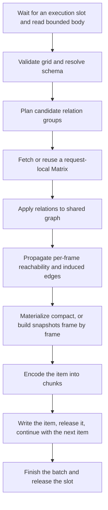

# Shared Topology Fetch, Output and Admission

The topology APIs build one request-local graph, propagate reachability over
the requested time grid, and return complete snapshots or a compact dictionary.
Public parameters and examples are in the [API guide](api/timegraph.md).

## Execution

### Matrix Reuse

`cmdb.v1beta3.shared_topology_reuse_matrix` defaults to `true`. The loader
retains one read-only Matrix. Reuse requires identical prepared queries,
expressions, resolved VM expansion, tenant/scope, storage types, time range,
step, lookback, exact/left-open grid and backend batch boundary. Preparation still
runs for every logical query; ephemeral metadata hash IDs are excluded.
Only direct-VM relation queries are eligible.

Empty and partial results can be reused; errors cannot. Every application
validates the grid and contributes to quality and logical counters. Reuse does
not keep a second resident copy. A different fetch releases the previous
slot. No graph or Matrix cache is shared across requests.

### Relation Fetches

Each request fetches and applies its planned relation groups sequentially.
The loader retains at most one reusable Matrix and releases it before receiving
a different response. Equivalent queries still share one physical read.

The configurable execution slot count bounds concurrent requests through
response writing. Each active request has at most one in-flight relation fetch;
there is no separate worker pool or backend semaphore.

### Candidate Planning

`cmdb.v1beta3.shared_topology_plan_candidates` defaults to `true`. Planning uses
an H-hop resource-type upper bound, retaining relations within that bound and
root observations. `target_types` filters the final output only.

Complete identities and compatible static bidirectional schemas allow bounded
instance reads for H1 star and H2 bipartite components. Other shapes and deeper
queries use bulk reads with safe root/range filters. Root probes can stop an
empty query; incomplete identities or a large candidate frontier use the wider
read. The 128-candidate transition changes the fetch plan, not the answer size.

Identity batches contain up to 64 complete primary-key tuples joined by OR;
each tuple remains an AND of its fields. One backend response is bounded by a
16 MiB batch boundary (a program constant, not a capability limit): oversized
responses split identity batches while retaining the exact time grid. A root
read, a whole-relation read, an info read or a single identity whose response
still exceeds the boundary is re-read in two non-overlapping time halves of the
exact grid, recursively down to one evaluation point; each point is evaluated
with its own window, so the merged graph equals one read. One evaluation point
that still exceeds the boundary returns the terminal `max_response_bytes` error.
Aggregation children share the rejection state so it cannot be silently
converted into a partial success.

Identity unions across frames are only fetch bounds. Edge masks and per-frame
reachability determine the answer; observations from different frames cannot
form a path. H-boundary induced edges, direction, full relation identity and
quality remain part of the result. Numeric node IDs are request-local, so
comparisons use resource type, complete primary key, relation identity and time.

## Response Formats

Omitted `response_format`, or `snapshots`, returns sorted independent frames,
including empty frames. Numeric node IDs and the existing snapshot wire shape
are preserved. Each frame owns its attribute maps; graph cleanup cannot mutate
returned data.

`compact-v1` returns `code`, time/grid fields, `response_format`, `compact`, and
optional `message`. It omits `snapshots`. Failed items have `compact: null`.
Unknown formats are rejected.

The compact object contains:

- `version: 1` and `timestamps`: the complete grid, including empty frames.
- `nodes`: `{id, resource_type, dimensions, mask}` attribute versions.
- `edges`: `{source, target, relation_type, metric_name, category, direction, mask}`.
- `partial`: ordered `{index, reason}` quality entries.
- `node_occurrences` and `edge_occurrences`: counts after expanding all frames.

IDs are decimal strings. A mask is an array of 16-character lowercase hexadecimal
uint64 words; bit 0 is the first frame. The supported grid has at most 60 points,
so this version emits one word. The array wire shape remains unchanged.
Versions of one node have disjoint masks. Edge masks intersect edge activity and
both endpoint reachabilities. Target-type filtering happens after propagation.
Filtering either sorted dictionary for one frame preserves snapshot ordering.

The [JavaScript reader](examples/topology-compact.mjs) retains string IDs and
materializes a requested frame with independent attribute maps. The consumer
fixtures cover both formats, historical attributes, output filters and failures.

Both formats use the chunked item encoder. Each item is written to the response
as soon as it is encoded and then released, so a batch holds only the item being
encoded. Snapshots are built frame by frame from the shared graph and encoded as
they are produced; the K frame DTOs are never materialized together. Repeated
node/edge encodings may be reused within the item. Encoded bytes are counted for
traces and the `response-item` payload metric; they are not a rejection reason.
A compact item whose conservative JSON bound is at most 4 MiB is encoded whole;
larger items are encoded row by row so the largest single allocation stays near
the 64 KiB chunk size. All paths produce the same bytes.

Once the first item has been written, the HTTP status and success envelope are
fixed. If the request deadline or cancellation arrives later, the current and
remaining items are written as failed items (`code: 400` with the cause), so the
response is still complete JSON. Before the first write, such a failure fails
the whole request as before.

## Resource Protection

Requests are rejected only for out-of-spec raw inputs: request body bytes, batch
query count, grid points and hops for topology; request body bytes, batch query
count and range points for the two legacy-compatible entries. Internal quantities (graph nodes, edges,
attribute versions, targets, memory estimates, encoded bytes, waiter count) are
never a rejection reason. The working set is bounded by sequential fetches, one
retained Matrix, the backend batch boundary and chunked encoding; instance
memory is sized from the deployment spec. Default configuration is listed in
[resource boundaries](timegraph-shared-memory.md).

Admission is a wait-only gate. At most the configured number of requests
execute; the others wait in FIFO order, without a queue length cap, bounded
only by their own deadline or cancellation. Waiting shares the original request
deadline. A waiting HTTP request reads only its bounded body; peer closure,
cancellation and body errors remove its queued state. Nested model calls reuse
the request lease. Direct model calls acquire and release their own lease.

The lease lasts through HTTP or proxy response writing and write failure
cleanup. The proxy clears retained response data before releasing the lease.
Active requests and waiters have separate
[metrics](timegraph-relation-observability.md).

## Legacy Queries

Legacy target queries retain their response fields, first-nonempty candidate
selection and range bucket semantics. They enumerate all finite simple schema
paths, including paths beyond six hops; topology's explicit H limit does not
truncate these candidates. Candidate discovery and execution share one query
deadline. Target counts and graph size are not capped.

Each candidate loads relations in hop order. The first hop keeps the source
matcher; later hops use batches of complete frontier identities and require
matching timestamps. Range queries read the grid in adaptive segments that
bound the per-segment time-bucket graph; an empty segment keeps the next
segment's length. Legacy reads use the same 16 MiB response boundary as
topology: an oversized read is split by identity and then by time inside the
segment, down to one evaluation point. One point that is still too large fails
the query without trying later candidates. An empty frontier stops further reads without clearing
quality. A missing physical route makes that candidate unavailable, allowing
later candidates to be tried. Cancellation and deadlines terminate the query.

For both legacy handlers, all candidate execution failures produce a failed
item instead of a successful empty result. The outer HTTP batch can still be
200; callers check each item's code. Legacy partial/truncated quality stays in
bounded metrics and item traces. Topology APIs expose their documented quality
fields without changing the legacy response DTOs.
