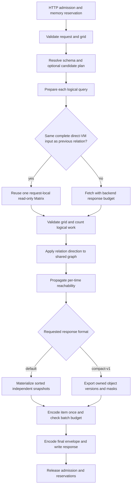

# Shared Topology Fetch, Output and Admission

This extends the shared topology API without changing the default snapshot
response. It is not evidence that a particular production capacity or latency
target has been met. Ordinary query routes retain their existing renderer.

## Execution



### Matrix Reuse

`cmdb.v1beta3.shared_topology_reuse_matrix` defaults to `true`. A single slot
is owned by the loader, never shared between requests. Preparation runs on
every logical query. Reuse requires matching serialized QueryTs, expression,
resolved VM expansion, user/tenant/scope, query parameters, storage types,
time range, step, lookback, exact/left-open grid and backend byte budget.
Ephemeral metadata hash IDs are excluded. Only direct-VM relation queries
are eligible; aggregated/non-direct routes fall back to fetching.

Empty and partial results can be reused. Errors cannot. Both applications
still validate the grid and contribute to partial status and logical counters.
Reusing the same live Matrix does not allocate another resident copy. The previous slot is dropped before a different fetch.
Apply never mutates the Matrix. There is no retry or cross-request cache.

`matrix-query-count` remains the logical loader count. New trace attributes
`matrix-physical-query-count`, `matrix-reused-query-count` and `matrix-reused`
separate actual loader fetch attempts from reuse. Physical load metrics no
longer charge reused data; `cmdb_timegraph_matrix_reuses_total` counts hits.
A loader fetch attempt is not necessarily one downstream HTTP request for
non-direct routes. Backend scanning cost remains unknown unless reported by
that backend; Matrix point/label counts are not a scan-cost measurement.

### Candidate Planning

`cmdb.v1beta3.shared_topology_plan_candidates` defaults to `true`.
The planner first computes an H-hop type reachability upper bound and retains
relations between those types plus incoming root observations. `target_types`
only filters output, never the candidate frontier.

When the source has every configured primary key and all values are nonempty,
shared topology reads an instance frontier instead of entire business-wide
relation matrices. Incomplete source identities retain the existing type plan
and full candidate loading. Disabling this option retains the full-scan path
for identity-normalized comparison.

The instance path validates all planned physical routes before it can return
an empty result, observes the root at both relation endpoints, and expands
outgoing planned relations for each discovered complete identity over the
entire request grid. Dynamic relations keep their original orientation and
`from_`/`to_` prefixes even when anchored at the target. H-boundary identities
receive one outgoing closure read so induced edges, back edges, and self edges
are retained. H+1 nodes discovered during closure do not extend the frontier.

Identity union across frames is only a fetching upper bound. Existing edge
bitmaps and per-frame BFS determine the final nodes and induced edges; edges
from different frames cannot be combined into a path. Source attribute info
continues to restrict eligible roots per frame without restricting neighbors.
Request identity alone never creates an observed root.

Selectors batch at most 64 complete primary-key tuples. Each tuple is one AND
group, including all endpoint nonempty guards; groups are joined by OR. No
per-field IN product is used. Oversized multi-identity responses split identity
batches first, keeping the same grid. Both the backend size error and a local
HTTP byte-cap rejection may trigger this split. Each physical fetch receives
an independent cap flag, shared by its aggregation children so rejection
cannot be downgraded to partial. A single identity exceeding the normal-mode
cap remains an explicit error; YOLO retains exact-grid time splitting.

All batches and shards share the loader's deadline, logical Matrix-point counters,
live graph/output reservations, admission lease, and partial timestamps. Missing
required routes, cancellation, and exhausted budgets remain errors. An empty
partial frontier returns partial empty frames, never an unrestricted retry.
Skipped unrelated backend queries no longer contribute their partial signal.
Candidate changes can renumber request-local IDs, so comparisons must use
resource type and complete primary-key identity, plus relation identity and
frame quality, rather than numeric IDs.

`TestTopologyFrontierMatchesFullScanWithCompositeKeysAndChanges` checks both
formats against the full-scan path with changing frames, composite cross-key
counterexamples, all directions, cycles, and boundary induced edges. Independent
per-frame BFS tests also cover the public query. Selector and shard tests cover
parsed OR groups, the real cap flag (including aggregation swallowing the
error), partial propagation, cumulative accounting, hard single-identity
rejection, and cancellation. These do not establish live latency or capacity.

## Response Formats

Default or `response_format: "snapshots"` on a query keeps the existing wire
shape, empty arrays, numeric IDs, ordering, messages and budgets. API conversion
transfers already-owned attribute maps; graph cleanup cannot mutate them. The
handler retains each checked item as RawMessage instead of retaining all its
objects and encoding them again. The final envelope still incurs validation,
copying and allocation: this is not streaming or zero-copy output.

`response_format: "compact-v1"` is an explicit per-query opt-in. It returns
`code`, time/grid fields, `response_format`, `compact`, and optional `message`.
It does **not** return `snapshots`. Failed items have `compact: null`; never
treat that as an empty successful graph. Unknown formats are rejected.

The `compact` object contains:

- `version: 1`, `timestamps`: the entire evaluation grid, including empty frames.
- `nodes`: full `{id, resource_type, dimensions, mask}` attribute versions.
- `edges`: full `{source, target, relation_type, metric_name, category, direction, mask}` versions.
- `partial`: ordered `{index, reason}` entries, including an empty reason when the frame is partial.
- `node_occurrences`, `edge_occurrences`: counts after expanding all frames,
  not dictionary sizes.

IDs are decimal strings, including values above JavaScript's exact Number
range. Masks are arrays of 16-character lowercase hexadecimal uint64 words.
Word 0 contains frames 0..63, with frame 0 in its least significant bit.
Trailing zero words can be omitted. For example, frame 64 alone is represented
by `["0000000000000000", "0000000000000001"]`. YOLO supports larger grids;
there is no new single-word or 60-point restriction in this protocol.

Node masks intersect reachability and the existing disjoint attribute-version
masks. Uncovered bits use the same stable-identity fallback as snapshots. Edge
masks intersect edge activity and both endpoint reachabilities. Target-type
filtering happens after propagation. Dictionaries own their maps and mask
strings before graph cleanup. Nodes are emitted in numeric ID order; versions
of one node have disjoint masks. Edges preserve the snapshot comparator order.
Filtering either dictionary for one frame therefore preserves snapshot order.

[The dependency-free JavaScript reader](examples/topology-compact.mjs) retains
IDs as strings and materializes only the requested frame. It validates masks,
overlapping node versions and dangling edges. Each returned frame owns its
dimension objects. The Node tests also compare server-produced fixtures.

```javascript
import { createTopologyReader } from "./topology-compact.mjs";
const reader = createTopologyReader(successfulItem.compact);
const frame = reader.frame(64);
```

Normal mode reserves the complete graph and traversal workspace before target
filtering, then reserves the DTO containers actually emitted. HTTP checks actual
encoded batch bytes. Repeated observations and conservative JSON upper bounds
are not independent rejection limits. Version-heavy inputs may compress poorly.

## Resource Protection

The following settings are under `cmdb.v1beta3`:

| Setting | Default | Meaning |
| --- | ---: | --- |
| `max_shared_topology_concurrent_requests` | 8 | Execution slots; FIFO queue holds at most the same number of waiting requests |
| `max_shared_topology_reserved_bytes` | 4294967296 | Process-wide estimated in-flight reservation cap |
| `shared_topology_request_memory_bytes` | Deprecated | Read for configuration compatibility; empty leases no longer reserve a fixed floor |
| `shared_topology_memory_headroom_bytes` | 536870912 | Additional margin below observed available memory |
| `yolo_mode` | false | Sustained bypass of TimeGraph quantity/data/admission budgets, configured hop ceilings and internal query deadlines; requested scope, validation and cancellation remain |

Nonpositive values use the finite defaults, not unlimited mode. These starting
values are conservative configuration defaults, **not a recommended capacity
for every Pod**. Calibrate them for the actual CPU/memory limits, ordinary-query
baseline, labels, versions, GC behavior and downstream service capacity.

Reservations follow simultaneously live stages. Request reading reserves 6x the
body cap; backend receiving/decoding reserves 8x the response cap, then switches
to Matrix slice capacity and retained labels. Shared graph accounting follows
unique nodes, full relation identity, indexes and attribute versions, including
old/new storage during replacement; it updates in 256 KiB blocks. Traversal
workspaces are reserved separately. DTO and encoder growth use 4 MiB blocks.
Prior batch items' encoded buffers remain charged while the next graph executes.
These are calibration estimates, not exact allocation or RSS guarantees.

`materialized` confirms only lower bounds of initialized, request-owned storage
that remains live. Borrowed strings, map capacity allowances and unused capacity
stay pending. `pending = reserved - materialized`; headroom checks subtract
pending reservations from current available memory after the configured margin.
Zeroing a stage also clears its credit, including after cancellation. A failed
growth does not wait while holding a graph.

Normal requests wait for execution slots in a bounded FIFO queue, sharing the
original request deadline. A queued HTTP request drains only its bounded body,
allowing HTTP/1 peer closure detection, and counts that body in the total ledger.
The queue is checked before reading additional bodies. Queue-full, cancellation,
deadline and body failures release queued state without starting model work.

Admission and reservation growth additionally inspect host MemAvailable and
all visible cgroup v1/v2 memory limit/usage pairs, including visible ancestors.
Unlimited sentinels and read failures do not become infinite reservations: the
configured cap still applies. Namespace-hidden parents and shared external
activity cannot be certified by these reads. Memory paths are discovered once
per process; restart after moving a process to another cgroup. Only confirmed owned storage already reflected in current usage receives
materialized credit; unknown ownership remains conservative. A check is not an
atomic promise about future RSS.

The lease spans actual response writing, including proxy envelopes and write
failures. Nested model calls share it; release is idempotent. Proxy cleanup clears retained response data before releasing the lease. Active
requests, waiters, reserved bytes and materialized bytes have separate gauges.
Rejections expose stable `max_topology_admission_waiters`, `max_topology_reserved_bytes` or
`max_topology_memory_headroom` reasons and count/limit attributes. Response
encoding and network writing have separate `http-response-encode` and
`http-response-write` spans; neither is a CPU-time measurement.

## Verification and Rollout

Tests cover independent/combined fetch reuse and planning, logical counters without duplicate resident
charging on reuse, immutable Matrix application, owned results after cleanup,
randomized historical attributes/directions/partial at 1..257 points, exact
uint64 client IDs, induced edges, target post-filtering, cancellation, resource
rejection/recovery and direct/proxied writer failure cleanup. Go tests execute
the client fixture tests when Node is available; otherwise run them explicitly:

```sh
node --test docs/examples/topology-compact.test.mjs
GOTOOLCHAIN=go1.24.4 go test -race -tags=jsonsonic ./cmdb/v1beta3 ./service/http/api ./service/http/proxy ./metric
GOTOOLCHAIN=go1.24.4 go test -tags=jsonsonic ./cmdb/v1beta3 -run '^$' -bench BenchmarkTopologyOutputFormats -benchmem
```

The opt-in local pipeline probe supports `TG_PIPELINE_MODE=shared|compact`,
`TG_EDGES`, `TG_POINTS`, `TG_CONCURRENCY` and `TG_PIPELINE_YOLO=true`. It records
fixture/response hashes, stages, allocations, live/retained heap and GC. Use
independent processes and external RSS/cgroup sampling. There is no fixed 4-way
test ceiling, but increased load still needs measured headroom and a stop rule.
Synthetic tests are not real 10x business load or production tail-latency proof.

Validate a newly built image in an authorized test window before rollout.
Keep transport/HTTP2 failures separate from these optimization claims. Bounded
parallel fetch and frontier pushdown remain conditional follow-up experiments
only when post-reuse backend measurements justify them; this change does not
increase physical query concurrency or modify ordinary-query routing.

## Attribute Selection and Representation Budgets

`source_expand_info` is consumed by both topology endpoints. It selects roots
from the resource-info query at each evaluation frame, intersected with observed
relation endpoints. It does not filter neighboring entities or invent info-only
roots. Conflicting identity filters fail; primary keys in the expanded matcher
complete the effective source identity.

Compact output charges each stored node/edge version, including ID and bitmap
overhead. Snapshot output charges each expanded frame object. Expanded occurrence
counts remain observable; Matrix input, H/K, graph memory reservation and global
admission remain independent guards. This change does not certify a workload or
a production resource limit. The HTTP wrapper reuses owned item buffers through
the existing segment writer, retaining batch byte limits and failure cleanup.

The four legacy relation endpoints expose optional `partial` and
`partial_reason` on successful items. Known source-info missing routes and
backend partial retain available matching data and explicit quality. Complete
items omit both fields. Each batch item has an independent metadata status scope;
a failed item remains an error. Required relation missing-route errors are
unchanged.

## Sustained YOLO operation (2026-10-13)

With `cmdb.v1beta3.yolo_mode=true`, TimeGraph does not impose its configured hop
ceiling, 60-second query deadline, sample/output/memory budgets or admission gate.
The request-scoped flag also bypasses the local PromQL engine timeout, sample
budget and admission tracker, and the VM client deadline; instant VM requests
omit the client-supplied `timeout` field. Registered TimeGraph routes also clear
HTTP body-read and response-write deadlines after routing, so the server write
window cannot discard a completed long query. Parent cancellation still applies. Shared engines and VM instances are not
mutated, so ordinary metric queries retain their configured limits.

Caller-specified hops, paths, time grids and positive `Limit` retain their query
meaning. YOLO does not inject the default root `Limit`; the current legacy
adapter already disables that default and the execution layer does not consume
it. Automatic schema path searches enumerate finite simple resource-type paths
and respond to parent cancellation. Input/schema validity and parent deadlines
still apply. Downstream service limits and Pod resources are separate settings.

For the current rollout, sustained YOLO is the accepted operating policy. Normal
budget-mode capacity acceptance and additional stress scenarios are not release
prerequisites. This policy does not turn unexecuted scenarios into passed tests.

The scoped HTTP middleware covers the two topology, two v1beta3 multi-resource
and two TimeGraph path-resource POST routes, including configured route aliases
and proxy dispatch through the registered handler chain. Ordinary metric/legacy
VM routes retain server deadlines. Header acquisition and the outer proxy
envelope happen before the TimeGraph route is identified and retain their
transport settings; the middleware does not reset caller deadlines.
