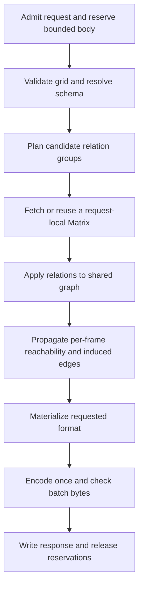

# Shared Topology Fetch, Output and Admission

The topology APIs build one request-local graph, propagate reachability over
the requested time grid, and return complete snapshots or a compact dictionary.
Public parameters and examples are in the [API guide](api/timegraph.md).

## Execution

### Matrix Reuse

`cmdb.v1beta3.shared_topology_reuse_matrix` defaults to `true`. The loader
retains one read-only Matrix. Reuse requires identical prepared queries,
expressions, resolved VM expansion, tenant/scope, storage types, time range,
step, lookback, exact/left-open grid and backend byte budget. Preparation still
runs for every logical query; ephemeral metadata hash IDs are excluded.
Only direct-VM relation queries are eligible.

Empty and partial results can be reused; errors cannot. Every application
validates the grid and contributes to quality and logical counters. Reuse does
not charge a second resident copy. A different fetch releases the previous
slot. No graph or Matrix cache is shared across requests.

### Relation Fetches

Each request fetches and applies its planned relation groups sequentially.
The loader retains at most one reusable Matrix and releases it before receiving
a different response. Equivalent queries still share one physical read.

The configurable request admission limit bounds concurrent requests through
response writing. Each active request has at most one in-flight relation fetch;
there is no separate worker pool or backend semaphore. Receiving and resident
Matrix memory remains part of the process-wide reservation budget.

### Candidate Planning

`cmdb.v1beta3.shared_topology_plan_candidates` defaults to `true`. Planning uses
an H-hop resource-type upper bound, retaining relations within that bound and
root observations. `target_types` filters the final output only.

Complete identities and compatible static bidirectional schemas allow bounded
instance reads for H1 star and H2 bipartite components. Other shapes and deeper
queries use bulk reads with safe root/range filters. Root probes can stop an
empty query; incomplete identities or a large candidate frontier use the wider
read. The 128-candidate transition changes the fetch plan, not the answer size.

Identity batches contain up to 64 complete primary-key tuples joined by OR;
each tuple remains an AND of its fields. Oversized responses split identity
batches while retaining the exact time grid. A single identity exceeding the
backend response cap returns an error. Aggregation children share the cap
rejection state so it cannot be silently converted into a partial success.

Identity unions across frames are only fetch bounds. Edge masks and per-frame
reachability determine the answer; observations from different frames cannot
form a path. H-boundary induced edges, direction, full relation identity and
quality remain part of the result. Numeric node IDs are request-local, so
comparisons use resource type, complete primary key, relation identity and time.

## Response Formats

Omitted `response_format`, or `snapshots`, returns sorted independent frames,
including empty frames. Numeric node IDs and the existing snapshot wire shape
are preserved. Each frame owns its attribute maps; graph cleanup cannot mutate
returned data.

`compact-v1` returns `code`, time/grid fields, `response_format`, `compact`, and
optional `message`. It omits `snapshots`. Failed items have `compact: null`.
Unknown formats are rejected.

The compact object contains:

- `version: 1` and `timestamps`: the complete grid, including empty frames.
- `nodes`: `{id, resource_type, dimensions, mask}` attribute versions.
- `edges`: `{source, target, relation_type, metric_name, category, direction, mask}`.
- `partial`: ordered `{index, reason}` quality entries.
- `node_occurrences` and `edge_occurrences`: counts after expanding all frames.

IDs are decimal strings. A mask is an array of 16-character lowercase hexadecimal
uint64 words; bit 0 is the first frame. The supported grid has at most 60 points,
so this version emits one word. The array wire shape remains unchanged.
Versions of one node have disjoint masks. Edge masks intersect edge activity and
both endpoint reachabilities. Target-type filtering happens after propagation.
Filtering either sorted dictionary for one frame preserves snapshot ordering.

The [JavaScript reader](examples/topology-compact.mjs) retains string IDs and
materializes a requested frame with independent attribute maps. The consumer
fixtures cover both formats, historical attributes, output filters and failures.

Both formats use the bounded encoder. Checked item chunks are retained for the
final batch write; repeated node/edge encodings may be reused within the item.
Actual encoded bytes enforce the response cap. Conservative JSON estimates
reserve working memory, without independently rejecting a response that fits
the byte cap. Compact output charges stored versions; snapshots charge expanded
frame objects. Version-heavy graphs can still produce large responses.

## Resource Protection

All TimeGraph requests use configured timeouts and finite resource limits.
Default configuration is listed in [resource boundaries](timegraph-shared-memory.md).

Reservations track simultaneously live stages. Request reading reserves 6x the
body cap; receiving/decoding reserves 8x the backend response cap, then switches
to Matrix capacity and retained labels. Graph accounting follows nodes, complete
relation identities, indexes and attribute versions, including replacement
storage. Traversal workspaces, output DTOs, encoder scratch and retained batch
buffers are charged separately. Graph growth updates in 256 KiB blocks;
DTO and encoder growth use 4 MiB blocks.

`materialized` records initialized, owned storage still live in the request.
Borrowed strings and capacity allowances remain pending. Headroom checks subtract
`pending = reserved - materialized` from available memory after the configured
margin. Stage cleanup clears both counters. Growth failure returns immediately.

Admission uses a bounded FIFO queue with the same capacity as the execution
slots. Waiting shares the original request deadline. A waiting HTTP request
reads only its bounded body and reserves it; peer closure, cancellation and body
errors remove its queued state. Nested model calls reuse the request lease.
Direct model calls acquire and release their own lease.

Memory checks inspect host MemAvailable and visible cgroup v1/v2 limits,
including visible ancestors. The configured reservation cap still applies when
these readings are unavailable. Estimates support resource admission; they are
not exact RSS measurements. Memory paths are discovered once per process.

The lease lasts through HTTP or proxy response writing and write failure
cleanup. The proxy clears retained response data before releasing the lease.
Active requests, waiters, reserved bytes and materialized bytes have separate
[metrics](timegraph-relation-observability.md).

## Legacy Queries

Legacy target queries retain their response fields, first-nonempty candidate
selection and range bucket semantics. They enumerate all finite simple schema
paths, including paths beyond six hops; topology's explicit H limit does not
truncate these candidates. Candidate discovery and execution share one query
deadline, and actual resource exhaustion returns an error.

Each candidate loads relations in hop order. The first hop keeps the source
matcher; later hops use batches of complete frontier identities and require
matching timestamps. An empty frontier stops further reads without clearing
quality. A missing physical route makes that candidate unavailable, allowing
later candidates to be tried. Cancellation and deadlines terminate the query.

For both legacy handlers, all candidate execution failures produce a failed
item instead of a successful empty result. The outer HTTP batch can still be
200; callers check each item's code. Legacy partial/truncated quality stays in
bounded metrics and item traces. Topology APIs expose their documented quality
fields without changing the legacy response DTOs.
